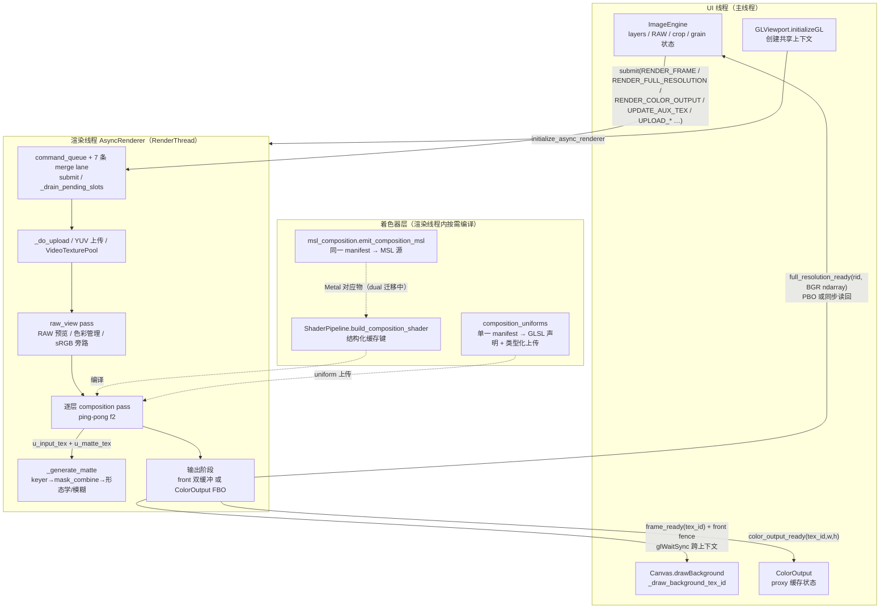

# Color 渲染管线架构（color-rendering）

> 计划04 架构文档 · Color 篇。本文描述 Topos Color 页（调色）从 UI 参数变更到
> 像素上屏 / 导出的完整 GPU 渲染管线。所有结论均以源码为准（版本对应 2026-09
> dev 分支）；文末列出依据的源文件清单。

---

## 1. 总览

Color 渲染管线是一个 **双上下文、单消费多生产** 的异步 GPU 架构：

- **UI 线程**（`ImageEngine` + `Canvas`/`GLViewport`）只组装不可变参数 DTO 并
  `submit()` 命令，从不直接执行 GL 渲染；
- **渲染线程**（`AsyncRenderer`，QThread 名 `RenderThread`）持有独立的
  ModernGL 共享上下文，消费命令队列，完成全部纹理创建 / 着色器执行 / 发布；
- 结果通过 **Qt 信号 + 共享纹理名（glo）+ GL fence** 回到 UI 线程上屏，或以
  **BGR ndarray** 形式读回 CPU 用于导出；
- Metal 侧（`msl_composition.py`）与 GL 侧共享同一份 uniform manifest，处于
  `gl_only → dual → msl_verified` 迁移状态机中（见 §2.5）。



---

## 2. 数据流主线

模块顺序：`image_engine.py` → `async_renderer.py` → `shader_compiler.py` →
`opengl_render_backend.py`（+ `msl_composition.py` Metal 侧对应物）。

### 2.1 ImageEngine：UI 侧编排者（`src/features/color/core/image_engine.py`）

`ImageEngine` 是 QObject，住在 UI 线程，职责是 **状态持有 + 参数 DTO 组装 + 命令
提交**，不做渲染：

- **`_layer_render_data(layer)`**（约 :50）：把可变 `Layer` 对象转换为渲染线程消费
  的**不可变 dict DTO**（grading/LUT/soft_clip/qualifier/curves/mask_shapes/plugins/
  is_baked 等的深拷贝）。这是 UI 状态与渲染输入之间唯一的单一转换点，preview 与
  ColorOutput 两条路径共用，防止两边各自手写漏字段。
- **`set_image()`**（:668）：源图加载。`img_high/img_low` 归一化为 float32
  `[0,1]`，随后 `submit(UPLOAD_IMAGE, {'image': f32 contiguous, 'original_size': …})`；
  新文件会 `_source_epoch += 1`（使 bake 前缀摘要失效）并把 ColorOutput 标脏。
  `.toos` 线性浮点源会被探测为非 sRGB（M1-F5），走 RAW 变换 + sRGB 输出编码。
- **`render_pipeline(render_reason=…)`**（:2698）：**所有调色变更的总入口**。
  `render_reason` 取值决定副作用范围：
  - `full` / `grading`：更新 CPU mask 纹理 + ColorOutput 标脏（grading 复用
    'full' 语义，仅可读性区分）；
  - `viewport_refresh` / `playback`：瞬态刷新，**跳过** mask 更新与 ColorOutput
    标脏，避免缩放平移污染 Composite 页输出状态。
  
  它组装 `render_params`（`render_request_id`、`viewport_size`、`visible_rect`、
  `grain_visible_rect`（grain 恒用原图坐标）、`layers`、`raw_preview`、
  `film_grain`、`video_generation` 快照等），然后：
  - 常规：`submit(RENDER_FRAME, render_params)`；
  - 全分辨率（`is_full_res=True`）：先 `register_full_resolution(rid)`（关闭
    "提交后-出队前" 取消竞态窗口），携带 CPU 端 `source_image`（f32 RGB）提交
    `RENDER_FULL_RESOLUTION`；
  - 无渲染线程兜底：持 `gl_manager.mutex` 在主上下文执行旧同步路径
    `_do_render_full_res`（:3052，仅在 `renderer is None` 时可达）。
- **`_update_mask_textures()`**（:2643）：CPU 栅格化 mask shapes（递归支持
  MaskGroup、笔刷/曲线羽化 SDF）与 AI matte（add/subtract/intersect 合成），
  输出 1024px（交互中 512px）**uint8 单通道** 纹理经 `UPDATE_AUX_TEX('mask')`
  上传；上传侧 bump `_mask_epoch` 使 matte 缓存失效（P1-COLOR-08）。
- **bake 前缀校验**（`_validate_baked_prefixes`，:4501，P0-COL-04）：baked 层
  语义是"到该层为止的完整栈前缀"，任何下层/源图变更都会使摘要不匹配并**自动
  解冻**——每次 `render_pipeline` / `request_color_output` 入口先校验。
- **`request_color_output()`**（:392）：以 proxy 分辨率（`ColorOutput.
  PROXY_MAX_DIM = 2048`）+ 全图 visible_rect 提交 `RENDER_COLOR_OUTPUT`，
  `color_output_target` 取 `composite` / `monitor` / `scope`。
- **`request_gpu_scope(demand)`**（:639）：提交 `RENDER_GPU_SCOPE`，GPU 侧示波器
  零 CPU 读回；旧 `request_scope_snapshot`（CPU 读回）默认被
  `scope_snapshots_enabled=False` 关闭，仅作暂停态兜底。
- **上屏消费**：`_draw_background_tex_id()`（:3788）——`mutex.tryLock()`（绝不
  阻塞 GUI），锁内**快照最新** `current_front_tex_id`（而非调用方传入的旧 id），
  `_wait_for_front_texture_fence` 用 `glWaitSync`（服务端等待，不阻塞 GUI 线程）
  对齐渲染线程的写入，再用 `QOpenGLFunctions_4_1_Core` 在 Canvas 自己的共享
  上下文里 blit；blit 前显式 `glDisable(GL_FRAMEBUFFER_SRGB)` 防止已编码 sRGB
  被二次 gamma；letterbox 拟合用 `presentation_size`（固定媒体显示几何）而非
  瞬态 FBO 尺寸；split view 额外绑定原图纹理（`get_original_texture_id`）。

### 2.2 AsyncRenderer：渲染线程 orchestrator（`src/features/color/core/async_renderer.py`）

**上下文构造（`__init__`，必须在 GUI 线程）**：`QOffscreenSurface` 在主线程
create（Windows WGL 要求）；临时 `doneCurrent` 后 `setShareContext(main_context)`
创建共享 QOpenGLContext，再 `moveToThread(self)` 移交渲染线程——这是 Windows
`wglShareLists` 黑屏修复的核心序列。

**`run()` 初始化（渲染线程）**：`makeCurrent(surface)` → `moderngl.
create_context()` → `FramebufferManager`（临时纹理/FBO 对象池）→ 固定功能
shader（keyer / blur / morphology / matte_denoise / passthrough / raw_view /
mask_combine / mask_preview / matte_sample + GPU scope 组）→ identity LUT 与
默认纹理（white/curves/hsl_curve/warper）→ `VideoTexturePool(5)` +
`YUVGPUUploader(5)` + YUV GPU 自检 → `VideoDenoisePipeline`（失败仅禁用降噪）→
把核心资源登记进 backend 台账并置 READY。

**核心渲染 `_do_render_impl`（:2240）**，单次 pass 的阶段顺序：

1. **取消与播放所有权门控**：请求级取消检查；`video_playback_active`（播放期间
   只有视频 lane 可发布 front）、`video_texture_pending`（换 clip 期间挂起）、
   `video_generation` 代际比对（跨 clip 的陈旧 grading/viewport 命令直接丢弃）、
   pyramid 陈旧代际守卫——这一组门控共同消灭"调参数时闪一下上一镜头"类 bug。
2. **目标选择**：`color_output_mode` → `_ensure_color_output_fbo(target)`（composite
   / monitor / scope / full_res 各自持久纹理，互不挤占）；否则 `_ensure_fbos(w,h)`
   重建 front 双缓冲（f2）。
3. **源纹理选择**（优先级）：`source_image` 覆盖（全分辨率导出，f4 RGBA 临时
   纹理，pass 后释放）＞ YUV/NV12/P010 平面（`_render_yuv_planes_to_rgb_texture`
   转 f2 RGB，ring buffer）＞ `current_video_texture`（packed 视频帧）＞
   `pyramid_textures[0]`（静图，GPU 硬件 mipmap）。视频源在此之后统一过
   `_apply_video_denoise`（时域+空域）。
4. **raw_view pass**：RAW 预览 / 色彩管理一遍过——exposure、WB gains、lift/gain/
   contrast/saturation、shadows/highlights、color_boost、mid_detail/sharpness、
   `color_space`（16 种色域→ProPhoto 中转）、`gamma`（18 种传输曲线）、
   `is_srgb_source`、`u_bgr_swizzle`，可选 raw LUT。**关键旁路**：当源"事实上
   是 sRGB"且 RAW 模块未启用时，强制 `color_space=-1, gamma=0`、单位增益，
   完全跳过输入→ProPhoto→输出变换（否则 sRGB 静图会偏色/黑屏）。
5. **逐层 composition 循环**（ping-pong，f2）：
   - 隐藏层跳过（活动层 + show_mask 例外）；qualifier 的 keyer 输入**刻意取
     raw_view_tex**（与画布取色器看到的显色一致，见 §2.4 matte）；
   - AI 插件结果纹理（`ai_plugin_textures`）作为该层的新 source；
   - `baked` 层捷径：整层替换为 baked 纹理 passthrough（栈前缀语义），不再
     二次叠加调色；
   - 结构位（has_curves/warper/lut3d/soft_clip/hsl_curve/mixer/grain/plugins）
     → `pipeline.build_composition_shader(...)` 取缓存/编译 program；
   - 绑定 `u_input_tex=0`、`u_matte_tex=1`，aux 纹理从 unit 2 起（curves /
     hsl_curve / warper / lut3d，缺省回落默认纹理）；uniform 由
     `composition_uniforms.upload_composition_uniforms` 类型化上传；
   - 渲染 quad → ping/pong 交换；**最后一层**才应用 film grain。
6. **输出阶段**：
   - `color_output_mode`：passthrough 进 ColorOutput FBO；composite/monitor
     目标 `ctx.finish()`（跨渲染.pass/跨上下文消费者需要立即可见），emit
     `color_output_ready` / `monitor_color_output_ready`；
   - 视口模式：画进 front 双缓冲当前写槽（清屏 0.1 灰 + BLEND，show_mask 时走
     mask_preview 三模式 shader），`write_idx` 翻转，发布策略：
     - 静图 / viewport_refresh / 静态视频预览 / 强制标记 → `ctx.finish()`（完整
       发布，防撕裂）；
     - 视频播放 / 暂停视频 grading → **GL fence**（`glFenceSync`+`glFlush`），
       UI 侧 blit 前 `glWaitSync`，GPU 保序而不阻塞任何 CPU 线程；
   - 发布后：更新 `current_front_tex_id/size`、`rendered_visible_rect`、scope
     内容 revision（viewport_refresh 不递增——纯裁剪/缩放不算内容变化），emit
     `frame_ready(tex_id)`。

**全分辨率导出 `_do_render_full_resolution`（:2155）**：请求级注册/取消 →
`_do_render(allow_during_playback=True)` 渲到私有 `_full_res_color_output_fbo`
（f4）→ 优先 **PBO 异步读回**（`AsyncPBOReadback` ring=3，`_poll_full_
resolution_readbacks` 在命令循环里轮询，fence 就绪后 emit）；PBO 不可用则同步
`fbo.read(dtype='f4')` → flipud → RGB→BGR，emit `full_resolution_ready(rid, bgr)`。
读回输出统一为 **BGR float32 ndarray** 契约。

### 2.3 ShaderPipeline：动态 GLSL 编译（`src/features/color/core/shader_compiler.py`）

- **唯一生产路径** `build_composition_shader`（逐层 per-layer pass）；旧的
  `build_shader` 融合路径因缺失 BLUR_SHARPEN_SNIPPET 自始编译失败，已随 P7-01
  删除。
- **结构化缓存键**：`(has_curves, has_warper, has_lut3d, has_soft_clip,
  grain_enabled, has_qualifier, has_hsl_curve, has_mixer, plugin_key)`。
  `plugin_key = (plugin_id, enabled, structural select 参数值)`——**enabled 与
  select 值进键**（触发重编译），**slider 等值参数只走 uniform**（拖动不重编译）。
  `has_active_*` 系列做恒等检测（如 RGB 曲线是否就是 45° 对角线），避免为"无
  操作"生成 shader 变体。
- **GLSL 结构**（`#version 330`）：uniform 声明由 `composition_uniforms` 的
  manifest 分 header（u_input_tex/u_matte_tex）与 body 两区段发射，与重构前手写
  文本物理顺序逐行一致（G1 位级门禁）。snippet 顺序固定：
  `COMMON_DEFINITIONS → GRADING → CURVES → MIXER → LUT3D → WARPER →
  BLEND_MODES → BLUR_SHARPEN（必须在 FILM_GRAIN 之前，声明 u_tex_size）→
  FILM_GRAIN → SOFT_CLIP → QUALIFIER`。
- **main() 效果顺序**：blur/sharpen → grading → curves → hsl_curve → soft_clip
  （if u_sc_enabled）→ mixer → warper → 3D LUT → 插件 `process_P{i}` →
  blend_mode → `mix(color, blended, mask * u_opacity)` → film grain → 输出
  `vec4(color, tex_color.a)`。
- **插件命名空间改写**（GL emitter 内部实现细节，MSL 禁止依赖）：`process(`
  → `process_P{i}(`，`@param` 裸名 → `u_P{i}_name`；改写后残留的未声明 `u_*`
  标识符**提前拒绝**并写入诊断缓冲（`record_compile_failure`，含
  CODE_SHADER_UNDECLARED_UNIFORM / CODE_SHADER_COMPILE_FAILED，只含 plugin_id
  与错误文本，不含路径/源码）。编译失败的层在本 pass 被跳过，但**显式落日志**
  （禁止"导出成功但少一层"式的静默丢失）。
- `release()` 按 program 身份去重后统一释放（缓存键可能共享同一 program）。

### 2.4 matte（遮罩）生成

`_generate_matte`（:3249）双路径：

- **源分辨率路径**（P2-1）：有源分辨率纹理且 **qualifier 未启用** 的层（即纯
  mask/AI matte 层）。matte 在 (src_w, src_h) 生成一次并按
  `matte_cache_hash(qp, ms, size, rect, frame_epoch, mask_epoch)` 缓存（与
  visible_rect 无关——缩放平移不重算），命中后仅用 matte_sample shader 重采样
  到当前视口。
- **视口分辨率路径**（fallback / qualifier 启用）：qualifier 刻意走这条路径，
  因为源分辨率金字塔是**未经 RAW 开发的原始像素**，而画布取色器用的是 RAW
  开发后的颜色——两者不匹配会导致 keyer 抠错色。此路径 cache key 含
  visible_rect 与 `frame_epoch`（每个上传视频帧 bump，播放中逐帧重新 key）。

生成链（`_generate_source_matte`）：keyer（HSL 三通道软阈值 + invert）→
mask_combine（与 CPU mask 纹理相乘，源分辨率下 UV 恒等）→ 后处理
（`_apply_matte_postprocess`：形态学膨胀/腐蚀 → 可分离高斯模糊 → matte
denoise）。无 qualifier 且无 mask shapes 的常见层**早退 white_tex**，零 GPU
开销。

### 2.5 OpenGLRenderBackend 与 msl_composition：契约门面与 Metal 对应物

- **`opengl_render_backend.py`**：`AsyncRenderer` 的 GraphicsBackend 契约
  （`src/shared/gpu/graphics_backend.py`）'opengl' 维度实现，放 feature 侧是为
  不违反模块边界（它包装的就是 feature 侧 orchestrator）。关键约束：**不创建
  平行渲染路径**——`render_pass` 直接委托 `orchestrator.submit`（lane 语义原样
  保留）；`create_texture/create_target` 是真实 GL 调用，线程守卫
  `BackendThreadViolationError`；`present` 只读 front 描述符（tex id / size /
  fence），零 GL 调用；`release` 是纯台账（`GLResourceRegistry` 按
  framebuffers/shaders/upload/denoise/grading/present 分组），真实释放仍由
  `_cleanup` 分段路径执行。
- **`msl_composition.py`**：与 GL emitter 消费**同一份** composition uniform
  manifest，生成 Metal 源（vertex `vs_composition` + fragment `fs_composition` +
  `CompositionParams` struct）。要点：
  - 纹理槽位是 **Metal 侧 ABI**（索引恒定）：texture(0)=input、(1)=curves、
    (2)=hsl_curve、(3)=lut3d、(4)=warper、(5)=matte；sampler(0)=linear/clamp；
    buffer(0)=CompositionParams。GL 侧槽位由运行期分配，无此约束。
  - struct 布局按 P6-06 对齐规则：全标量平铺、4 字节紧排、bool→uint、vec 逐
    分量展开。
  - 已迁移效果 `MIGRATED_EFFECTS`（grading/curves/hsl_curve/lut3d/mixer/
    warper/blur_sharpen/blend_modes/soft_clip/film_grain）；**含插件的管线在此
    显式 ValueError（G4 无静默部分状态）**。
  - 数值保真特例：film grain 的 fract-hash 链对 FMA 收缩极端敏感，grain 激活时
    整个文件注入 `#pragma clang fp contract(off)`（MSL 不支持作用域化关闭）。
  - 顶点着色器 uv.y 翻转，使输出内存行序与 GL/输入一致。

---

## 3. 渲染线程模型

### 3.1 命令队列与 lane 合并

`submit(cmd_type, data)` 是**唯一**的跨线程入口（线程安全）。命令分两类：

- **可合并命令** → 7 条 `RenderLane`，每条 lane 只保留最新一条（后来者覆盖并
  计入 `_coalesced_lane_commands`）；覆盖 `RENDER_VIDEO_GPU_FRAME` 时释放其
  持有的 `GpuDecodedFrame`（零拷贝解码表面的精确一次性释放）。lane 判定
  （`_get_lane_for_command`）：

| Lane | 触发命令 | 合并策略 |
|---|---|---|
| VIDEO_PLAYBACK | RENDER_VIDEO_FRAME / RENDER_VIDEO_GPU_FRAME（proxy+playback） | 只留最新帧 |
| VIEWPORT_REFRESH | RENDER_FRAME(reason=viewport_refresh) | 只留最新（最后执行以发布最新视口态） |
| GRADING_REFRESH | RENDER_FRAME(reason=grading) | 只留最新（拖滑块不积压） |
| AUX_TEX | UPDATE_AUX_TEX | 只留最新 |
| COLOR_OUTPUT | RENDER_COLOR_OUTPUT | 只留最新 |
| SCOPE_SNAPSHOT | RENDER_SCOPE（deprecated CPU 回读） | 只留最新 |
| GPU_SCOPE | RENDER_GPU_SCOPE | 最低优先级，最新结果胜 |

- **关键命令**（UPLOAD_* / RENDER_FULL_RESOLUTION / BAKE_* / REMOVE_LAYER /
  RENDER_FRAME(reason=full/playback) / SET_VIDEO_DENOISE 等，见
  `src/shared/video/render_commands.py`）直接入队，**永不丢弃**。

lane 提交后向真实队列放一个去重后的 `_drain_pending` 哨兵；渲染线程遇到哨兵按
**固定顺序** drain：`AUX_TEX → GRADING_REFRESH → VIDEO_PLAYBACK →
VIEWPORT_REFRESH → COLOR_OUTPUT → SCOPE_SNAPSHOT → GPU_SCOPE`（aux 先行满足
依赖；viewport 在 video 后执行保证最终态；GPU scope 永远分析最新 front）。

### 3.2 线程边界

```
UI 线程                        RenderThread                    其它 CPU worker
────────                       ────────────                    ──────────────
ImageEngine(状态/DTO)          AsyncRenderer.run()             RawUpdateWorker
  submit() ────────────────►     queue.get(0.01)               (RAW 解码)
Canvas.drawBackground    ◄────   GL mutex + _handle_command     AIMaskWorker
  tryLock + glWaitSync           全部 GL 创建/编译/渲染/释放     (SAM/BiRefNet)
GLViewport.initializeGL          _poll_full_resolution_readbacks AIPluginEngine
  (创建共享 ctx, 启动渲染线程)                                   (ONNX)
```

- **GL 互斥**：`GLContextManager.mutex`（全局 QMutex，单例双检锁）串行化渲染
  线程的每条命令处理；UI 上屏用 `tryLock()` 不阻塞，失败就保留上一帧等下次
  `frame_ready`。
- **异常隔离**（G-P0-11）：drain 批内每条 lane 命令独立 try/except，`task_done()`
  在 finally 中执行——一条坏命令不会让整批静默丢失或让 `join()` 永久阻塞。
- **UI→渲染**交互点：`render_pipeline`（调色/图层/视口）、`request_color_output`
  （进 Composite 页）、`request_gpu_scope`、`set_image`（UPLOAD_IMAGE）、
  `on_raw_params_changed`（RAW 参数 → 后台解码 → UPLOAD_IMAGE）、视频控制器
  （RENDER_VIDEO_FRAME / RENDER_VIDEO_GPU_FRAME）、`request_full_resolution`。
- **渲染→UI** 信号：`frame_ready(tex_id)`（GLViewport 转发触发场景 invalidate，
  Canvas 在 paint 里 blit）、`color_output_ready` / `monitor_color_output_ready`
  （Composite 页 COLOR 节点 / DeckLink）、`full_resolution_ready/failed/
  progress`、`layer_baked_ready`、`gpu_scope_ready`。
- **重入保护**：`render_pipeline` 检测 `canvas_ref._in_draw_background`——在
  drawBackground 执行期间再提交渲染会形成 paint→render→repaint 死循环（P4-2，
  视频卡顿的根因），生产环境记日志直接返回。
- **播放期间的所有权模型**：播放中 `video_playback_active=True`，普通
  RENDER_FRAME 被丢弃（grading 变更改为使播放缓存参数失效，由下一个视频帧
  命令携带新参数渲染），避免调轮子时新旧画面交替闪。

### 3.3 UI 消费协议（front texture 发布）

front 双缓冲 + fence 的完整协议：

1. 渲染线程写完写槽，按 §2.2-6 的策略 `finish()`（完整）或 `glFenceSync +
   glFlush`（fence）；
2. 发布 `current_front_tex_id / current_front_size / current_front_fence`（fence
   保留 PyOpenGL GLsync 原对象——macOS 上是 opaque 指针，`int()` 会抛异常并
   使所有展示退化为 glFinish 兜底）；
3. emit `frame_ready` → UI 失效场景 → `drawBackground` → `tryLock` → 锁内快照
   最新 tex id + fence → `glWaitSync`（服务端等待）→ blit。

---

## 4. GPU 资源生命周期

### 4.1 deferred-release（垃圾延迟释放）

- **garbage 列表**：`(timestamp, fbo, tex)` 三元组；front 双缓冲重建
  （`_ensure_fbos` 尺寸变化）时旧槽进 garbage，`_process_garbage()` 中
  **超过 2.0 秒**才真正 `release()`——因为旧 glo 可能仍被跨上下文消费者（Canvas/
  DeckLink）采样。`_cleanup` 时 `force=True` 全量清。
- **已知不一致**（审查 AUD-0201 佐证，源码核实）：`_ensure_color_output_fbo`
  尺寸/dtype 变化时**立即释放**旧 ColorOutput 纹理（:5797-5806），未走 garbage
  延迟——而该 glo 已通过 `color_output_ready` 发布给 Composite/monitor 消费者，
  理论上存在单帧花屏窗口。修改 ColorOutput 重建路径时应关注这一差异。
- **零拷贝视频帧**：`GpuDecodedFrame` 持有外部解码表面。lane 合并覆盖、clip
  切换与线程停止三条路径都要精确释放（`safe_release_gpu_frame`；
  `_release_queued_gpu_frames` 在 `_cleanup` 最前处理命令队列中未执行的帧）。

### 4.2 纹理缓存矩阵

| 缓存 | 位置 | 键 / 规格 | 格式 | 生命周期 |
|---|---|---|---|---|
| 金字塔（静图源） | `pyramid_textures` | level 0 单纹理 | RGBA **f2** + `LINEAR_MIPMAP_LINEAR` + `build_mipmaps()` | 每次 UPLOAD_IMAGE 重建；带 `_pyramid_epoch_generation` 代际戳 |
| front 双缓冲 | `fbo_pair/tex_pair` | 视口尺寸 ×2 | RGBA f2 | 尺寸变化进 garbage；关线程释放 |
| 持久 raw_view/ping/pong | `_persistent_*` | 视口尺寸 ×3 | RGBA f2 | 尺寸变化直接重建释放 |
| **ColorOutput**（composite/monitor） | `_color_output_tex/fbo` | proxy 尺寸（≤2048） | RGBA f2 | 持久；resize 立即释放旧纹理 |
| full-res 导出目标 | `_full_res_color_output_*` | 全分辨率 | RGBA **f4** | 独立于 live ColorOutput（防导出挤占消费者） |
| scope 私有目标 | `_scope_color_output_*` | 质量档尺寸 | RGBA f2 | 独立（防档位切换失效 Composite 纹理） |
| **matte 缓存** | `matte_cache` | `layer_id → (matte tex, params_hash)` | R16F f2 单通道 | params_hash 失配重建；视口重采样纹理逐帧释放 |
| 层 aux 纹理 | `layer_textures` | `(layer_id, type)`：curves (256,1)×3ch / hsl_curve (6,256) R / warper RG / lut3d 3D / mask R8 | f4（mask 为 **f1**） | write-in-place 复用；REMOVE_LAYER/CLEAR 释放 |
| YUV→RGB 输出环 | `_yuv_rgb_output_cache` | 尺寸 → 3 个纹理 ring | RGBA f2 | 永久缓存（注意：按尺寸累积，审查 AUD-0202 指出无上限） |
| 临时纹理池 | `FramebufferManager` | `(w,h,components,dtype)` | 任意 | get/release 对象池；ColorOutput 临时纹理经 ExitStack 保证全路径归还 |
| composition program | `ShaderPipeline.comp_cache` | §2.3 结构化键 | GLSL | 结构变更前命中；`release()` 去重释放 |
| baked / AI 插件纹理 | `baked_textures` / `ai_plugin_textures` | layer_id / (layer_id, instance_id) | 视输入 | bake/解冻/REMOVE 时释放 |

### 4.3 关闭序列（`_cleanup`，渲染线程）

顺序即依赖序：释放队列中零拷贝帧 → VT 桥接 → front fence → 降噪管线 → matte
缓存 → 层 aux → baked → AI 插件 → YUV ring/FBO → quad VAO 缓存 →
pool/uploader → **composition program（在引用它的 VAO 之后）** → 固定 shader/
默认纹理 → tile/persistent 纹理 → scope 池 → `fb_manager.cleanup()` →
`_process_garbage(force=True)` → ColorOutput ×3 + PBO → front 对/金字塔 →
`doneCurrent()` → backend 台账 `release()`（纯记录，无 GL 调用）。

---

## 5. HDR 内部约定

- **内部处理格式 = float16（`dtype='f2'`）**：金字塔、front 双缓冲、持久
  raw_view/ping/pong、YUV 输出环、ColorOutput（composite/monitor/scope）、
  matte 全部是 f2——半精度足够承载调色中间态，带宽减半。
- **float32（`'f4'`）用于"精确值"语义**：全分辨率导出目标与 source 覆盖纹理、
  curves LUT、HSL 曲线 LUT（R32F）、warper 网格（RG32F）、3D LUT、PBO/同步
  读回——曲线采样点与导出不应引入 f2 量化。
- **CPU 侧量化点**：输入归一化 `uint8/255`、`uint16/65535`；CPU mask 纹理
  uint8（→ f1 纹理，仅作权重足够）；导出读回 `fbo.read(dtype='f4')` → BGR
  float32 ndarray（应用层契约）；grain seed 恒为 `[0,1)` float，按黄金比例
  步长 `0.61803398…` 随帧号确定性推进（P1-COLOR-13，重渲/导出可复现）。
- **色彩空间**：内部中转色域为 ProPhoto（raw_view shader 的
  `u_raw_color_space`/`u_raw_gamma` 完成 输入色域→ProPhoto→输出编码 两段变换，
  支持 16 色域 × 18 传输曲线）；sRGB 静图默认**整体旁路**（§2.2-4）；上屏时
  渲染输出已是显示编码值，blit 显式关闭 `GL_FRAMEBUFFER_SRGB` 防双重 gamma。
  HDR 全程**不做无理由 clamp(0,1)**（.clinerules 红线）；blend/matte 的
  `mix` 权重自然落在 [0,1]。
- **视频 YUV**：BT.709/BT.601 矩阵、limited/full range、8/10/16bit、chroma
  siting 元数据来自实际帧（非 raw_preview），GPU 自检决定 macOS 上是否走 GPU
  路径，失败自动 CPU fallback。
- **GLSL 数值形态**：所有 snippet 浮点字面量显式 `.0`；循环上限编译期常量
  （.clinerules）；MSL 侧额外注意 FMA 收缩（grain 需文件级 `contract(off)`）。

---

## 6. 关键调用链（文本列表）

调色滑块拖动 → 上屏：

```
UI 控件 → ImageEngine.grade_image/set_interaction_mode
  → render_pipeline(render_reason='grading')          [UI 线程]
    → _validate_baked_prefixes / _layer_render_data ×N
    → AsyncRenderer.submit(RENDER_FRAME, params)      [lane: GRADING_REFRESH]
      → run() 哨兵 drain → _handle_command → _do_render
        → _do_render_impl
          → 源选择（pyramid / video tex / YUV planes）
          → _apply_video_denoise（视频）
          → raw_view pass（RAW/色彩管理 或 sRGB 旁路）
          → for layer: _generate_matte（keyer/mask/后处理，缓存）
                       build_composition_shader（结构键命中或编译）
                       _update_composition_uniforms + _bind_aux_textures
                       _render_quad → ping/pong 交换
          → front 输出（finish 或 fence）→ frame_ready(tex_id)
  ← frame_ready → GLViewport._on_frame_ready → 场景 invalidate
  → Canvas.drawBackground → _draw_background_tex_id
      tryLock → 快照 front id → glWaitSync(fence) → blit
```

全分辨率导出：

```
request_full_resolution → render_pipeline(is_full_res=True)
  → register_full_resolution(rid)
  → submit(RENDER_FULL_RESOLUTION, {source_image: f32, color_output_target:
    'full_res', …})                                       [关键命令，不合并]
  → _do_render_full_resolution
    → _do_render(allow_during_playback=True)
      → source override f4 纹理（pass 后释放）
      → 同一 raw_view + 逐层 composition（临时 f4 ping/pong）
      → 输出到 _full_res_color_output_fbo（f4）
    → PBO enqueue（ring=3）→ 命令循环 _poll_full_resolution_readbacks
      → fence 就绪 → full_resolution_ready(rid, BGR f32)   [或同步 fbo.read 兜底]
  ← ImageEngine._on_full_resolution_ready
```

进入 Composite 页：

```
request_color_output(target='composite')
  → submit(RENDER_COLOR_OUTPUT)                          [lane: COLOR_OUTPUT]
  → _do_render_color_output → proxy 尺寸覆盖（≤2048）
  → _do_render(color_output_mode=True)
  → 输出 → ctx.finish() → color_output_ready(tex_id,w,h)
  ← ImageEngine._on_color_output_ready → ColorOutput.update + revision++
  → Composite 页 COLOR 节点消费 tex_id
```

GPU 示波器（播放中安全）：

```
request_gpu_scope(demand) → submit(RENDER_GPU_SCOPE)     [lane: GPU_SCOPE，最低优先]
  → _do_render_gpu_scope → 私有 scope ColorOutput（内容 revision 缓存）
  → GPU 侧 waveform/vectorscope/histogram/CIE/falsecolor 累积
  → 一次跨上下文 finish 后发布纹理 → gpu_scope_ready(ScopeGpuFrame)
```

层 bake：

```
ImageEngine.bake_layer → submit(BAKE_LAYER)              [关键命令]
  → _do_bake_layer → 前缀层逐层渲染到离屏 → layer_baked_ready(layer_id, ndarray)
  → ImageEngine._on_layer_baked → 异步 EXR 保存 → 前缀摘要台账登记
  （后续渲染入口 _validate_baked_prefixes 校验，下层变更自动解冻）
```

---

## 7. 改动注意事项（呼应 .clinerules）

1. **UI 线程禁止 GL**：任何 ModernGL 调用只能在渲染线程（`run`/`_do_*`/
   `_cleanup`）。UI 侧新功能一律走 `submit()` + 新 `RenderCommand`（在
   `src/shared/video/render_commands.py` 登记）；`OpenGLRenderBackend` 的
   `create_texture/render_pass` 有线程守卫，绕过即抛
   `BackendThreadViolationError`。
2. **新命令先定 lane 归属**：`_get_lane_for_command` 返回 None = 关键命令永不
   丢弃；可合并预览类命令必须归入正确 lane，且 drain 顺序
   （AUX_TEX→…→GPU_SCOPE）不可随意打乱（依赖发布顺序）。
3. **纹理格式选择**：中间渲染产物用 f2；曲线/LUT/导出目标等"精确值"用 f4。
   全分辨率与 proxy 必须语义一致（同一 composition 代码路径，仅目标不同）。
4. **释放路径全覆盖**：渲染线程创建的 texture/FBO/program 必须进入
   deferred-garbage（跨上下文消费者）或对应缓存（`_cleanup` 有登记）；取消/
   失败/关窗路径同样清理（参考 `_do_render_impl` 的 ExitStack 与 try/finally
   模式）。修改 `_cleanup` 时注意顺序依赖（program 在 VAO 之后、fb_manager 在
   其用户之后）。
5. **GLSL 纪律**：浮点字面量显式 `.0`；循环上限编译期常量；不在 HDR 路径加
   无理由 clamp；新 snippet 插入位置注意声明依赖（BLUR_SHARPEN 必须在
   FILM_GRAIN 前）。
6. **shader 缓存键纪律**：只有结构性参数（select 值、enabled、效果位）进
   `comp_cache` 键；值参数走 uniform。误把 slider 放进键会让每次拖动重编译。
7. **插件管线禁止静默失败**：编译失败/未声明 uniform 走
   `record_compile_failure` 诊断 + 层跳过日志；MSL 侧含插件显式
   ValueError（G4）。新增效果必须双 emitter 同步迁移或显式登记未迁移。
8. **front 发布协议**：发布新 front 必须走 finish/fence 二选一并调用
   `_update_front_present_sync`；新增消费者（如第二个监视器输出）应复制
   Canvas 的 tryLock + fence 快照模式，不得在 UI 线程做阻塞同步。
9. **播放所有权**：播放期间新增的渲染入口必须处理 `video_playback_active` /
   `video_texture_pending` / `video_generation` 三重门控，否则会复活跨片闪帧
   bug。`render_pipeline` 不得在 `Canvas.drawBackground` 内被调用（P4-2 守卫
   已在生产环境拦截）。
10. **ColorOutput 脏标记语义**：`viewport_refresh`/`playback` 不得标脏
    ColorOutput；内容性渲染必须递增 scope 内容 revision（见 §2.2-6）。scope
    的 ColorOutput 是**私有**目标——不要复用 composite/monitor 纹理，反之亦然。
11. **全分辨率请求必须注册**：`register_full_resolution(rid)` 先于 submit，
    失败路径 `forget_full_resolution`；读回输出保持 BGR float32 契约。
12. **性能基线**：以 4K 实时播放为准；改动前先看
    `get_render_stats`（dropped/coalesced/finish 次数）与 lane 状态，先测量
    再优化；不得靠每帧 `glFinish()` 掩盖同步问题（fence 协议即为此存在）。

---

## 8. 本篇依据的源文件

主线（全文或核心区段通读）：

- `src/features/color/core/image_engine.py`（4,730 行）
- `src/features/color/core/async_renderer.py`（6,669 行）
- `src/features/color/core/shader_compiler.py`（430 行，全文）
- `src/features/color/core/opengl_render_backend.py`（200 行，全文）
- `src/features/color/core/msl_composition.py`（249 行，全文）
- `src/features/color/core/composition_uniforms.py`（495 行，manifest 结构区段）
- `src/features/color/core/color_output.py`（87 行，全文）

支撑（关键区段）：

- `src/shared/video/render_commands.py`（RenderCommand 常量）
- `src/shared/gpu/gl_backend.py`（GLContextManager 单例互斥 + FramebufferManager
  对象池，132 行全文）
- `src/features/color/ui/gl_viewport.py`（initializeGL → 渲染线程启动链）
- `src/features/color/ui/canvas.py`（drawBackground 消费 front texture）
- `.clinerules`（改动注意事项的约束来源）

佐证（审查报告，仅用于交叉验证源码结论）：

- `docs/audit/2026-09-28/batches/batch-002-color-core-async-renderer.md`
  （AUD-0201 ColorOutput 立即释放 vs garbage 延迟、AUD-0202 YUV ring 无上限）
- `docs/audit/2026-09-28/batches/batch-006-color-core-image-engine.md`
