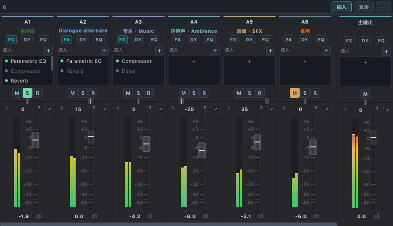
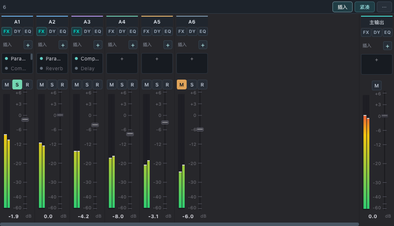
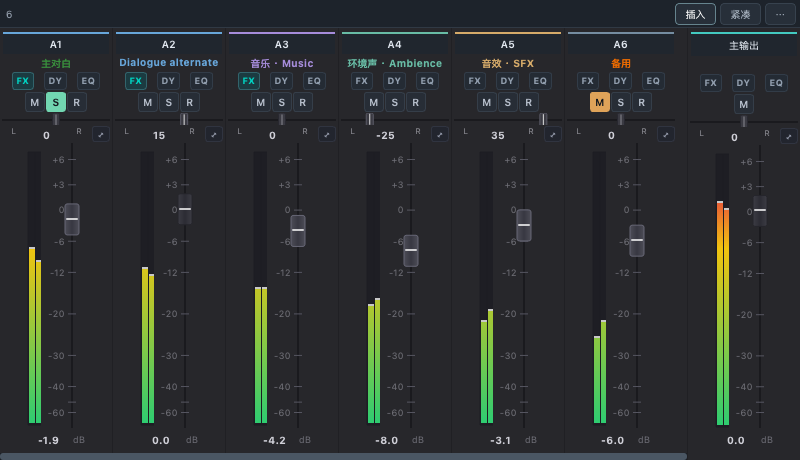

# Audio Mixer UI 与效果器审计证据

日期：2026-11-14。源基线：6fecfb1c；后续工作区仅实现Mixer UI／交互，后端留待计划执行。

## 真实主窗口播放

媒体：`tests/test_videos/2K_h264.mp4`，约62.89秒，25fps，AAC 48kHz stereo。

通过现有MainWindow、MediaPool导入和时间线服务新建V1／链接A1，沿既有效果器提交入口挂EQ、Dynamics、Panner、Reverb、Delay；没有用另一个播放器代替项目音频引擎。

真实AudioSink播放约12秒，记录211次遥测（包括暂停生命周期事件），播放头从第5帧推进至286帧。EQ保持96个bin，效果器电平发生明显变化。原始观测范围和末值见[playback-baseline.json](playback-baseline.json)。用户也确认动画／电平有变化。

此基线在UI修改前录制。它证明这次普通A1集成链可工作，不能证明每个旋钮正确、每实例tap正确、所有工程都不会出现冻结。暂停后的旧格式静音事件不能更新效果器表；这一后端缺陷已列入实施计划。

## 本次UI验证

综合focused回归：**187 passed**，约7.79秒；最后控件居中微调后，新增10个案例再次验证**10 passed**。新增案例覆盖：

- 空FX／多FX／Master推子起点和行程对齐。
- 标准112px／紧凑70px与新轨继承；Inserts显隐不提交音频变更。
- 聚焦效果器列表后Space旁路、Delete删除各一次命令。
- 隐藏轨计数／最小宽度；删除后以同id恢复保持隐藏。
- 静音时gain／pan仍可编辑，提交沿用原信号且不取消静音。
- 8轨400px、2轨250px、8轨紧凑300px时横向滚动与Master行程一致。
- 改变面板高度但没有新音频包时，电平表仍保持当前dB的正确比例。

命令：

```bash
QT_QPA_PLATFORM=offscreen .venv/bin/python -m pytest \
  tests/shared/test_audio_mixer_compact_ui.py \
  tests/shared/test_audio_mixer_units.py \
  tests/shared/test_cw_a1_gating_and_telemetry.py \
  tests/shared/test_fix_wd17g98_aud.py \
  tests/shared/test_fix_wd17g99_aud.py \
  tests/edit/test_mixer_placeholder_entrances_disabled.py -q
```

另在后端审计阶段运行EQ／DSP／导出等145项测试和遥测15项，均通过；本次发现的数学／生命周期缺陷并不在这些原有断言覆盖范围内。

独立UI审查先发现横向滚动条占高不一致、隐藏轨重注册两项问题，已修复并增加原场景回归。最终复查无剩余重要问题。后补的电平表resize绘制修复由第10个新案例覆盖。

## 布局预览

下面是实际Qt控件的离屏布局渲染，使用示例静态读数，**不是新增实播截图或模拟音频功能**。生产UI没有新增随机电平／假动画。







重建预览：

```bash
QT_QPA_PLATFORM=offscreen .venv/bin/python docs/audit/2026-11-14-audio-mixer/render_mixer_preview.py
```

## 功能审计与参考

在用户已打开的Resolve Studio 20中查看了EQ／Dynamics／Panner，播放观察了Dynamics真实输入输出和轨迹。Delay／Reverb未完成直接打开其原生窗口的现场验证，使用本机官方Resolve 20手册3950–3951、3971–3973页核对控制语义并视觉检查相关PDF页；不把该部分称为完整现场A/B听音。

详细差距、成熟算法、实施顺序、兼容策略和验收见[实施计划](../../plans/2026-11-14-audio-mixer-fx-maturity-plan.md)。没有实现DSP、Master／Bus、尾音、外部侧链导出、预设／快照等后端修复，也没有修改五款效果器自身面板。
