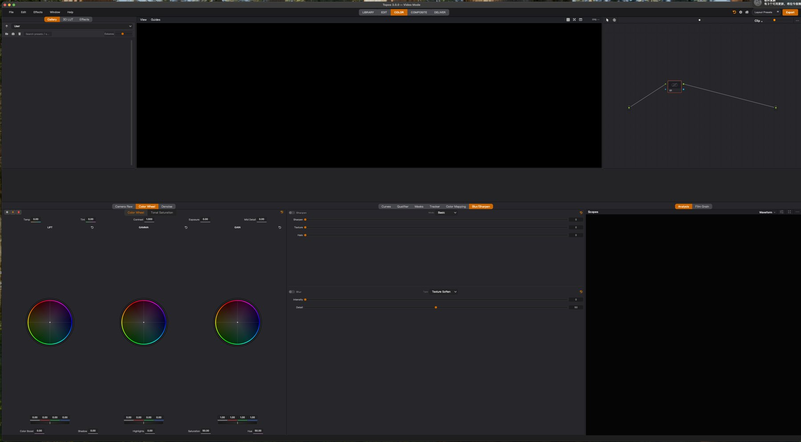

# 调色节点与 Color 页面后续实施计划（2026-11-04）

## 0. 使用范围与判定口径

本表承接 [资源与节点后端计划](color_resources_backend_implementation_plan.md) 和
[R12 验收记录](validation/color_resources/r12_release/README.md)。已通过的 R00–R11 与各 N
项已声明的 v1 行为不重做；下表只列未完成、未通过或本轮新发现的缺口。
每个任务都要同时提交：实现、针对失败路径的测试、原生运行证据、文档状态。
没有实机设备的项目标 `NOT RUN`，不能写成 `PASS`。

### 本轮实机布局证据

用户 2026-11-04 23:32 的实机截图显示：底部 Color Wheel/Blur/Scopes 工具区
约占窗口**一半**，色轮却早已达到可用最大半径，工具区留下大片空白。
之前一次自动截图捕获到不同的保存布局，曾误判为中间 Gallery 过高；
**以上述用户实机截图为本任务的基准**。真实面板中 Mask 的最小高度约
306px、Grading 约 289px，整组 tabified Dock 受最大面板的最小尺寸限制。
曾尝试 160px 最小高度，用户指出很多控件无法操作，已撤回。
`_WheelCanvas._geometry()` 的半径最大 100 逻辑像素；独立 Qt 探针表明
GradingPanel 在宽 1260px、高约 403px 时已达该上限，继续加高没有色轮收益。
当前工作树将停靠 Color 工具 Dock 的最大高度设为 410px；浮动或移至侧边
时解除上限。此修复需要按下述回归步骤完成验收。

## 1. 优先级与依赖

| 顺序 | 编号 | 状态 | 交付目标 | 前置 |
|---|---|---|---|---|
| P0 | L01 | 已完成（410px 上限 + 全量原生回归通过：旧布局启动钳制/拖拽极限/浮动解除/重停靠恢复/切页往返/保存重启保持） | Color 底部工具上限、保存布局与拖拽体验 | 无 |
| P0 | V01 | 已完成（compound id 重映射根因修复；普通/resources 双路径 passed + 阻断负路径 exit 1） | 逐节点预览真实生成及脚本不能假绿 | 无 |
| P0 | R12-A | 已通过（2026-11-05 复测全预算过：RSS 167.9/250 MB/10min；分行为归因新增） | 30 分钟资源与播放性能 | V01 |
| P0 | R12-B | 本机出口矩阵通过；跨平台 NOT RUN；UI 级同帧对拍边界已登记 | 多出口、4K/HDR/32 节点与平台矩阵 | R12-A，可分批运行 |
| P0 | N16 | 部分完成（shared 全绿清零、ui 4 既有修复杂4 污染、媒体并发收窄、全局 DeferredDelete 冲刷；edit 12 文件级既有+~7 顺序污染与合并跑 EXR SIGILL 崩溃点登记为残余债务） | 单进程全套件稳定性与资源所有权 | 无 |
| P1 | R06-B | v1 已接线（onnx_tile 后端+结果会话+service+图命令+R09 闭包，17 测试；UI 触发面板登记为后续） | 离线 AI/bake worker、结果和取消生命周期 | R06 现有协议 |
| P1 | N02-B | v1 边界 | Qualifier/Window/bitmap 的完整 key 后处理 | N02/N03 |
| P1 | N07-B | v1 复核 | Group/Timeline 全出口最终链序与身份 | N07/R09 |
| P1 | N10-B | v2 待办 | Mask/Qualifier 动画轨道与定义级扇出 | N10 v1 |
| P1 | N12-B | v2 待办 | 选择性复制与跨工程资源闭包 | R09/N12 |
| P1 | N14-B | v1 边界 | Metal/CPU 其余域能力逐项实现 | R06/R12 |
| P2 | N15 | 人工对照待办 | 达芬奇四种 Window 组合的 UI/交互对拍 | N15 命令已存在 |

## 2. 逐项施工与验证

### L01 — Color 页面比例、空白区与拖拽

**现象/证据**：用户截图中的底部工具区约半屏高、色轮周围大片空白。
原 `src/app/controllers/dock_layout_controller.py::_migrate_color_grading_dock_height`
只运行一次，虽有 480px 的迁移目标上限，迁移标记写入后拖拽或恢复布局仍可
超过上限。底部工具行的低限由同组面板中最大的 `minimumSizeHint` 决定。
`QMainWindow::separator` 有 8px 透明命中区。

**实施方法**：

1. 以色轮半径 100px 的现有绘制上限为基准，确认 410px 停靠 Dock 上限在
   100%、150%、200% 缩放和不同面板宽度下都能显示完整的 Lift/Gamma/Gain、
   下方数值及底排参数；如果字体/DPI 使半径尚未达到 100px，按实测值
   调整上限，避免写死不适用的魔法数字。
2. 遍历 Color 页所有可见 Dock，记录 `objectName`、区域、几何、最小/最大
   尺寸、浮动/tab 状态。用用户截图同类布局确认底部三组工具同步受限，
   多出来的高度实际分配给 Viewer/Nodes，而不是另一个空 Dock。
3. 对 Color Wheel、Curves、Mask、Qualifier、Blur/Sharpen、Scopes 测可操作
   最小高度；保留原有控件完整性，不能用 160px 全组滚动。浮动/侧边停靠
   解除底部上限，重新停靠底部恢复上限。
4. 若旧保存布局在启动时仍出现半屏底栏，做一次版本化越界修复，更新
   `page_layouts["Color"]` 与 LayoutStore；无论迁移标记如何，最大高度
   都应持续生效。检查 Gallery 下方是否存在另一个异常空 Dock。

**验证方法**：用用户截图对应布局把底部 separator 向上拖至极限，停靠
工具不得高于色轮达到 100px 半径所需高度；色轮下的所有数值可操作，
Viewer/Nodes 获得释放的高度。保存→重启→切 Edit→切 Color→浮动/停靠→
重启后仍受限；小屏与 4K 均无控件遮挡。记录几何断言和原生前后截图。

**回归结果**（2026-11-05，证据 `docs/validation/color_resources/l01_layout_cap/`，
驱动 `scripts/validate_color_layout_cap.py`，原生 macOS 进程）：
- **seed**：解除上限后底部工具行拉至 497px（复现旧版半屏底栏），恢复
  上限即钳到 410，释放高度实际落入 Viewer/Nodes（各 +87px）；
- **restore**：旧版超高布局（497px blob）启动恢复被钳（最高 315）；
  separator 拖至极限不超上限；浮动时解除上限（可调至 760px）、重停靠
  底部恢复 410；Edit→Color 往返后仍受限；正常保存落盘；
- **restart**：保存→重启后仍钳在 410；
- **radius**：真实主题（DARK_THEME 13px 字体）下，900/1100/1260/1500px
  宽 × 面板高 403px（= 410 dock 上限 − 7px 框架）时色轮半径恰为
  100px，510px 无额外收益；QT_SCALE_FACTOR 1.0/1.5/2.0 三档一致。
  注意：无主题的裸 Qt 探针（系统 13pt 字体）在同高度只测得 98px，
  属探针伪影——pytest 环境为确定性 Fusion/Sans Serif 9，与真实主题
  两个环境下 410 上限都恰好对应半径 100；
- **最小可操作高度**（主题下 minimumSizeHint）：GradingPanel 293、
  Blur/Sharpen 252、Qualifier 116；dock 内实测 Mask 306、Curves 291、
  ColorMapping 293、Tracker 276——均高于已否决的 160px 全组滚动方案；
- 左区仅 Gallery/LUT/Effects 三者 tabified，Gallery 下方无异常空 Dock；
  底部释放高度由 dockViewport/dockLayers 获得（1400px 窗口下各 542px）；
- 物理小屏/物理 4K 设备行：本机无对应设备，`NOT RUN`（逻辑像素等价性
  已由三档 QT_SCALE_FACTOR 覆盖）。

### V01 — 逐节点缩略图与原生校验脚本（已完成 2026-11-05）

**现象/证据**：`scripts/validate_color_node_media.py --workflow` 曾在
`per_node_rendering="source_thumbnail_only (evaluated=0)"` 时仍报告 `passed`。
本轮已加 `evaluated >= 2` 的硬断言。用同一素材实跑复现：
[普通 `--workflow` 报告](validation/color_resources/v01_node_thumbnails/plain_workflow_fail.json)
为 `failed`、`node_thumbnail_count=0`、退出码 1；
[带 `--resources --workflow` 报告](validation/color_resources/v01_node_thumbnails/resources_workflow_pass.json)
为 `passed`、`node_thumbnail_count=2`、退出码 0。两次均开启 graph flag。

**根因**（2026-11-05 定位）：`ColorNodeOutputPreview._evaluate_job` 对
compound 请求把 `node_list` 整体替换为 `_resolve_viewer_node` 解析出的
内部链尾节点 id，投递与缓存都用内部 id——GUI 侧 `_on_node_output_thumbnail_ready`
按 `view.cards`（compound 卡片 id）查收全部丢弃；缓存键同样用内部 id 存、
按请求 id 查，永不命中 → 停留每 600ms 全量重评。`--resources` 路径只是
因为资源阶段多耗约 10 秒，让两张 corrector 缩略图赶在 compound 包装前
落地，属偶然通过；普通路径结构性 0 张。

**修复**：评估/缓存/投递全程使用请求方（卡片）id，解析 id 只用作编译
viewer 目标（`src/app/controllers/node_thumbnail_evaluator.py`）。校验脚本
在 compound 包装前后各加一个确定性等待阶段并作像素断言（graded 链输出
与源 mean abs diff≈78.5/255），新增 `--block-evaluated` 负路径标志。

**验证结果**（证据目录 `docs/validation/color_resources/v01_node_thumbnails/`，
均开启 `TOPOS_COLOR_GRAPH_RENDER=1`）：
- `plain_workflow/`：passed、exit 0、`node_thumbnail_count=3`
  （2 corrector + 1 compound）、像素断言通过；
- `resources_workflow/`：passed、exit 0；
- `blocked_negative/`：`--block-evaluated` 阻断 demand → failed、exit 1，
  校验器不可能假绿；
- 单元测试 `tests/app/test_node_thumbnail_evaluator.py`（新增 compound
  重映射投递/缓存/内容断言）、`tests/ui/test_color_node_source_preview.py`。
- 断线、重连、seek、改参数、撤销、切 clip 的世代守卫由既有
  `test_generation_guard_drops_stale_results` 与视图层不覆盖断言覆盖。

### R12-A — 资源增长与播放新鲜度（2026-11-05 复测通过）

**现象/证据**：原 30 分钟压力录制的 RSS 预算未过；已定位 float/page
路径及 Qt GL 上下文重建残余债务。复核记录曾见约 289.2 MB/10min
高于 250 MB/10min 目标，25fps 素材的实测新帧只有约 1.09fps，
p95 渲染间隔约 282ms。详情按 R12/N09 原始报告复核，不把历史数值当新结果。

**复测结果**（证据 `docs/validation/color_resources/r12a_20261105/before/`，
`TOPOS_COLOR_GRAPH_RENDER=1`，原生 macOS，同 30 分钟脚本同素材）：
- **全部预算通过**：RSS 增长 **167.9**/250 MB/10min、playback_clock
  p95 42.5/60ms、render_freshness 1.288/≥0.5fps、param p95 6.0/120ms、
  seek p95 0.17/400ms；无 scope 硬失败事件。
- **分行为 RSS 归因**（本轮新增字段）：playback 窗口平均斜率最高
  （375.8，窗口间回落，非纯泄漏）、page 211.4、scope 45.8、float 3.2、
  seek 10.1、param 6.7——总量口径（全程首尾）167.9 达标。playback 窗口
  斜率登记为后续收敛对象（非泄漏；池/缓存在窗口间回收）。
- 进程收尾仍见 `QThread: Destroyed while thread still running`——
  活动线程残留登记入 N16 治理项。
- 压力脚本自身的 `render_stats_keys` 采样缺陷（调用不存在的
  `engine.get_render_stats()`，应为 `engine.renderer`）与 float 窗口
  死代码（`_floating_window` 属性不存在，关窗/resize 分支永不执行）
  已定位，随 N16 后续批次修复（不影响本轮预算判定口径）。

**实施方法**：

1. 固定设备、素材、窗口大小、graph flag、scope 模式与 GPU/驱动版本；
   分离静置、持续播放、浮动/停靠、切页、seek、拖参数和 scope 切换窗口。
2. 按资源所有者（renderer、节点缓存、scope 池、Qt GL context、临时纹理）
   记录 RSS、GL 对象数、缓存字节、活动 QThread/timer、帧提交与显示时间戳。
3. 针对仍增长的所有者修复 release/deferred garbage 与页面上下文重建；
   对播放定位解码、图编译、节点缓存失效、GL 提交和 UI 展示哪一段最慢，
   先保帧新鲜度，再优化吞吐。

**验证方法**：同一 30 分钟脚本前后对照，按原 R12 预算逐项判 PASS/FAIL；
记录平均/峰值 RSS 与 10 分钟斜率、真实新帧 fps、p95/p99 帧龄与 UI
事件 p95；无黑 scope、旧帧覆盖、活动 QThread 残留。未达门槛不默认开启
`TOPOS_COLOR_GRAPH_RENDER`。

### R12-B — 完整出口、素材与平台矩阵（2026-11-05 本机出口矩阵通过）

**实施方法**：按原 R12 表列出 1080p/4K、SDR/HDR、1/32 节点、Serial/
Parallel/Mixer/Window/OFX/LUT、静帧/播放/seek；同一帧从 Color Viewer、
Edit、Composite、Scopes、thumbnail、headless/export 取结果，记录无法支持
路径的明确拒绝诊断。补 macOS Intel/Apple Silicon、Windows、Linux 实机行，
每行记 OS/GPU/驱动/Qt/GL/Metal 能力与 feature flag。

**本轮结果**（驱动 `scripts/validate_color_export_matrix.py`，证据
`docs/validation/color_resources/r12b_export_matrix/matrix_report.json`，
headless GL 出口层）：
- 6 案例全过：serial8+非单位域 LUT+插件×2（HDR 源）、serial32（HDR）、
  分支+Mixer（真实 SDR 1080p）、Compound（真实 SDR）、serial8 plain
  （真实 SDR）、serial4 **4K 3840×2160 full-res f4**（475.7ms 单帧）；
- front(f2) ↔ full-res(f4) 出口对拍差异全部落在**逐 pass 半精度舍入
  线性累积**容差内（32 节点深链按 pass 数放宽后 0.0396 ≤ 0.0652）；
- 逐节点 viewer 需求（含 N06 缓存写入）后 front 出口复跑**位级一致**
  （依赖锥/缓存键无污染）；
- HDR 负值（−0.2）/超白（4.0）经无钳制链在 f4 出口保真；非单位域
  LUT 阶段实测生效（去引用重跑输出可区分）；角点采样语义由 R05
  LUT golden 套件覆盖；
- 平台行：本机 Darwin 24.3.0 x86_64 / AMD Radeon RX 6800 / GL 4.1
  ATI-6.1.13 PASS；Linux/Windows/Apple Silicon **NOT RUN（无设备）**。
- **边界登记**：Color Viewer/Edit/Composite 的 UI 级同帧 golden 与
  Window/OFX 域、静帧/播放/seek 行为矩阵由 N01/N02-B/N07-B 批次与
  原生 workflow 校验器承接；headless 出口层本轮已闭环。

**验证方法**：相同 color management 与输出格式下做像素对拍或有依据的
容差对拍；每项保存原生截图、日志、fixture、命令与判定。不存在的设备写
`NOT RUN`；未完成矩阵前默认 flag 保持关闭。

### N16 — 单进程全套件与线程/定时器治理（2026-11-05 部分完成）

**现象/证据**：`tests/shared` AI provider 基线失败、单进程全套件原生崩溃，
`tests/edit` 存在文件级通过但全套件顺序运行失败的污染。R12 README
记录了具体组别；不能通过跳过断言或放宽 golden 容差遮掩。

**本轮完成**：
- **tests/shared 27 失败全清零**（2792 passed）：根因一为本机
  `/usr/local/opt/openssl@3` 符号链接缺失致 `_ssl` 不可加载（26 例
  环境性失败；重建链接修复）；根因二为三例真实测试债务（torch 缺失
  改 importorskip、编码器 close 测试对齐 M21.1 发布事务契约、曲线
  空白点击测试适配 margin 15→7 边界）。
- **tests/ui 8 失败 → 4**：tool_feedback 两例接口更名
  （`panel_layer_payload`）、media_pool 两例选择契约翻新（组保留/
  收敛两分支）修复；余 4 例（ai_edit 滚动跟随、ef03×3）为顺序污染
  （单独跑通过）。
- **媒体并发收窄**（单进程崩溃的治理基础）：hwaccel/windows_hw 子类
  覆写补 av 锁（硬解中不再提前关容器）、probe/extract_pts 容器关闭
  走空闲窗口、_DEFERRED 驱逐移交常驻线程、close 锁超时不再本线程拆
  PyAV 状态。
- **全局 DeferredDelete 冲刷**（从 tests/color 提升到 tests/conftest）；
  冲刷暴露并修复 zoom resume 悬垂定时器 use-after-delete。
- **i18n 键集不变量恢复**：清除已删 SoftClipPanel 的 8 语言孤儿键、
  en_US 补登 tracker.stabilizer 20 活键。
- 分套件基线：tests/color 3570 全绿（workspace_presets ERROR 未复现）、
  tests/app 1797 全绿、tests/shared 2792 全绿、tests/edit 11853 过
  19 失败（12 文件级既有：ssl 修复后 wd12g52 依赖债/金属阈值/ef01
  等与 R12 登记一致；~7 顺序污染：drag_inject/edit_mode_toggle/ui_aud3/
  wd11g53/wd12g65×3/media_pool_batch_delete/round4×2 家族）。

**残余债务（如实登记，未虚报）**：
- tests/edit ~7 顺序污染未 bisect 前件（DeferredDelete 冲刷不收敛——
  机制更接近 QThreadPool 饱和/全局单例状态）；
- 合并单进程跑（color+app+edit+shared，offscreen）在
  `test_presets_gallery::test_exr_roundtrip_preserves_hdr_values` 的
  `write_still_exr` 处 SIGILL——与 tests/color/conftest.py 历史记载的
  EXR 写入×GC 时机崩溃同点，clean HEAD 复现（R12 README 登记的
  「单进程原生崩溃」即此），需 OpenEXR 写入的 numpy 缓冲所有权专项；
- 「进程结束无活跃 QThread」断言与逐 owner teardown 注册表未落地
  （R12-A 收尾仍见 QThread destroyed 告警）。

### R06-B — AI / Bake 异步执行闭环

**现象/证据**：`src/features/color/core/color_bake_protocol.py` 的
`ColorBakeBroker` 有提交/取消/接受的协议壳，但当前生产代码无调用者，
仅测试引用；离线 AI/bake 的 worker、结果资源和生命周期未完成。

**实施方法**：用 typed request 绑定 source clip、revision、范围、能力与
取消 token；从后台队列读取已固定快照，生成可版本化结果资源；UI 仅收
状态信号，接受结果通过 command/service 一次提交到目标节点。取消、失败、
过期 revision 和关工程必须释放结果文件、GPU/CPU 临时对象；保存/重开走
R09 资源闭包。无实现的后端继续明确禁用。

**验证方法**：成功、取消、失败、过期结果、关工程、保存重开、undo/redo
均验证；重复 100 次后无孤儿资源或活动 worker；Viewer/导出结果一致。

### N02-B — Key 后处理与 Window/bitmap 完整图域

**实施方法**：在 snapshot/plan 中显式声明 Qualifier GPU keyer、Window
几何/羽化、透明 bitmap、Outside、Invert Key Input、KeyMixer 和 blur/clean/
gain 后处理的输入与顺序；GL/CPU 共用归一化参数语义，缺能力的后端
fail-closed。不要用常白 matte 或 RGB 顶替 key。

**验证方法**：梯度 key、边缘羽化、多个窗口组合、反相互补、透明图、
tracker 动画、alpha 输出和 source 依赖逐帧对拍；跨 GL/CPU 能力边界
明确记录，保存/撤销/导出一致。

### N07-B — Group / Timeline 的最终链序

**实施方法**：复核现有 timeline grade stack 的身份、迁移和五段链
`pre→main→trim→post→timeline`；同一数据经 Color、Edit、Composite、
headless/export 消费时不得重复应用或跳过；跨组 Composite 歧义保持
可见告警，定义合法情况下的准确目标栈。

**验证方法**：两 clip 同组/异组、不同 Timeline、Compound、切组、锁定、
shared definition、保存重开、undo/redo 与 scopes 同帧对拍；无实现的
路径保持只读/明确拒绝。

### N10-B — Mask / Qualifier 动画与定义级扇出

**实施方法**：在 N10 v1 grade 参数轨道外，给 Window/Qualifier 参数
定义稳定 path、源帧时间基、插值、节点实例与 shared definition 所属；
命令、播放求值、thumbnail、导出读同一轨道。复制/粘贴和 shared definition
扇出不能共享旧 Layer ID；trim/retime/Compound 要有映射规则。

**验证方法**：增删移动关键帧、插值、seek 随机帧、效果重排、跨 clip
复制、共享定义修改、保存重开和 undo/redo；同一帧预览/导出一致。

### N12-B — 选择性复制与跨工程闭包

**实施方法**：为 `paste_grade_domains` 明确域集合、冲突与覆盖策略；
跨工程 still/clipboard 递归收集 LUT/插件/bitmap/子图，按 R09 导入本地
资源并重新分配实例身份；缺插件保留占位与诊断，不静默丢弃。

**验证方法**：只粘曲线不更改 LUT/Window、跨 Compound/clip/工程、
共享定义、缺资源、重复粘贴及 undo 完整恢复；保存重开无绝对机器路径。

### N14-B — CPU / Metal 能力逐域推进

**实施方法**：沿 R06 capability registry 逐项列 GL/CPU/Metal 的
Corrector、LUT、HSL、Warper、FX、非 Normal 混合能力；按域提交实现、
shader/CPU 对拍、资源释放和明确版本号。不能一次性取消 fail-closed。

**验证方法**：同一 HDR fixture 在三后端跑色彩/alpha 对拍；不支持的域
必须报明确拒绝。缺设备的平台列 `NOT RUN`，不把 GL 通过算作 Metal 通过。

### N15 — 达芬奇 Window 组合人工对照

**实施方法**：在打开的 DaVinci Resolve Color 页逐一执行 CPW、LPW、
PPW、PCW：记录菜单/快捷键、新建节点、默认形状、连接、选中态、撤销
边界与追踪器初态；与 Topos 的 `add_window_combo` 原子命令逐项比对，
修 UI 文案、默认值或命令语义差异。

**验证方法**：四种操作各录屏/截图并附版本号；每项一次 undo 删除整个
组合，一次 redo 复原；默认图像中性，形状/跟踪身份正确。

## 3. 收口顺序

先完成 L01 与 V01，避免布局或校验器误判影响后续实测；再完成 R12-A、
R12-B 和 N16，达到发布门槛后才考虑默认开启图后端。R06-B、N02-B、
N07-B、N10-B、N12-B、N14-B 可按能力逐域交付，但必须保留版本边界；
N15 需要实机 UI 对照记录。每项完成时回填本表状态、提交哈希、测试命令、
原生证据目录和仍未支持的范围。
