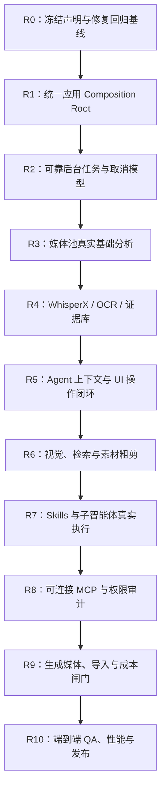

# AI Assistant / Agent Harness 完成度复核与收尾修复计划（2026-08-01）

> **用途**：本文件不是功能愿景，而是对
> `ai_assistant_agent_harness_product_plan_2026-08-01.md` 的实现复核结论和收尾施工清单。
> 按 R0 → R10 顺序实施；每项都有目标、操作、难点、验收标准。未满足验收标准前，不进入下一阶段。

---

## 0. 本次复核结论

### 0.1 结论：不能宣称 M0–M12 已全部完成

项目中已有大量很有价值的契约、数据类型、面板、服务接口与单元测试；AI 编辑核心定向测试也全部通过。但检查发现，多条用户实际使用的链路仍停在以下状态之一：

1. **确定性 Stub（模拟实现）**：转录、OCR、视觉理解、生成模型、子智能体角色执行器会返回可测试的固定结果，但没有调用真实模型或真实推理服务。
2. **只完成接口、没有生产接线**：`AssistantService` 与控制器创建的 `AnalysisService` 不是同一实例，Agent 不能读取媒体池分析证据。
3. **同步/进程内原型**：分析调度器不持有工作线程；MCP 只有进程内 JSON-RPC 分发，不能启动或连接真实 MCP Server；生成任务没有可靠的异步队列。
4. **UI 操作未闭环**：媒体池的“分析”操作当前只生成提案，确认后执行和进度/完成回写链路尚未形成可验证闭环。
5. **全量回归不健康**：本次 `pytest -q` 在约 6% 执行时已出现既有失败，并以 `QThread: Destroyed while thread is still running` 终止；因此 M12 的“全量回归通过”不能成立。

这不是否定当前工作：现有实现已经形成了正确的**可测试骨架**。下一步要把骨架接到真实媒体、真实模型、真实异步任务和真实 UI 生命周期上。

### 0.2 已验证的测试基线

| 范围 | 结果 | 说明 |
|---|---:|---|
| `tests/edit/ai_editing` | 927 passed | AI 编辑的契约与模拟路径健康 |
| App / UI AI 定向测试 | 72 passed | 控制器与 UI 的定向测试健康 |
| 媒体池相关定向测试 | 57 passed | 开关、请求与展示的定向测试健康 |
| `pytest -q` 全量回归 | 未完成 | 已出现非 AI 定向失败，随后 QThread 未退出导致进程 abort |

**重要解释**：单元测试通过证明接口和受控场景正确；它不等于 WhisperX、RapidOCR、MCP Server、视频生成服务或后台工作进程已经真实可用。

### 0.3 M0–M12 实际状态

| 原里程碑 | 实际状态 | 复核判断 |
|---|---|---|
| M0 基线与约束 | 黄 | 定向基线存在；全量回归尚不稳定 |
| M1 计划、预览、确认、撤销 | 黄 | 主体实现存在；需要真实 UI 端到端回归 |
| M2 证据契约与时间戳 | 黄 | 数据契约存在；真实产物/持久化链未验收 |
| M3 媒体池按需分析 | 红 | 开关与提案存在；真实工作线程、确认执行、逐素材取消未闭环 |
| M4 文本证据 | 红 | WhisperX / OCR 真实路径仍是未实现占位 |
| M5 Agent Dock 与上下文 | 黄 | UI 存在；上下文事实计算错误，分析服务未注入 Agent |
| M6 创作与软件帮助 | 黄 | 结构已具备；需接入真实上下文与主窗口端到端验收 |
| M7 核心剪辑工作流 | 黄 | 工作流存在；因证据无法进入 Agent，实际效果不成立 |
| M8 视觉理解 | 红 | 提供器接口/模拟结果存在，真实视觉模型链路未落地 |
| M9 Skills 与子智能体 | 红 | Skill/任务图框架存在；角色执行仍为确定性 Stub |
| M10 MCP 与自动化 | 红 | 仅进程内分发，尚非可连接的 MCP 能力 |
| M11 生成媒体 | 红 | 同步确定性生成与演示媒体箱，未形成真实任务/导入闭环 |
| M12 QA 与发布 | 红 | 全量回归 abort，不能发布为完成版 |

---

## 1. 施工总原则（务必遵守）

1. **先修接线与任务生命周期，后接大模型。** 没有可靠任务状态、取消和证据存储前，直接接 WhisperX/视频模型只会让问题更难定位。
2. **真实能力与 Mock 必须显式区分。** `mock`、`local-real`、`remote` 三种 provider mode 必须写入配置和 UI；绝不能因环境变量缺失而静默返回伪结果。
3. **所有耗时媒体工作离开 UI 线程。** FFmpeg、ASR、OCR、视觉嵌入、下载、生成轮询均不得在 Qt 主线程执行。
4. **任何改时间线的动作均经 Plan → Preview → Approve → Transaction。** Agent、MCP、Skill、子智能体和生成媒体都不能绕过此门。
5. **每个结果都可追溯。** 记录来源素材、内容哈希、模型包版本、参数、时间戳、置信度、任务 ID 与项目修订号。
6. **每个阶段都新增真实集成测试。** 只新增 mock 单测不能作为完成依据。

---

## 2. 总体实施顺序

---

## R0：建立可信回归基线（阻塞后续发布）

### 目标

让完整测试能结束，所有失败都有归属；在此之前不得将 M12 标记为完成。

### 实施步骤

1. 在干净环境运行 `pytest -q`，保存完整输出与退出码到 CI artifact（不要只看终端前几屏）。
2. 单独复现本次发现的早期失败：
   - `tests/app/test_color_timeline_clip_playback_mapping.py`
   - `tests/app/test_composite_entry_source_selection.py`
   - `tests/app/test_edit_controller_timeline_management.py`
   - 架构边界守卫相关测试
3. 单独复现并修复 `external/file_explorer/main.py` 中缩略图 `QThread` 生命周期：测试退出前必须 stop、wait，并确保队列工作者不会在对象析构后继续运行。
4. 让外部文件浏览器的线程启动由可注入的测试替身控制，避免无关 UI 测试启动真实缩略图任务。
5. 将“全量测试执行完成”设成 CI 必需检查；禁止因 Qt abort 将结果误判为通过。

### 难点与注意事项

- 不要在测试中简单 `sleep` 等线程退出；要使用可等待的完成信号和明确的 shutdown 协议。
- 先确认上述失败是否为当前分支既有问题，再决定是修复、隔离还是回滚相关改动；不能把无关失败归因于 AI 模块。

### 验收标准

- `pytest -q` 不发生 abort、不出现 `QThread: Destroyed while thread is still running`。
- 全量测试要么 100% 通过，要么每个被正式隔离的已知失败都有 issue、原因、过期日期和 CI 标记。
- AI 定向三组测试仍保持全绿。

---

## R1：修复应用装配（Composition Root）与依赖注入

### 当前缺口

`src/app/controllers/ai_editing_mixin.py` 创建 `AssistantService` 时没有传入 `analysis_service`，之后又创建并保存了另一份 `AnalysisService`。因此 `AssistantService` 会回退到 `_NullAnalysisReader`，Agent 工作流看不到任何真实媒体证据。

### 实施步骤

1. 在一个明确的应用装配点（建议 `ai_editing_mixin._init_ai_editing_controller` 或专用 `AiEditingCompositionRoot`）按下列顺序创建单例：
   - `AnalysisStore` / `EvidenceRepository`
   - `ModelPackManager`
   - `AnalysisService`
   - `AnalysisScheduler` / `AnalysisTaskManager`
   - `ToolFacade`
   - `AssistantService(analysis_service=同一实例, tool_facade=同一实例, ...)`
2. 禁止每个面板或控制器私自 `AnalysisService()`；改为从装配根获取同一实例。
3. 为服务增加稳定的 `project_id`、项目 revision、资产定位器（asset ID → 文件路径）提供器；项目切换时显式 close / reset。
4. 修正 Agent Context Provider：
   - `analyzed_count` 应由真实 `AnalysisStatus.READY` 统计，不是 `has_proxy`；
   - `locked_count` 应读实际锁定媒体；
   - `analysis_fresh` 应比较素材 hash、模型版本和项目 revision；
   - token / context 使用量必须来自运行时上下文管理器，不得伪造常量。
5. 加启动自检：若 Assistant 与媒体池分析服务不是同一 `EvidenceRepository`，开发模式直接报错，发布模式禁用“基于分析剪辑”并提示用户。

### 需要新增的测试

- 创建一个媒体资产、写入一段证据、请求“根据所有素材粗剪”，断言 Assistant 读取的是同一证据库。
- 修改素材内容 hash 后，断言 `analysis_fresh` 变为 false。
- 项目切换后，断言旧项目证据不能泄漏到新项目。

### 验收标准

- UI、Assistant、ToolFacade 共享同一项目范围的分析服务和证据仓库。
- Agent 对话中的分析数量、锁定数量、过期提示与媒体池完全一致。

---

## R2：实现可靠的后台任务、进度与逐任务取消

### 当前缺口

`analysis_scheduler.py` 明确声明自己不拥有工作线程；当前控制器也没有补上执行器。取消单个素材时使用 `cancel_all()`，会误取消其他排队任务。

### 实施步骤

1. 新建 `AnalysisTaskManager`（或扩展现有 scheduler），统一管理 `TaskRecord`：
   `task_id, project_id, asset_id, stages, state, progress, cancel_token, started_at, error`。
2. 使用 `QThreadPool + QRunnable` 或受控 `ProcessPoolExecutor`：
   - FFmpeg / Python I/O 优先独立 worker；
   - GPU 模型按设备建立串行队列，避免多个 Whisper/视觉模型抢显存；
   - UI 线程只接收 Qt signal，不直接调用 provider。
3. 实现状态机：`queued → running → partial → ready | failed | canceled`；状态变化必须原子持久化。
4. `cancel(asset_id/task_id)` 只取消相应 token；`cancel_all(project_id)` 仅用于项目级明确操作。
5. 每个 provider 阶段定期检查取消 token；FFmpeg 子进程需保存 PID 并在取消时优雅 terminate、超时后 kill。
6. 设置资源限额：并发数、单任务时长、最大视频时长、最大帧数、磁盘缓存上限、GPU 内存预留。
7. 完成/失败后以主线程信号回写媒体池、Agent 对话卡和持久化日志；不要在 `execute_analysis()` 返回时提前标为完成。

### 难点与注意事项

- 不可把 Qt 对象直接跨线程传给 worker；传纯数据 DTO，结果再通过 signal 回主线程。
- 进程池中的模型初始化昂贵，优先采用每 GPU 一个长期 worker，避免每段素材重新加载模型。
- 进度必须表示真实阶段权重，不能固定从 0 跳 100。

### 验收标准

- 同时分析 3 个素材时，取消其中一个不会影响另外两个。
- UI 在 100ms 内保持可响应；任务状态可在重启后显示为“中断，需重试”。
- 一条真实短视频任务有连续进度、可取消、完成后状态为 READY。

---

## R3：先落地不依赖大模型的真实媒体基础分析

### 目标

把“导入媒体池 → 用户开启分析 → 获得时间戳证据”建立为第一个真实闭环。此阶段不依赖云模型，可离线完成。

### 实施步骤

1. 在媒体池为每个素材保留：原路径、内容 hash、时长、帧率、音频流、代理文件状态和分析开关状态。
2. 用户点击“分析”或 Agent 发出 `topos.propose_asset_analysis` 后，只创建待确认计划；用户确认才入队。提供“分析全部素材”的二次确认和预计耗时/磁盘提示。
3. 实现真实 `MediaProbeProvider`：调用 FFprobe，写入时长、编码、帧率、分辨率、音轨、VFR 风险等事实。
4. 实现真实 `SceneCutProvider`：调用 PySceneDetect 或 FFmpeg 检测；输出镜头 `[start_ms, end_ms]`、检测方法与阈值。当前“无注入就返回空镜头”的 fallback 不得在 real mode 中静默成功。
5. 实现 `AudioFeatureProvider`：使用 FFmpeg `ebur128` 获取 LUFS/音量曲线，使用 librosa/madmom 计算 BPM 与 beat timestamps（没有音乐时应明确标记 `not_applicable`）。
6. 提取镜头关键帧并写入缓存目录；文件命名使用 `asset_hash + shot_range + analyzer_version`，不得只依赖原始文件名。
7. 建立 `evidence.json`（或 SQLite 表）并使用版本化 schema，最小字段见原计划 §18.5。结果必须关联 `asset_hash` 与 provider/version。

### UI 闭环要求

- 修复 `EditPage._on_analysis_requested`：提案需要在 Agent Dock 或媒体池确认卡中明确显示“确认分析 / 取消”。
- 确认按钮调用 R2 的实际入队接口；禁止只停留在 `request_analysis_draft()`。
- 每项素材显示未分析、排队、分析中、部分完成、完成、失败、过期；失败卡可复制诊断并重试。

### 验收标准

- 不配置任何大模型时，用户仍可对真实 MP4 得到时长、镜头、响度和关键帧等带毫秒时间戳的真实证据。
- 证据可在重启后重新读取；原始素材改变后自动标记过期。

---

## R4：接入真实转录、说话人、OCR 与证据索引

### 当前缺口

`transcript_provider.py` 与 `ocr_provider.py` 的 real mode 仍抛出 `NotImplementedError`；不能将环境变量开关视为已完成的真实能力。

### 实施步骤

1. 定义统一 Provider 配置：`mode=mock|local-real|remote`、模型包 ID、设备、语言、参数、超时、隐私策略。UI 必须显示当前模式。
2. 实现本地音频提取：用 FFmpeg 转为固定采样率 mono WAV，并记录提取版本与 offset。
3. 实现 Faster-Whisper / WhisperX Adapter：
   - 返回 segment、word 级 `start_ms/end_ms`、语言、置信度；
   - WhisperX 对齐失败时保留 segment 级时间戳并写 `alignment_status`，不能伪造 word timestamp；
   - 语言自动检测和用户强制语言均要可配置。
4. 实现 pyannote diarization Adapter：输出说话人区间与重叠区间；将 diarization 与 ASR 对齐，保留“未知/不可靠”标签。
5. 实现 RapidOCR Adapter：对关键帧及高 OCR 变化帧识别，写入文本、bbox、frame timestamp、置信度、帧 hash；中文/英文模型包单独管理。
6. 设计 `EvidenceRepository`：优先 SQLite（FTS5）+ JSON sidecar。至少包含 `assets, analysis_runs, segments, shots, ocr_items, frames, audio_features, embeddings`；所有记录可按 `asset_id/time range` 查询。
7. 构建 FTS 索引（转录/OCR）与可选向量索引（镜头/关键帧 embedding）；搜索必须返回原始时间范围和证据引用。
8. 将真实模型包登记进 `ModelPackManager`：真实下载 URL、SHA-256、许可、大小、所需运行时、兼容平台。删除“placeholder hash 通过校验”的生产旁路；仅 mock 测试可使用虚拟包。

### 风险与决策点

- WhisperX 与 pyannote 的模型许可、Hugging Face token、CUDA 兼容性需在安装向导中透明展示。
- Apple Silicon、NVIDIA CUDA、纯 CPU 都要有明确性能等级与降级方案；不要承诺所有机器实时分析。
- 素材和转录内容可能敏感，默认离线本地；远程 provider 必须逐项目确认并说明发送范围。

### 验收标准

- 使用真实 1–3 分钟中英混合样片，能生成可播放跳转的转录、说话人和 OCR 证据。
- 测试向量包括静音、无音轨、多人重叠、VFR、旋转视频、烧录字幕、OCR 为空、模型缺失和取消中断。
- 模型哈希不符时拒绝加载，并向 UI 报明确错误。

---

## R5：使 Agent Dock、媒体池与编辑计划形成真实闭环

### 实施步骤

1. 建立用户命令路由：
   - “分析所有素材” → 生成带范围、预计资源消耗的计划 → 用户确认 → R2 入队；
   - “按采访内容做 30 秒粗剪” → 读取 R4 证据 → 生成候选片段及证据引用 → 预览 → 确认后写 timeline transaction；
   - “这个功能怎么用” → 查询本地功能帮助索引，必要时引导 UI 高亮，不执行剪辑修改。
2. 将每个 Agent 回复区分为：文本回答、待确认工具调用、任务进度、编辑提案、失败诊断。不要用纯自然语言暗示已经执行。
3. 每个选中片段显示证据：转录原文、说话人、镜头、OCR、评分理由、精确时间戳；用户可一键在查看器定位。
4. 实现上下文预算管理：项目摘要 + 检索到的证据片段 + 当前选择 + 历史摘要，按照 token budget 裁剪。压缩必须保留原始证据引用，不能把摘要当作事实来源。
5. 新对话、历史对话、工作区/项目隔离、模型选择、权限模式、上下文长度与压缩按钮要持久化，并在重启后恢复。
6. 审批前重新检查项目 revision、素材 hash、权限 scope；任一变更即要求重新生成计划。

### 验收标准

- 从自然语言“分析所有素材”到媒体池完成卡可走通，不需开发者手动触发确认函数。
- 从证据驱动的粗剪提案到审批、写入时间线、撤销/重做可走通。
- Dock 的数字和状态来自真实 repository，不再使用代理文件或固定 fallback。

---

## R6：视觉语义、检索、素材筛选与粗剪质量

### 实施步骤

1. 在 R3 关键帧之上接 SigLIP / InternVideo2 等可替换视觉 provider，输出场景、物体/人物、镜头类型、审美/清晰度评分与 embedding。
2. 设置采样策略：镜头首中尾帧 + 场景变化帧 + OCR 变化帧；避免对每帧执行视觉模型。
3. 实现混合检索：文本 FTS、向量相似度、时间过滤、素材类型、人物/说话人、清晰度和锁定状态过滤。
4. 将评分拆开保存：相关性、画质、音频可用性、重复惩罚、节奏匹配、用户偏好。Agent 输出应可解释，不能只给总分。
5. 粗剪只生成可编辑的片段建议；导入时间线必须经 M1 transaction，并保留源证据/版本号。

### 验收标准

- 用户可搜索“主持人在室内讲产品且屏幕出现价格”，结果能定位到正确时间段并展示命中证据。
- 同一查询在证据未变时结果稳定；模型更新后可通过版本控制重建索引。

---

## R7：把 Skills 与子智能体从“任务图”接成可控执行系统

### 当前缺口

现有 Skill manifest、任务图和角色框架可用，但角色 executor 仍为确定性 stub；不能称为具备真实子智能体协作。

### 实施步骤

1. 为每个 Skill 定义 manifest：名称、版本、输入 schema、输出 schema、所需工具、最小权限、资源上限、是否允许子任务、测试夹具、许可。
2. 构建真实 `RoleExecutor`：调用配置的大模型或本地模型，强制结构化输出；模型失败可重试，但不能用伪结果冒充成功。
3. 先实现三个受控 Skill：
   - `script_outline`：文案/脚本与镜头大纲；
   - `rough_cut_planner`：只读证据，产出剪辑候选；
   - `editing_help`：只读功能帮助，不允许写项目。
4. 子智能体只能提交 proposal / artifact，不能直接执行破坏性工具；协调器负责合并、冲突检测、预算、超时和最终审批。
5. 建立 `TaskGraph` 的持久化、可恢复、可取消、父子 trace 与日志；父任务取消必须级联取消未提交的子任务。
6. 限制最大深度、并发数、总 token、总时间、允许工具；把这些限制暴露给高级用户但给安全默认值。

### 验收标准

- 一项脚本到粗剪任务可观察每个子任务的输入摘要、输出 artifact、证据引用和最终合并理由。
- 子智能体即使获得恶意提示，也无法绕过 ToolFacade / 审批写入时间线。

---

## R8：实现真正可连接、可审计的 MCP

### 当前缺口

当前 MCP 代码是进程内 JSON-RPC dispatcher，适合契约测试，但不是能够与外部 MCP Server 通讯的 transport。

### 实施步骤

1. 明确第一期边界：优先实现 **本地 stdio MCP client/server**，不先开放任意远程 URL。
2. 实现 transport 生命周期：启动子进程、握手、工具列举、调用、超时、取消、stderr 日志、退出清理、版本协商。
3. MCP 工具必须映射到 Capability / ToolFacade；外部声明的工具不能自动获得文件、网络、时间线写入权限。
4. 增加服务器注册表：来源、版本、命令、哈希/签名、权限、启用项目、最近调用、健康状态。第三方 server 首次启用必须二次确认。
5. 对每次调用记录：任务/对话 ID、server/tool、已批准参数摘要、权限决定、耗时、结果摘要、错误；敏感参数需脱敏。
6. 对编辑类 MCP 工具只允许返回 EditPlan；由本地 Agent/UI 显示预览并确认后才调用 TransactionService。
7. 在完成本地安全模型前，不实现默认联网下载/自动安装 MCP server。

### 验收标准

- 用一个最小 stdio 示例 server 进行真实握手、列工具、调用和退出测试。
- 未授权写 timeline 的 server 只能得到权限拒绝；授权后仍须走预览和审批。

---

## R9：生成媒体、素材导入、时间线与成本控制

### 当前缺口

生成服务为同步确定性 stub，生成媒体箱没有可靠接入真实媒体池、代理、分析和时间线审批闭环。

### 实施步骤

1. 设计 `GenerationJob`：provider、模型、提示词、参考资产引用、seed、分辨率、时长、成本预估、实际成本、状态、远端 job ID、产物 hash、版权/许可元数据。
2. 实现异步 provider adapter：提交、轮询/webhook、取消、失败重试、下载校验；禁止在 UI 或 Agent 主调用栈同步等待生成。
3. 先选一个实际 provider 做端到端集成，另一个保留接口。所有 provider 均须明确数据发送范围与用户确认。
4. 下载产物后走正常媒体导入：生成代理、写入媒体池、可选分析开关、来源标识、文件生命周期与磁盘配额。
5. Agent 只能提出“生成并导入素材”的计划；用户确认成本、内容和导入位置后才开始生成。生成完成后再次确认是否放入时间线。
6. 实现真实成本闸门：项目/日/单任务预算、软预警、硬阻止；不能只记录账本后 `pass`。
7. 对失败/取消任务清理临时文件，保留必要日志；不要删除用户已确认导入的产物。

### 验收标准

- 一个真实图片/音频/视频生成任务可异步完成，产物校验后进入媒体池，并能按正常流程进入时间线。
- 超过硬预算时请求在提交给远端前被拒绝且有清晰提示。

---

## R10：最终验收、性能、安全与开源交付

### 实施步骤

1. 建立三层测试：
   - 纯单元测试：schema、评分、权限、事务；
   - 本地集成测试：FFmpeg fixture、短视频、真实 SQLite、可替代的本地模型 fixture；
   - 手工 E2E：媒体池 → 分析 → Agent → 提案 → 审批 → 时间线 → 撤销。
2. 加入测试媒体集合：无音频、静音、多人、长视频、VFR、旋转、损坏媒体、字幕/无字幕、超大分辨率、敏感 OCR、模型缺失。
3. 性能指标至少记录：分析时长/分钟媒体、峰值内存、峰值显存、磁盘缓存、UI 卡顿、取消响应时间、检索延迟、工具调用成功率。
4. 安全审计：路径穿越、任意命令执行、MCP 参数注入、提示注入、越权工具调用、跨项目证据泄漏、密钥日志泄漏、远程上传提示。
5. 发布前完成隐私说明、第三方模型与权重许可证清单、离线安装指南、硬件要求、故障排查、数据删除/重新分析机制。
6. 不将 `mock` provider 当成默认产品演示结果；演示环境必须有明确“模拟数据”水印/标签。

### 最终发布验收清单

- [ ] 全量 `pytest -q` 正常结束且通过。
- [ ] 至少一个真实本地分析链（FFprobe + 场景 + ASR + OCR）端到端通过。
- [ ] 至少一个真实 LLM agent 与真实证据检索端到端通过。
- [ ] 分析、编辑、生成、MCP 的取消、错误和权限拒绝都有 UI 反馈。
- [ ] 所有写项目动作都有可见预览、明确确认、事务日志和撤销。
- [ ] MCP stdio 示例、一个 Skill、一个子任务、一个生成 provider 均有真实集成测试。
- [ ] 文档明确区分 stable、experimental、mock 三类能力。

---

## 3. 建议的提交拆分（避免一次大重构不可审查）

1. `fix(ai): stabilize test shutdown and compose shared analysis services`
2. `feat(ai): add persistent analysis task manager with per-asset cancellation`
3. `feat(media): implement ffprobe scene and audio evidence pipeline`
4. `feat(media): add real whisperx diarization and rapidocr providers`
5. `feat(ai): wire analysis confirmations and evidence-backed agent context`
6. `feat(ai): add visual retrieval and evidence-based rough-cut proposals`
7. `feat(ai): execute skills and subagents through controlled role runtime`
8. `feat(mcp): add audited local stdio transport and capability gates`
9. `feat(generation): add async generation import and enforce cost budgets`
10. `test(release): add end-to-end fixtures performance and security gates`

每一提交都应包含：变更说明、迁移说明、失败恢复方式、针对真实路径的测试。不要把模型下载、数据库 schema 改动和 UI 大改混在同一个不可回滚提交中。

---

## 4. 本次没有直接修复代码的原因

本次问题不是可安全孤立的一两行错误。例如，把单素材“取消”从 `cancel_all()` 改成表面上的 `cancel(asset_id)`，但没有 task ID 映射、取消 token、worker 生命周期和状态持久化，反而会制造“UI 显示已取消、后台仍在写证据”的数据竞争。

同理，只给 `AssistantService` 注入一个新 `AnalysisService` 也不够：它必须与媒体池、调度器、证据库、项目切换共享同一项目范围实例。因此应按 R1 与 R2 先补齐基础设施，再进行这一处接线修复。

---

## 5. 复核时定位到的主要代码入口

| 主题 | 入口 |
|---|---|
| 应用装配与 Assistant 注入 | `src/app/controllers/ai_editing_mixin.py` |
| Agent 读取分析证据 | `src/features/edit/ai_editing/assistant_service.py` |
| 分析调度与取消 | `src/features/edit/ai_editing/analysis_scheduler.py`、`media_analysis_controller.py` |
| 媒体池分析 UI | `src/ui/edit_page.py`、`src/ui/media_pool_panel.py` |
| 转录 / OCR provider | `src/features/edit/ai_editing/transcript_provider.py`、`ocr_provider.py` |
| 模型包与校验 | `src/features/edit/ai_editing/model_pack_manager.py` |
| MCP | `src/features/edit/ai_editing/mcp_gateway.py` |
| 生成媒体 | `src/features/edit/ai_editing/generation_provider.py`、`media_generation_service.py` |
| Skills / 子智能体 | `src/features/edit/ai_editing/skill_runtime.py`、`task_graph.py` |

这些文件是 R1–R9 的优先阅读顺序，不建议在不了解它们的依赖关系前进行零散补丁。
