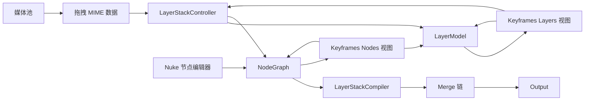

# Topos Color：AE 图层工作流与 Nuke 节点工作流融合实施计划

**文档状态：** 规划版  
**制定日期：** 2026-08-07  
**适用范围：** Composite 页面、Keyframes 面板、媒体池、NodeGraph、Merge/Output 合成链  
**目标：** 在保留 Nuke 式自由节点编辑能力的同时，为 Topos Color 增加 AE 式图层堆栈、时间线和媒体拖拽工作流。

---

## 1. 目标与基本原则

### 1.1 总体目标

用户可以在同一个 Composite 工程中选择两种工作方式：

```text
AE 工作流：媒体池 → 图层面板 → 关键帧/父级/混合模式
Nuke 工作流：节点编辑器 → 节点连接/分支/遮罩/复杂合成
```

两种工作流共享同一个底层合成结果，不产生两套互相独立的渲染数据。

### 1.2 核心原则

1. **NodeGraph 是实际执行图。** 所有渲染、端口连接、参数表达式和节点依赖最终都必须落到 NodeGraph。
2. **LayerStack 是图层交互模型。** 它保存图层顺序、图层状态和 AE 式操作语义。
3. **Keyframes 面板不直接修改 NodeGraph。** 面板发出操作意图，由 Controller/Service 完成校验、修改、Undo 和渲染刷新。
4. **图层不是节点的替代品。** 一个图层可以由多个节点组成；Blur、Mask、Merge 等节点不必强行变成图层。
5. **简单操作走图层，复杂操作走节点。** 图层排序不能限制用户在 NodeGraph 中创建分支、Dot、Group、多输入和复杂 Merge。
6. **所有高层操作必须可撤销。** 一次媒体拖入应对应一次 Undo，而不是分别撤销素材节点、Transform 节点和 Merge 节点。
7. **默认保持旧项目兼容。** 没有 LayerStack 的旧项目应能够打开，并在首次进入图层模式时生成兼容投影。

---

## 2. 总体架构



### 2.1 三个核心模块

| 模块 | 职责 | 是否保存渲染数据 |
|---|---|---:|
| `LayerModel` | 图层 ID、顺序、名称、开关、父级、时间范围 | 否 |
| `NodeGraph` | 节点、参数、端口、连接、表达式 | 是 |
| `LayerStackCompiler` | 将图层顺序编译为 Merge/Output 连接 | 生成节点连接 |

### 2.2 两种操作模式

| 模式 | 主要用户 | 主要操作 | 对 NodeGraph 的影响 |
|---|---|---|---|
| Layers | AE/传统时间线用户 | 排序、关键帧、父级、透明度、混合模式 | 通过 Controller 修改 |
| Nodes | Nuke/节点用户 | 连接、分支、遮罩、Group、复杂 Merge | 直接编辑 NodeGraph |

Layers 模式和 Nodes 模式必须共享：

- 当前选中节点/图层；
- 当前帧；
- 关键帧选中状态；
- 节点参数值；
- 时间范围；
- 锁定和可见状态；
- 表达式和父级绑定状态。

---

## 3. 数据模型设计

### 3.1 `LayerStack`

建议新增：

```python
@dataclass
class LayerStack:
    stack_id: str
    name: str
    output_node_id: str
    layer_ids: list[str]
    generated_merge_node_ids: list[str] = field(default_factory=list)
    enabled: bool = True
    managed: bool = True
    version: int = 1
```

字段说明：

| 字段 | 说明 |
|---|---|
| `stack_id` | 图层堆栈唯一标识 |
| `name` | 图层堆栈名称，例如 Main Comp |
| `output_node_id` | 最终连接的 Output 节点 |
| `layer_ids` | 从前景到背景排列的图层 ID |
| `generated_merge_node_ids` | 由图层系统创建并管理的 Merge 节点 |
| `managed` | 是否允许 LayerStack 自动维护 Merge 链 |
| `version` | 用于项目文件迁移 |

一个合成可以先只支持一个主 LayerStack，后续再支持：

- 预合成内部 LayerStack；
- Group 内部 LayerStack；
- 多 Output 对应多个 LayerStack；
- 3D 场景独立 LayerStack。

### 3.2 `Layer`

建议新增：

```python
@dataclass
class Layer:
    layer_id: str
    name: str
    root_node_id: str
    source_node_id: Optional[str] = None

    enabled: bool = True
    solo: bool = False
    locked: bool = False
    shy: bool = False

    label_color: str = "#777777"
    opacity: float = 1.0
    blend_mode: str = "normal"

    parent_layer_id: Optional[str] = None
    in_frame: Optional[int] = None
    out_frame: Optional[int] = None

    layer_type: str = "media"
    managed: bool = True
    collapsed: bool = True
```

### 3.3 图层类型

| `layer_type` | 说明 | 默认根节点 |
|---|---|---|
| `media` | 图片、视频、序列帧 | Source + Transform |
| `text` | 文字图层 | Text |
| `shape` | 形状/矢量图层 | Shape/Transform |
| `adjustment` | 调整图层 | Adjustment/Transform |
| `solid` | 纯色图层 | Constant/Transform |
| `group` | 预合成或图层组 | Group |
| `external` | 来自自由节点图的节点 | 外部节点 |
| `3d` | 3D 内容 | Scene3D/Model3D |

### 3.4 图层与节点关系

一个图层允许包含多个节点：

```text
Layer: Video 1
 ├─ source_node_id: VideoFrame
 ├─ Transform
 ├─ Blur
 ├─ ColorCorrect
 └─ root_node_id: ColorCorrect
```

图层系统只需要稳定记录 `root_node_id`，不要假设一个图层只对应一个节点。

### 3.5 Node 能力声明

父级绑定、图层根节点和自动包装都需要能力标记：

```python
class Node:
    supports_parent_transform = False
    supports_layer_root = False
    supports_layer_opacity = False
```

初始能力建议：

| 节点 | 父级变换 | 图层根节点 | 备注 |
|---|---:|---:|---|
| Transform | 是 | 是 | 标准 2D 层根 |
| Text | 是 | 是 | 内置变换通道 |
| ImageInput | 否/自动包装 | 否 | 自动添加 Transform |
| VideoFrame | 否/自动包装 | 否 | 自动添加 Transform |
| Blur | 否 | 否 | 作为效果节点 |
| Merge | 否 | 否 | 作为合成节点 |
| Color | 否 | 否 | 作为效果节点 |
| Scene3D | 独立 3D 层级 | 视情况 | 不参与普通 2D 父级 |

---

## 4. LayerStack 与 Merge 连接规则

### 4.1 图层顺序定义

`layer_ids[0]` 永远表示最上方、最靠前的图层。

例如：

```text
Layer A
Layer B
Layer C
```

等价于：

```text
A over B over C
```

### 4.2 Merge 链

节点图应生成：

```text
A ───── Foreground
                  Merge1 ───── Foreground
B ───── Background              Merge2 ───── Output
                  C ─────────── Background
```

逻辑表达为：

```text
Merge1(A, B) → Merge2(Merge1, C) → Output
```

具体 Foreground/Background 端口名称必须以当前 `MergeNode` 的实际端口定义为准，并添加单元测试锁定顺序。

### 4.3 图层数量规则

| 图层数量 | 生成结果 |
|---:|---|
| 0 | Output 使用空输入或默认背景 |
| 1 | 图层根节点直接连接 Output |
| 2 | 生成 1 个 Merge |
| N | 生成 N-1 个 Merge |

### 4.4 Merge 复用规则

每次重排不能无条件创建新 Merge。

编译步骤：

1. 读取当前 LayerStack 管理的 Merge 节点；
2. 计算新图层顺序需要的 Merge 数量；
3. 优先复用已有 Merge；
4. 数量不足时创建新 Merge；
5. 数量过多时清理多余的自动 Merge；
6. 不删除用户手动创建的 Merge；
7. 将连接变更封装为一个 Undo 命令。

### 4.5 连接冲突

如果用户在节点编辑器中拆散了自动 Merge 链，LayerStack 不能静默覆盖。

建议提示：

```text
图层堆栈的自动连接已被节点编辑器修改。

[重新生成图层连接]
[保留当前节点连接]
[解除图层堆栈管理]
```

---

## 5. 媒体池拖入 Keyframes 面板

### 5.1 MIME 数据

建议使用：

```text
application/x-topos-media-asset
```

数据示例：

```json
{
  "asset_id": "asset_123",
  "path": "/media/demo.mov",
  "media_type": "video",
  "duration": 240,
  "width": 1920,
  "height": 1080
}
```

不要只传文件路径。媒体池可能使用代理文件、素材 ID、缩略图缓存或重新链接信息。

### 5.2 拖放指示器

Keyframes 图层区需要明确显示插入位置：

```text
Layer A
────────────  ← 插入指示线
Layer B
```

| 拖放区域 | 行为 |
|---|---|
| 图层行上半区 | 插入到该图层上方 |
| 图层行下半区 | 插入到该图层下方 |
| 图层面板空白区 | 添加到图层堆栈底部 |
| 参数行 | 拒绝拖放 |
| 节点图区域 | 按节点编辑规则处理 |

拖放到图层行中部时建议显示整行高亮，但最终位置仍根据上/下半区确定。

### 5.3 创建流程

```text
拖入媒体
  ↓
解析 MIME
  ↓
校验资产和媒体类型
  ↓
确定 LayerStack 和插入位置
  ↓
创建 Source 节点
  ↓
必要时创建 Transform 根节点
  ↓
创建 Layer
  ↓
编译 Merge 链
  ↓
连接 Output
  ↓
建立 Undo
  ↓
刷新预览和 Keyframes 面板
```

### 5.4 首个素材

```text
Media → ImageInput/VideoFrame → Transform → Output
```

如果素材本身已经具有变换通道，可以复用原节点，避免重复添加 Transform。

### 5.5 第二个素材

如果 B 拖到 A 上方：

```text
B ───── Foreground
              Merge → Output
A ───── Background
```

如果 B 拖到 A 下方：

```text
A ───── Foreground
              Merge → Output
B ───── Background
```

---

## 6. Keyframes 面板升级方案

### 6.1 Layers/Nodes 双模式

顶部增加模式切换：

```text
[Layers] [Nodes]
```

### Layers 模式

```text
眼睛 锁定  编号  图层名             父级  关键帧
------------------------------------------------
👁   □     1     Video 1           🔗    ◆
                  Transform
                  Position X
                  Position Y
                  Scale
                  Rotation
                  Opacity
```

### Nodes 模式

```text
Output
Merge 2
Merge 1
Transform
Blur
VideoFrame
```

Layers 模式中的图层属性仍然映射到节点参数，不能复制关键帧数据。

### 6.2 图层行和节点行区分

| 行类型 | 视觉设计 |
|---|---|
| 图层行 | 较高行高、缩略图、编号、图层颜色 |
| 节点行 | 普通行高、节点颜色、节点类型 |
| 参数行 | 缩进显示 |
| 自动 Merge | 可折叠，默认弱化显示 |
| 外部节点 | 显示 Node 标记 |

### 6.3 图层操作

第一阶段需要支持：

- 拖动排序；
- 双击或 Enter 重命名；
- Delete 删除；
- Ctrl+D 复制；
- 显示/隐藏；
- 锁定；
- Solo；
- Shy；
- 颜色标签；
- 折叠/展开；
- 时间范围；
- 不透明度；
- 混合模式；
- 父级绑定；
- 从图层跳转到节点。

### 6.4 现有 Keyframes 功能保留

当前已经具备的功能继续作为基础能力：

- 时间码、帧数、帧率显示；
- Alt 点击关键帧按钮打开编辑行；
- 当前帧关键帧橙色显示；
- 关键帧值拖动；
- 参数表达式绑定；
- 父级绑定反馈；
- 拖拽线置于数值控件之上。

后续改造重点是将这些功能从“节点行”扩展到“图层行”。

---

## 7. 图层父级、表达式与绑定

### 7.1 图层父级

图层层面保存：

```python
Layer.parent_layer_id
```

实际执行时映射到 Transform 节点的父级关系：

```text
Parent Transform
        ↓
Child Transform
```

### 7.2 能力限制

| 类型 | 普通 2D 父级 |
|---|---:|
| Transform | 支持 |
| Text | 支持 |
| Image/Video 图层 | 自动包 Transform 后支持 |
| Blur/Color/Merge | 不支持 |
| Scene3D | 走独立 3D 层级 |

UI 行为必须统一：

- 不支持的节点不显示父级按钮；
- 不支持的节点不能开始父级拖拽；
- 不支持的节点不能成为目标；
- 父级候选菜单只显示支持节点；
- 拖拽时只有支持节点高亮；
- 自己、后代和形成循环的目标显示禁止状态。

### 7.3 表达式绑定

参数表达式绑定仍然使用：

```text
target_node_id + target_param_name
source_node_id + source_param_name
```

图层面板只负责提供 AE 风格操作入口，实际绑定仍由统一 BindingController 校验并写入 NodeGraph。

---

## 8. Nuke 节点编辑能力保留方案

### 8.1 节点图自由操作

NodeGraph 必须继续支持：

- 任意节点连接；
- 多分支；
- Dot/Reroute；
- Group；
- 多输入 Merge；
- 遮罩连接；
- 3D 节点；
- 多输出；
- 节点级表达式；
- 手动调整 Merge 顺序。

### 8.2 Managed 和 Free Graph 状态

```python
LayerStack.managed = True / False
```

### Managed

LayerStack 负责：

- 图层顺序；
- 自动 Merge；
- Output 主链；
- 图层开关；
- 图层父级。

### Free Graph

用户可以自由编辑节点连接，LayerStack 只作为历史视图或参考视图存在。

### 8.3 节点图变化后的处理

| 节点图变化 | 处理方式 |
|---|---|
| 只移动节点位置 | 不影响 LayerStack |
| 修改自动 Merge 输入顺序 | 尝试更新图层顺序 |
| 拆散自动 Merge 链 | 标记冲突，不静默覆盖 |
| 新增额外分支 | 保留节点图，LayerStack 继续指向主链 |
| 删除图层根节点 | 图层标记为失效，提供修复入口 |
| 手动接入复杂节点 | 保留自由节点拓扑 |

---

## 9. 建议代码模块

建议新增：

```text
src/features/composite/core/
├── layer_model.py
├── layer_stack_controller.py
├── layer_stack_compiler.py
├── layer_stack_validator.py
├── layer_undo_commands.py
├── binding_controller.py
└── media_drop_payload.py
```

建议修改：

```text
src/features/composite/ui/keyframes_model.py
src/features/composite/ui/keyframes_tree_view.py
src/features/composite/ui/keyframes_panel.py
src/features/composite/ui/composite_page.py
src/features/composite/core/node_engine.py
```

如果媒体池有独立 UI 模块，还需要补充其拖拽出口：

```text
src/features/media_pool/...
```

### 9.1 `layer_model.py`

负责：

- Layer；
- LayerStack；
- ID；
- 顺序；
- 数据序列化；
- 版本迁移。

### 9.2 `layer_stack_controller.py`

负责：

- 添加图层；
- 删除图层；
- 移动图层；
- 复制图层；
- 重命名；
- 设置图层状态；
- 设置父级；
- 调用编译器；
- 建立 Undo。

### 9.3 `layer_stack_compiler.py`

负责：

- 读取 LayerStack；
- 计算正确的 Merge 链；
- 创建或复用 Merge；
- 设置 Foreground/Background；
- 连接 Output；
- 保留用户节点；
- 检查冲突。

### 9.4 `layer_stack_validator.py`

负责：

- LayerStack 是否引用存在节点；
- 是否有重复 Layer ID；
- 是否形成图层循环；
- 是否形成节点循环；
- Merge 端口是否正确；
- Output 是否有效；
- 父级节点是否支持；
- 是否有失效素材。

---

## 10. Undo/Redo 设计

所有图层操作必须是原子命令：

```text
AddLayerCommand
RemoveLayerCommand
MoveLayerCommand
DuplicateLayerCommand
RenameLayerCommand
SetLayerVisibilityCommand
SetLayerBlendModeCommand
SetLayerParentCommand
RebuildLayerStackCommand
```

一个媒体拖入至少需要保存：

```python
before_layer_stack
after_layer_stack
before_connections
after_connections
created_node_ids
created_layer_ids
deleted_node_ids
```

媒体拖入的 Undo 必须一次恢复：

1. 删除素材节点；
2. 删除自动 Transform；
3. 删除自动 Merge；
4. 恢复原连接；
5. 恢复原图层顺序；
6. 恢复当前选择。

---

## 11. 分阶段实施计划

| 阶段 | 目标 | 主要工作 | 主要产物 | 验收标准 |
|---|---|---|---|---|
| 0 | 架构确认 | 梳理 NodeGraph、Merge、Output、媒体池、Undo | 数据流和连接规则文档 | 明确唯一数据源 |
| 1 | 数据模型 | 新增 Layer/LayerStack、序列化和迁移 | `layer_model.py` | 新旧项目都能打开 |
| 2 | Merge 编译 | 实现顺序到 Merge 链的编译 | `layer_stack_compiler.py` | 1/2/3/10 层顺序正确 |
| 3 | Controller | 统一添加、删除、重排、复制操作 | `layer_stack_controller.py` | UI 不直接改图 |
| 4 | 媒体拖入 | MIME、拖放指示线、素材节点创建 | `media_drop_payload.py` | 图片/视频可以拖入 |
| 5 | 图层视图 | Keyframes Layers/Nodes 模式 | UI 改造 | 图层顺序和画面一致 |
| 6 | 图层排序 | 拖动图层、自动重连、Undo | MoveLayerCommand | 一次拖动一次 Undo |
| 7 | 图层属性 | 可见、锁定、Solo、名称、颜色、时间范围 | Layer property projection | 状态实时同步 |
| 8 | 图层关键帧 | Transform、Opacity、时间范围关键帧 | 关键帧映射 | 不复制关键帧数据 |
| 9 | 父级绑定 | Layer parent、节点能力筛选、循环校验 | BindingController | 只显示可支持节点 |
| 10 | 双向同步 | 节点图选择同步、冲突检测 | validator/sync logic | 不静默覆盖手动节点改动 |
| 11 | Nuke 能力 | 分支、Dot、Group、多输入、自由连接 | Graph workflow | 不削弱现有节点编辑 |
| 12 | 性能与兼容 | 批量刷新、异步加载、大项目测试 | 性能报告 | 50～100 层可操作 |

---

## 12. MVP 范围

第一版建议只实现以下功能：

1. LayerStack/Layer 数据模型；
2. 旧节点图生成图层投影；
3. 媒体池拖入 Keyframes；
4. 自动创建图片/视频节点；
5. 自动创建 Merge；
6. 根据拖放位置设置前景/背景；
7. 图层上下拖动；
8. 图层名称、可见、锁定；
9. Layers/Nodes 模式切换；
10. LayerStack 操作 Undo/Redo；
11. Transform/Opacity 关键帧；
12. 支持节点的父级绑定；
13. 节点编辑器继续自由工作。

第一版暂不实现：

- 复杂预合成；
- 调整图层；
- 图层蒙版；
- Track Matte；
- 3D 图层父级；
- 多 LayerStack；
- 自动把任意自由节点推断成图层；
- 节点图任意变化后完全自动还原图层结构。

---

## 13. 测试计划

### 13.1 数据模型测试

- 新建 LayerStack；
- 添加、删除、复制、重排 Layer；
- 序列化和反序列化；
- 旧项目迁移；
- 缺少节点时的失效状态；
- 媒体丢失时的占位状态；
- LayerStack 版本升级。

### 13.2 Merge 编译测试

- 0 层；
- 1 层不创建 Merge；
- 2 层 Foreground/Background；
- 3 层顺序；
- 10 层顺序；
- 顶部插入；
- 中间插入；
- 底部插入；
- 删除顶部；
- 删除中间；
- 删除底部；
- 多次重排不产生重复 Merge；
- 不产生循环连接；
- Output 始终连接最终结果。

### 13.3 Keyframes UI 测试

- Layers/Nodes 模式切换；
- 图层展开/折叠；
- 图层选择和节点选择同步；
- 媒体池拖入；
- 插入线显示；
- 上方/下方插入；
- 参数行拒绝媒体拖入；
- 图层重命名；
- 删除和复制；
- 锁定图层不能移动；
- 隐藏和 Solo；
- 父级按钮能力筛选；
- 拖拽高亮能力筛选；
- 拖拽线位于 DragValue 之上。

### 13.4 节点同步测试

- 图层添加后节点图连接正确；
- 图层删除后节点图恢复正确；
- 手动修改自动 Merge；
- 手动拆散自动 Merge；
- 手动增加分支；
- 删除 Layer 根节点；
- 解除 LayerStack 管理；
- 切换回 Managed 模式。

### 13.5 性能测试

测试规模：

```text
10 层、30 层、50 层、100 层
```

重点记录：

- 图层拖动响应时间；
- Merge 编译耗时；
- Keyframes 刷新耗时；
- NodeGraph 重绘次数；
- 媒体缩略图加载耗时；
- 内存增长；
- 撤销/重做耗时。

---

## 14. 关键风险与应对方案

| 风险 | 影响 | 应对 |
|---|---|---|
| Layer 和 Node 双数据源 | 状态不一致 | Layer 只保存图层状态，参数仍归 Node |
| Merge 顺序错误 | 前后景颠倒 | 固定 layer_ids 顺序并加端口测试 |
| 拖动产生大量 Merge | 节点图污染 | Merge ID 复用和自动节点标记 |
| 节点图被静默覆盖 | 破坏 Nuke 工作流 | 冲突检测和解除管理选项 |
| 媒体异步加载 | UI 卡顿 | 资产 ID、占位节点、异步更新 |
| 父级循环 | 变换错误或递归 | Controller 统一做祖先检查 |
| 旧项目无图层数据 | 无法进入 Layers 模式 | 从 Output 主链生成兼容投影 |
| 任意节点无法归类为图层 | 图层显示混乱 | 标记为 external，不强行归类 |
| 3D 节点混入 2D 父级 | 变换语义错误 | 3D 层级单独处理 |
| 频繁重建渲染 | 拖动不流畅 | 批量编译、节流和增量连接 |

---

## 15. 最终用户工作流

### AE 式工作流

```text
媒体池拖入素材
    ↓
自动生成图层和 Merge
    ↓
在 Keyframes 面板调整图层顺序
    ↓
编辑位置、缩放、旋转、透明度关键帧
    ↓
设置父级、混合模式和时间范围
```

### Nuke 式工作流

```text
切换到节点编辑器
    ↓
查看自动生成的 Source、Transform、Merge
    ↓
添加 Blur、Mask、Grade、Dot、Group
    ↓
创建复杂分支和多输入合成
    ↓
根据需要保留或解除 LayerStack 管理
```

### 混合工作流

```text
先用图层面板快速搭建合成
    ↓
切换节点图完成复杂处理
    ↓
回到图层面板调整关键帧和层级
    ↓
两个视图共享同一个合成结果
```

---

## 16. 第一阶段建议执行顺序

建议实际开发按以下顺序推进：

1. 先完成 Layer/LayerStack 数据模型；
2. 为现有节点图生成兼容 LayerStack；
3. 实现纯内存 LayerStack → Merge 链编译器；
4. 添加 Merge 顺序和 Foreground/Background 单元测试；
5. 再接入媒体池拖放；
6. 再改造 Keyframes 的 Layers 视图；
7. 最后接入图层排序、Undo、父级和节点图同步。

不要一开始就同时修改媒体池、Keyframes、NodeGraph、Undo 和渲染器。第一步应先让“图层顺序 → 正确 Merge 链”在无 UI 环境下稳定通过测试。

---

## 17. 完成标准

该功能达到可交付状态时，应满足：

1. 媒体池素材可以拖入 Keyframes 图层面板；
2. 系统可以自动创建正确的素材节点和 Merge 节点；
3. 图层上下关系始终对应正确的前景/背景关系；
4. 图层重排不会产生重复或孤立的自动 Merge；
5. 一次图层操作可以一次 Undo；
6. Layers 和 Nodes 两种视图选中状态同步；
7. 关键帧仍然归属于底层节点参数；
8. 父级绑定只显示在支持的节点上；
9. NodeGraph 仍然支持 Nuke 式自由连接和分支；
10. 节点图手动修改不会被图层系统静默覆盖；
11. 旧项目可以正常打开；
12. 50～100 层项目仍然可以正常操作。
