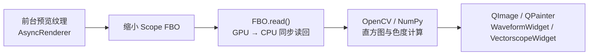
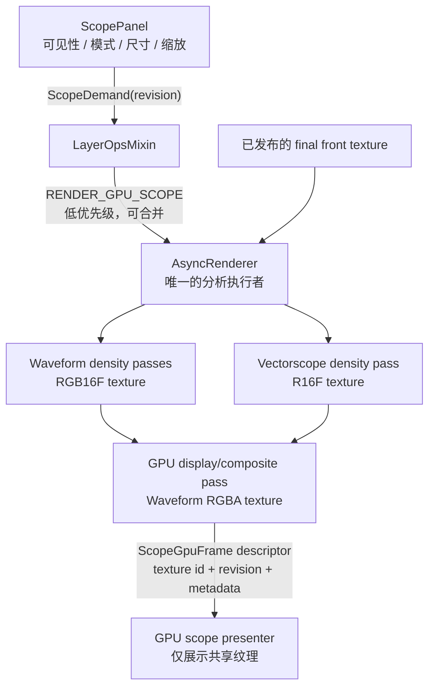

# Topos Color GPU Scope 实施计划

**日期：** 2026-08-05  
**状态：** 待实施  
**范围：** Color 页面 RGB Waveform、Vectorscope 与分屏显示  
**目标平台：** PyQt6 + ModernGL；应用请求 OpenGL 4.5 Core，但以 UI 侧实际兼容下限 OpenGL 4.1 为准；分析 shader 使用 GLSL 330 兼容子集

## 1. 背景、问题与边界

当前 scope 链路虽然已将 OpenGL 调用移出 UI 线程，但仍是“GPU 渲染、CPU 分析、CPU 绘制”的实现：



具体入口在：

- `src/features/color/core/async_renderer.py`：`RENDER_SCOPE` 与 `_do_render_scope_snapshot()`；
- `src/features/color/core/image_engine.py`：`request_scope_snapshot()`；
- `src/app/controllers/layer_controller.py`：`on_frame_ready()` 触发和 UI 回调；
- `src/features/color/ui/scope_panel.py`：scope 更新节流；
- `src/shared/ui/widgets/vectorscope_widget.py`：当前 CPU Waveform / Vectorscope 计算与绘制。

另有 `ImageEngine.render_scope_view()` 与 `render_full_image_for_scope()` 中的旧式 FBO readback。它们不应接入新实时链路；GPU 实施完成后应标记弃用或限制为明确的暂停态诊断/兼容 fallback，避免未来又从 UI 线程引入读回。

`FBO.read()` 强制 GPU/CPU 同步，并随后产生 NumPy、OpenCV 与 QImage 工作。在播放的每一帧都执行该路径时，它会与视频上传、调色渲染共用同一渲染线程和 GPU 队列，从而造成 Color 页面掉帧。

在 GPU scope 完成之前，当前的可见性与播放门控必须保留：面板未真正显示时不请求 scope；CPU scope 在视频播放期间保持上一次结果，不得读回。它是保护现有播放体验的过渡措施，不是 GPU scope 的最终设计。

## 2. 实施目标与不可违反的约束

| 项目 | 实施后要求 |
|---|---|
| 动态数据路径 | 播放和调参时不得执行 `FBO.read()`、`Texture.read()`、`cv2`、`numpy.histogram*`、`QImage` 的逐帧 scope 计算。 |
| GPU 所有权 | Scope 分析、密度累计、颜色映射和输出纹理均在 `AsyncRenderer` 的共享 OpenGL 上下文/渲染线程执行。 |
| UI 职责 | UI 只表达可见性、模式、尺寸、缩放和刷新需求；不得在主线程创建 scope 分析任务或读取纹理像素。 |
| 隐藏面板 | Scope dock 或 `ScopePanel` 任一不可见时，不提交分析命令，不占用 GPU 分析预算。 |
| 播放 | GPU scope 可以在播放时刷新；必须采用独立、可合并的低优先级 lane，绝不阻塞或抢占视频帧。 |
| 过期结果 | 切片、seek、分辨率、模式或面板可见性改变后，旧 generation 的结果不得显示。 |
| 兼容性 | 第一版必须在 GLSL 330 上工作；GL 4.3 compute/SSBO/atomic 是可选优化，不能成为基础功能前提。 |
| 降级 | GPU scope 初始化失败时，保留现有 CPU scope 作为“暂停/单帧”手动降级；播放中默认不走 CPU 降级。 |
| 取样语义 | V1 明确分析已发布的 final viewport/front texture（即用户当前看到的最终预览），不是原始全分辨率媒体；全图/scene-linear 分析以后以独立产品选项实现。 |
| Mask | V1 不支持 scope mask，或在需求模型中明确传入已共享的 mask texture；不得为了支持 mask 把 mask 或画面读回 CPU。 |

## 3. 目标架构



### 3.1 责任划分

| 组件 | 新职责 | 明确不做的事 |
|---|---|---|
| `ScopePanel` | 发出 `ScopeDemand`；保存当前模式/尺寸/缩放；接收 GPU 输出描述符；控制 presenter 的显示。 | 不接收/缓存 `ndarray` 作为实时播放数据；不做直方图。 |
| `LayerOpsMixin` | 根据真实可见性、播放状态和交互状态合并需求；更新 revision；把需求交给 ImageEngine。 | 不读取 OpenGL 纹理，不在 `on_frame_ready()` 做像素计算。 |
| `ImageEngine` | 暴露类型化 `request_gpu_scope(...)`；转发 `gpu_scope_ready`。 | 不把 final texture 转为 NumPy。 |
| `AsyncRenderer` | 拥有 scope FBO、density texture、shader、缓存、generation 丢弃和计时。 | 不向 UI 发像素数组。 |
| Scope presenter | 只呈现已生成的共享 GPU 纹理和静态标尺/标签。 | 不参与分析、不使用 `read()`。 |

### 3.2 数据结构建议

在 `src/features/color/core/scope_types.py` 新增独立、可测试的数据模型：

```python
@dataclass(frozen=True)
class ScopeDemand:
    revision: int
    source_revision: int
    mode: Literal['waveform', 'vectorscope', 'split']
    display_size: tuple[int, int]
    analysis_size: tuple[int, int]
    vectorscope_zoom: float
    is_playing: bool

@dataclass(frozen=True)
class ScopeGpuFrame:
    revision: int
    source_revision: int
    waveform_texture_id: int | None
    waveform_size: tuple[int, int]
    vectorscope_texture_id: int | None
    vectorscope_size: tuple[int, int]
    analysis_ms: float
```

规则：`revision` 由 UI 需求变化递增；`source_revision` 由每次 front texture 成功发布递增。UI 只允许显示与自身当前需求匹配、且不早于当前源 revision 的 `ScopeGpuFrame`。

## 4. GPU 算法设计（GLSL 330 基线）

第一版采用 raster + additive blending 的密度累计。它只需要 GLSL 330、FBO、浮点纹理和普通 draw call，不依赖计算着色器或原子操作。

### 4.1 通用预采样

先把 final front texture 在 GPU 上缩放为固定分析输入；不进行 CPU resize。这里的 `front texture` 是已发布的最终 viewport 渲染结果，故其契约与用户看到的预览完全一致。

| 参数 | 建议初值 | 说明 |
|---|---:|---|
| `analysis_size` | `320 × 180` | 57,600 样本；足以稳定 scope，成本远低于 512² readback。 |
| 高质量静止帧 | `512 × 288` | 仅在停止播放且空闲时使用。 |
| 采样方式 | 均匀网格，必要时使用蓝噪偏移 | 首版优先确定性，便于测试和复现。 |
| 色彩 tap | final front texture（与观众看到的画面一致） | 后续可扩展“pre-display / scene-linear”选项，首版不混入。 |
| 值域 | display-referred RGB，先夹至 `[0.0, 1.0]` | HDR / log 映射作为后续单独需求，避免首版 scope 定义不清。 |

预采样纹理应是 renderer 内复用的 texture/FBO，按 `(analysis_size, source format)` 缓存；尺寸不变时不能重新分配。

### 4.2 RGB Waveform

1. 清空 `RGB16F` waveform density FBO（建议 `1024 × 300`；窄面板可使用 `512 × 300`）。
2. 以每个预采样像素为一个顶点绘制点；顶点着色器利用 `gl_VertexID` 推导源像素坐标并用 `texelFetch` 取样。
3. x 坐标映射到源像素的水平位置；R、G、B 分三次绘制（或经验证后用 instancing），y 坐标映射到对应通道的信号值。
4. 启用 additive blending（`ONE, ONE`），把每个采样点累加到密度纹理。
5. 用一次 fullscreen tone-map pass 把密度映射为带余辉的 RGBA waveform 纹理。该 pass 同时绘制水平 graticule，避免 QPainter 每帧绘制背景。

建议将 waveform 的 RGB 点绘制拆成三次明确的 draw call。它的行为更容易验证，也避免 GL 3.3 下为一条命令引入 geometry shader 的复杂度；确认性能后再评估 instanced 三通道绘制。

### 4.3 Vectorscope

1. 清空 `R16F` vectorscope density FBO（建议 `800 × 800`，与当前视觉精度接近）。
2. 每个预采样像素作为一个点。顶点着色器在 GPU 上把 RGB 转为 Rec.709 的 Cb/Cr：
   - `Y = 0.2126 R + 0.7152 G + 0.0722 B`
   - `Cb = (B - Y) / 1.8556`
   - `Cr = (R - Y) / 1.5748`
3. 将 `(Cb, Cr)` 映射到 scope 中心；`vectorscope_zoom` 只改变映射比例，不重新读回或重采样。
4. additive blending 累加密度。
5. fullscreen display pass 在 GPU 上叠加圆形 graticule、肤色线、R/G/B/C/M/Y 目标标签位置及密度颜色。

静态 graticule 有两种可行做法：首先在 display shader 中程序化绘制（无额外纹理）；若视觉设计需要复杂标记，再预渲染一次静态 overlay texture，并仅在尺寸或主题变化时更新。

### 4.4 纹理、FBO 与 shader 资源

| 资源 | 建议格式/尺寸 | 生命周期 |
|---|---|---|
| `scope_sample_tex` | `RGB16F`，320×180 或 512×288 | renderer 复用，源尺寸/分析档位变化时更新。 |
| `waveform_density_tex` | `RGB16F`，1024×300 | renderer 常驻，面板尺寸/质量档变化时重建。 |
| `vectorscope_density_tex` | `R16F`，800×800 | renderer 常驻，面板尺寸/质量档变化时重建。 |
| `waveform_display_tex` | `RGBA8` 或 `RGBA16F` | GPU presenter 的直接输入。 |
| `vectorscope_display_tex` | `RGBA8` 或 `RGBA16F` | GPU presenter 的直接输入。 |
| VAO / 样本 ID buffer | 首版优先空 VAO + `gl_VertexID`；若驱动不兼容则静态索引 VBO | 初始化一次，analysis size 改变时更新。 |

需要新增的 shader 模块建议置于 `src/features/color/shaders/gpu_scope.glsl`，并在既有 shader 编译/缓存路径注册。所有 GLSL 数字使用浮点后缀，循环边界保持常量，版本为 `#version 330`。

## 5. 调度、优先级与状态机

新增 `RenderCommand.RENDER_GPU_SCOPE` 与 `RenderLane.GPU_SCOPE`。此 lane 是“最新结果优先”的可合并低优先级 lane，不得进入关键命令队列。

### 5.1 执行优先级

```text
关键命令（seek / upload / 切片切换 / export）
    > VIDEO_PLAYBACK
    > GRADING_REFRESH / VIEWPORT_REFRESH
    > GPU_SCOPE
```

`GPU_SCOPE` 只在当前 drain 周期中没有待处理视频帧和关键命令时执行；若提交时已有旧 scope demand，直接替换旧 demand。播放帧不能为等待 scope 而延迟。

### 5.2 更新速率与质量档

| 状态 | 是否运行 GPU scope | 最大频率 | 分析尺寸 | 备注 |
|---|---:|---:|---:|---|
| Scope 不可见 | 否 | 0 | — | 释放动态调度；可按空闲策略延后释放缓存。 |
| 视频播放 | 是 | 10 FPS | 320×180 | 只有渲染预算空闲时执行；可合并丢帧。 |
| 拖动调色控件 | 是 | 10 FPS | 320×180 | 与播放相同；结束拖动后补一帧。 |
| 暂停、普通预览 | 是 | 20 FPS | 320×180 | 新 final front texture 到达才请求。 |
| 暂停且空闲 150 ms | 是 | 单次 | 512×288 | 生成高质量最终 scope。 |
| Seek / 切片切换 | 否，直到新 front texture 发布 | — | — | 丢弃旧 generation；禁止“旧片段 scope 闪回”。 |

频率上限应使用单调时钟和 `ScopeDemand` 合并，而不是定时器反复提交相同工作。UI 模式切换（waveform / vectorscope / split）只改变所需输出；split 一次 demand 可以同时产生两个输出，避免连续两次分析。

### 5.3 生命周期与取消

1. ScopePanel 显示、模式/尺寸/缩放变化时递增需求 revision，并发送最新 `ScopeDemand`。
2. Layer controller 只在 scope 真实可见、且有已发布 front texture 时请求 GPU scope。
3. Renderer 执行前检查：面板需求是否仍有效、是否有待处理视频帧、`source_revision` 是否仍是最新。
4. 切片切换、seek、播放启动、面板隐藏时清空 `GPU_SCOPE` pending lane；正在执行的 pass 无需强行中断，但结果发射前必须再次做 generation 校验。
5. UI 收到 `ScopeGpuFrame` 后只展示 matching revision；其他结果静默丢弃。

## 6. 分阶段实施计划表

| 阶段 | 工作项 | 主要文件 | 产出 / 验收标准 | 依赖 |
|---|---|---|---|---|
| 0 | 固化基线和测量 | `tests/color/`，性能日志工具 | 记录 1080p/4K、播放/拖动、面板开关的 FPS、GPU/CPU 时间；当前 CPU scope 只在可见且非播放时运行。 | 当前可见性门控。 |
| 1 | 定义模型和调度接口 | 新建 `core/scope_types.py`；`image_engine.py`；`async_renderer.py`；`render_commands.py` | `ScopeDemand`、`ScopeGpuFrame`、`RENDER_GPU_SCOPE`、`GPU_SCOPE` lane；支持合并、revision、取消，不改 UI 视觉。 | 阶段 0。 |
| 2 | 建立 GPU 资源管理 | `async_renderer.py`；新建 `shaders/gpu_scope.glsl` | 可创建、复用和释放 sample/density/display texture；切换尺寸不泄漏；有 capability log。 | 阶段 1。 |
| 3 | 实现 Waveform 密度与显示 pass | `gpu_scope.glsl`；`async_renderer.py` | 一张静态测试图产生 GPU waveform；无 `read()`；位置、RGB 通道与 CPU 参考在容差内。 | 阶段 2。 |
| 4 | 实现 Vectorscope 密度与显示 pass | 同上 | 彩条、肤色样本、灰阶测试图产生正确角度/中心点；缩放只改变 GPU 显示 pass。 | 阶段 2。 |
| 5 | 接入 GPU presenter 与 ScopePanel | `scope_panel.py`；新 presenter；`layer_controller.py` | waveform、vectorscope、split 均显示共享纹理；UI 不接收数组；隐藏时无请求。 | 阶段 3、4。 |
| 6 | 播放调度与性能调优 | `async_renderer.py`；`layer_controller.py`；视频测试 | 播放中 10 FPS GPU scope；video lane 优先；1080p/4K 指标达标。 | 阶段 5。 |
| 7 | 可选 GL 4.3 加速 | 可选 `gpu_scope_compute.glsl` | capability 检测后启用 compute/SSBO；GL 3.3 输出一致并持续可用。 | 阶段 6，且 raster 版本已达标。 |
| 8 | 清理 CPU 实时链路与文档 | `vectorscope_widget.py`、旧 scope snapshot 代码、文档 | 移除或隔离实时 `FBO.read()`；CPU 仅保留明确手动 fallback；回归测试、用户验收完成。 | 阶段 6。 |

推荐提交粒度：阶段 1/2 一次、阶段 3 一次、阶段 4/5 一次、阶段 6/测试一次。不要把 CPU fallback 删除与首版 GPU 算法放在同一个提交中，便于二分定位。

## 7. 文件级变更清单

| 文件 | 变更 |
|---|---|
| `src/shared/video/render_commands.py` | 新增 `RENDER_GPU_SCOPE` 命令；维持 `RENDER_SCOPE` 仅用于过渡 CPU fallback，标记弃用。 |
| `src/features/color/core/async_renderer.py` | 新增 `GPU_SCOPE` lane、`gpu_scope_ready` signal、资源池、shader 缓存、`_do_render_gpu_scope()`，以及播放/seek/隐藏后的 pending 清理和 generation 检查。 |
| `src/features/color/core/image_engine.py` | 添加类型化 `request_gpu_scope(demand)` 与 `gpu_scope_ready` 信号转发；删除其对 CPU realtime scope 的默认依赖。 |
| `src/app/controllers/layer_controller.py` | 将 `on_frame_ready()` 改成 demand 合并器；订阅真实 dock/panel 的 `visibilityChanged`；将播放、交互、停止等状态传给需求模型。 |
| `src/features/color/ui/scope_panel.py` | 由 ndarray + QTimer 处理，改为保存/发出需求和消费 `ScopeGpuFrame`；保留模式、分屏、缩放交互。 |
| `src/shared/ui/widgets/gpu_scope_widget.py`（新） | 复用项目共享纹理的安全展示约定，显示 renderer 输出；必须是显示层而不是分析层。 |
| `src/shared/ui/widgets/vectorscope_widget.py` | 先保留为 CPU fallback/reference oracle；GPU 完成后移出实时路径，避免重复计算。 |
| `src/features/color/shaders/gpu_scope.glsl`（新） | sample、waveform accumulate/display、vectorscope accumulate/display 的 GLSL 330 shader 字符串。 |
| `tests/color/test_gpu_scope_*.py`（新） | 调度、generation、无读回、算法容差、资源复用、播放优先级测试。 |

### Presenter 的实现决策（阶段 5 前必须确认）

Scope 纹理与主 UI 的 OpenGL context 需要共享。优先复用项目现有 Canvas 的“共享 texture ID + 非阻塞 mutex”展示约定，新增的 `ScopeGLWidget`/presenter 只做 texture presentation。若现有 `QOpenGLWidget` 展示层必须在 GUI context 中绘制，必须满足以下限定：

1. 不创建 ModernGL 分析 FBO，不调用 `read()`，不在 UI 线程运行 scope shader；
2. 使用已有 GL mutex 的 `tryLock` 语义：拿不到锁就保留上一个 scope 帧，绝不阻塞 GUI 或触发重绘循环；
3. Scope widget 在自己的 GUI OpenGL context 内创建自己的 VAO/FBO/展示 shader（或使用 `QOpenGLFunctions`）；不得复用 Canvas/`GLContextManager` 的 context-local VAO 或 FBO；
4. renderer 在写入 display texture 后用现有的可见性/同步机制发布；启动时需做跨 context texture sharing probe；
5. 任何共享失败都降级为“暂停时 CPU fallback”，不能在播放期间拷回 CPU。

在开始阶段 5 前，先以单独的最小原型验证 macOS、Windows 和目标显卡上 texture ID 能被安全展示。未验证前不要重构整个 ScopePanel。

## 8. 性能预算与验收门槛

以下数值是首版性能门槛，须在同一测试素材、同一窗口尺寸下与“面板关闭”基线比较。

| 场景 | 目标 | 失败处理 |
|---|---|---|
| Scope 隐藏 | 相比关闭功能基线额外 GPU/CPU 时间约为 0；无 `RENDER_GPU_SCOPE` 提交。 | 检查 dock/panel visible signal 与 pending lane 清理。 |
| 1080p 30fps 播放 + Scope 可见 | 平均播放帧率不低于无 scope 基线的 95%，无连续掉帧。 | 降低 scope Hz/采样尺寸；确认 video lane 先于 scope。 |
| 4K 30fps 播放 + Scope 可见 | 平均播放帧率不低于无 scope 基线的 90%。 | 首先降到 5 FPS/256×144，不得改为 CPU readback。 |
| 调色滑块拖动 | 预览继续实时；scope 最大 10 FPS，最终停止后 150ms 内补高质量帧。 | 只合并最新 demand，检查重复分配与同步。 |
| Scope 单次 GPU 分析 | 1080p 目标 < 2 ms，4K 目标 < 4 ms（以预采样后的 GPU pass 计）。 | 用 timer query 定位 sample / accumulation / display 各 pass。 |
| CPU 使用 | 播放时不因 scope 出现与图像大小成正比的 CPU 峰值。 | 搜索/断言实时路径没有 `read`、`cv2`、`numpy` 图像函数。 |

测试日志至少记录：`source_revision`、demand revision、analysis 尺寸、各 pass GPU time、是否丢弃、lane queue depth、实际发布 Hz、纹理重建次数。

## 9. 验证策略

### 9.1 自动化测试

| 类别 | 用例 |
|---|---|
| 可见性 | dock 隐藏、panel 隐藏、切换页面时不会提交 GPU scope；重新显示只提交最新一帧。 |
| 合并 | 连续 100 次 `ScopeDemand` 时只保留最后一次；视频帧先被处理。 |
| 取消 | 已排队 scope 后开始播放/seek/切片切换，旧 demand 不执行或不发布。 |
| 无 CPU 回读 | GPU realtime 测试替身断言未调用 FBO/texture `read()`，也未调用 CPU scope widgets 的 `update_image()`。 |
| 资源 | 相同尺寸连续 1,000 帧不增加 texture/FBO 分配计数；尺寸改变后旧资源仅释放一次。 |
| Waveform 正确性 | 黑、灰、白、RGB 色条、渐变图的峰位置与 CPU reference 相差不超过 1–2 个 bin。 |
| Vectorscope 正确性 | 灰阶在中心；色条角度/半径落入预设容差；2× zoom 的标记一致。 |
| generation | 快速切两个视频片段时，旧 scope frame 不能覆盖新片段 scope。 |

### 9.2 人工验收

1. 关闭 scope dock，播放 1080p 与 4K 素材，确认与 Edit 页面同样流畅。
2. 打开 waveform、vectorscope、split 三种模式，播放时观察 scope 连续但可容许低频更新，预览不得闪烁。
3. 在播放、暂停、拖动滑块、快速 seek、切片切换、面板隐藏/再显示之间反复切换，确认没有旧画面/旧 scope 闪回。
4. 用标准 RGB 彩条、灰阶、肤色素材与当前 CPU scope 截图对照，确认方向、中心、亮度坐标和 graticule 合理。
5. 在目标 macOS/Windows 显卡分别验证共享纹理展示和 GPU fallback 行为。

## 10. 风险、决策点与回滚

| 风险 | 预防/处理 |
|---|---|
| 不同驱动对空 VAO + `gl_VertexID` 行为不一致 | 先做小型 capability test；准备静态样本索引 VBO 作为 GLSL 330 备用实现。 |
| 浮点 FBO additive blending 支持差异 | 初始化时检查纹理/FBO 完整性；必要时使用兼容浮点格式或较低精度 density texture，并记录能力。 |
| GPU scope 仍影响播放 | 严格低优先级 lane、最新需求合并、动态降频/降采样；最坏情况暂停 GPU scope，而非转 CPU。 |
| GUI context 无法安全展示 renderer texture | 先完成 presenter 原型；失败时保留 CPU fallback 仅限暂停帧，并把跨 context 展示作为独立修复。 |
| scope 结果与 CPU 版本视觉不同 | 将 CPU 算法保留为 reference oracle；使用测试图和 bin 级容差校准。 |
| HDR / Log 的 scope 定义争议 | 首版明确为 final display-referred；把 scene-linear、IRE、log 映射写为后续产品需求。 |

回滚开关建议为 `gpu_scope_enabled`：关闭时停止提交 `RENDER_GPU_SCOPE`。播放中显示最近一帧或空状态；仅在暂停时允许用户显式选择 CPU fallback。该开关方便在出现驱动问题时安全回退，不应在正常播放中偷偷启用 CPU readback。

## 11. 可选第二阶段：GL 4.3+ Compute 路径

当 GLSL 330 raster 方案已通过所有功能和性能验收后，才评估 compute shader。可能的收益是用 SSBO / image atomic 直接累计 histogram；代价是平台支持、同步和调试复杂度显著增加。

实施原则：

1. 通过 `ctx.version_code` 等能力检查显式选择，绝不以系统名称猜测；
2. compute 和 raster 输出使用同一 `ScopeGpuFrame` 接口；
3. 每种算法都有相同的 reference 测试；
4. GL 3.3 raster 路径永远保留；
5. 只有在真实目标设备上测得明显收益（建议至少 25% 的分析 GPU 时间下降）才启用默认 compute。

## 12. 实现完成定义

功能可以标记完成，须同时满足：

- Color 页面播放时，实时 scope 不再有 GPU→CPU 像素读回；
- Scope 隐藏时，scope 链路的动态 GPU 工作为零；
- Scope 可见时可在播放、调参、暂停下按各自预算稳定刷新；
- Waveform、Vectorscope、分屏、缩放和 graticule 的视觉/数值正确性通过测试；
- 快速切片、seek、面板开关没有旧结果闪回；
- 1080p/4K 性能门槛和跨平台共享纹理验证通过；
- CPU scope 明确只作为可控 fallback/reference，不再是实时播放路径。
