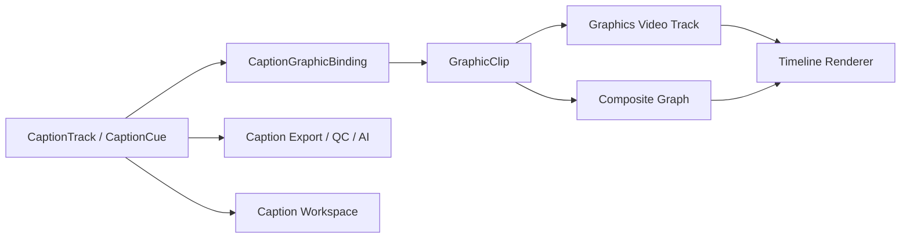

# 字幕图形片段与合成系统融合实施计划

**文档状态：** 实施规划版
**制定日期：** 2026-08-10
**适用范围：** Edit 页面字幕轨道、视频/图形轨道、Composite 页面、字幕导入导出、AI Assistant
**目标：** 在不破坏专业字幕编辑与交付能力的前提下，引入可转场、可加滤镜、可进入合成页面继续编辑的字幕图形片段。

---

## 1. 产品结论

字幕图形片段不应替代字幕轨道，而应与字幕轨道形成“语义源 + 视觉表现”的双层架构：

```text
CaptionTrack / CaptionCue
        │ source_caption_id
        ▼
GraphicClip / CompositeClip
        │
        ├── 视频轨道或专用图形轨道
        ├── 转场、滤镜、遮罩、关键帧
        └── Composite 页面复杂节点与动画
```

字幕轨道继续负责：

- 文本、时间码、语言、角色和审校状态；
- 全局样式与自定义样式；
- SRT、VTT、ASS、TTML 等字幕交付；
- 字幕质检、翻译和 AI Assistant 操作。

图形片段负责：

- 逐字动画、打字机、弹跳、缩放、发光、粒子和 3D；
- 视频轨道上的转场、滤镜、遮罩和混合模式；
- Composite 页面中的 Fusion/节点图效果；
- 复杂字幕包装模板和品牌化视觉表现。

参考 DaVinci Resolve 的混合方式：专用字幕轨道仍负责字幕数据和交付，同时可以在字幕轨道上应用 Fusion Template；需要独立转场或复杂节点时，再使用 Text+/Fusion Title 类图形片段。参考：[DaVinci Resolve 20 New Features Guide](https://documents.blackmagicdesign.com/SupportNotes/DaVinci_Resolve_20_New_Features_Guide.pdf)、[DaVinci Resolve Edit](https://www.blackmagicdesign.com/products/davinciresolve/edit)。

---

## 2. 三种用户模式

| 模式 | 字幕轨道 | 图形/视频轨道 | 适用场景 | 是否可导出字幕文件 |
|---|---|---|---|---:|
| 普通字幕 | 保留并直接显示 | 无 | 对白、翻译、交付字幕、快速编辑 | 是 |
| 字幕轨道特效 | 保留并直接显示 | 不生成独立片段；轨道绑定模板 | 所有字幕统一应用同一套动画/风格 | 是 |
| 字幕图形片段 | 保留为隐藏或数据源 | 生成绑定字幕的图形/合成片段 | 独立转场、滤镜、粒子、3D、复杂合成 | 是，导出源字幕 |

### 2.1 显示策略

必须避免普通字幕和图形片段重复显示。每个字幕源增加显示策略：

```text
native      只显示字幕轨道
graphic     只显示图形片段
both        调试模式，允许同时显示
disabled    暂不显示，但保留数据
```

默认策略：

- 转换为图形片段后自动切换为 `graphic`；
- 删除图形片段时可选择恢复 `native`；
- 图形片段失效或合成节点缺失时，不静默显示空结果，应提示并允许回退到 `native`。

---

## 3. 目标架构



### 3.1 单一事实源

字幕文本和时间码必须继续以 `CaptionCue` 为事实源。图形片段不得复制一份无法追踪的文本和时间码。

图形片段可以缓存渲染结果，但不得成为字幕内容的唯一来源。项目重新打开、模板升级、字幕文本修改后，都必须能根据绑定关系重建图形片段。

### 3.2 推荐的轨道策略

第一阶段不立即把 `graphics` 作为全新的底层轨道类型，以减少对现有视频/音频/字幕轨道不变量、渲染和持久化的影响。

推荐先使用：

```text
track_type = "video"
track_role = "graphics"
```

它可以复用现有视频轨道的：

- ClipInstance 时间范围；
- 转场系统；
- 滤镜/Effekt 链；
- 混合模式和透明度；
- 视频轨道排序和渲染管线。

UI 上将其显示为“图形轨道”，后续如果 Composite/视频渲染边界需要，再迁移为显式 `graphics` 类型。迁移前必须保持旧项目可读。

---

## 4. 数据模型设计

### 4.1 `CaptionGraphicBinding`

建议新增字幕图形绑定模型：

```python
@dataclass(frozen=True)
class CaptionGraphicBinding:
    binding_id: str
    caption_track_id: str
    caption_cue_id: str | None
    graphic_clip_id: str
    composite_id: str | None = None
    template_id: str = ""
    display_mode: str = "graphic"
    sync_text: bool = True
    sync_timing: bool = True
    sync_style: bool = False
    materialization: str = "live"
    template_version: str = "1"
```

字段语义：

| 字段 | 说明 |
|---|---|
| `caption_track_id` | 来源字幕轨道 |
| `caption_cue_id` | 来源字幕片段；轨道模板模式可为空 |
| `graphic_clip_id` | 时间线图形片段 |
| `composite_id` | 对应 Composite 工程/图节点 |
| `template_id` | 图形模板或 Fusion 模板 |
| `sync_text` | 字幕文本变更是否同步到图形文本节点 |
| `sync_timing` | 字幕起止时间变更是否同步图形片段 |
| `sync_style` | 字幕基础样式是否同步到图形参数 |
| `materialization` | `live`、`cached`、`detached` |
| `template_version` | 模板升级和兼容判断 |

### 4.2 轨道级模板绑定

对于“字幕轨道全部使用同一种特效”，不应该为每条字幕立即创建一份完整合成图。新增轨道级模板引用：

```python
@dataclass(frozen=True)
class CaptionTrackGraphicStyle:
    template_id: str
    template_version: str
    parameters: dict[str, Any]
    enabled: bool = True
    fallback_to_native: bool = True
```

渲染时根据当前字幕 cue 的文本和时间，将 cue 作为模板输入。只有用户要求单条字幕独立转场或独立复杂动画时，才物化为 `GraphicClip`。

### 4.3 项目持久化

建议新增项目数据块：

```json
{
  "caption_graphics_schema_version": 1,
  "caption_graphic_bindings": [],
  "caption_track_graphic_styles": [],
  "composite_templates": []
}
```

约束：

- 不保存模型 secret、绝对路径或不可重建缓存；
- 保留未知字段；
- 模板缺失时保留绑定，不静默删除图形片段；
- 项目打开时执行 schema migration；
- 绑定关系进入项目 revision、undo/redo 和 autosave。

---

## 5. 核心用户流程

### 5.1 单条字幕转换为图形片段

1. 用户右键字幕片段，选择“转换为字幕图形片段”；
2. 选择模板或“进入 Composite 编辑”；
3. 系统创建/复用图形轨道；
4. 生成 `GraphicClip` 和 `CaptionGraphicBinding`；
5. 自动将来源字幕切换为 `graphic` 显示；
6. 图形片段进入普通视频类渲染、转场和滤镜流程；
7. 用户可在 Edit 页面编辑时间，在 Composite 页面编辑效果。

### 5.2 全部字幕应用轨道模板

1. 用户在字幕轨道头选择“应用字幕图形模板”；
2. 系统只写入轨道级模板引用；
3. 当前字幕轨道的所有 cue 使用模板渲染；
4. 新增字幕自动继承；
5. 单条字幕可勾选“独立图形片段”，升级为单 cue 绑定；
6. 移除模板时恢复原字幕样式，不删除字幕数据。

### 5.3 图形片段与字幕同步

| 用户动作 | 默认行为 |
|---|---|
| 修改字幕文本 | 同步更新图形文本节点 |
| 修改字幕起止时间 | 同步更新图形片段范围 |
| 修改字幕轨道默认样式 | 只同步设置了 `sync_style` 的绑定 |
| 修改单条自定义样式 | 不覆盖已独立编辑的图形参数 |
| 删除字幕 cue | 提示删除、保留或解除图形片段绑定 |
| 删除图形片段 | 字幕保留，并询问是否恢复 native 显示 |
| 模板缺失 | 显示诊断，按绑定设置回退 native |
| 手动移动图形片段 | 标记为 detached 或询问是否同步回字幕时间码 |

### 5.4 转换回普通字幕

提供“解除图形绑定”与“转换回普通字幕”两种动作：

- 解除绑定：保留图形片段，字幕不再自动同步；
- 转换回普通字幕：删除/隐藏图形片段，恢复字幕轨道显示；
- 用户手动确认后才破坏绑定，避免误操作。

---

## 6. Composite 页面接入方案

### 6.1 第一阶段：模板引用

字幕轨道只保存 `template_id + parameters`，Composite 页面提供模板编辑器：

- 文本输入节点；
- 字体/大小/颜色/描边/阴影；
- 入场/出场动画；
- 逐字/逐行动画策略；
- 发光、模糊、粒子等效果；
- 可发布参数；
- 模板版本号。

### 6.2 第二阶段：单条字幕 Composite 实例

当用户进入某个字幕图形片段的 Composite 页面时：

```text
CaptionCue 输入
   ├── text
   ├── start/end
   ├── word_timings
   ├── language
   └── style parameters
          ↓
Composite Graph
          ↓
Graphic Clip Output
```

Composite 图形实例必须区分：

- 由字幕绑定自动驱动的参数；
- 用户在 Composite 页面手动覆盖的参数；
- 模板公开参数；
- 不允许被字幕全局模式覆盖的参数。

### 6.3 第三阶段：图形片段转场与滤镜

图形片段使用视频类片段的通用效果能力：

- 入场/出场转场；
- Cross Dissolve、Dip、Wipe 等基础转场；
- Blur、Glow、Color、Sharpen 等滤镜；
- Transform、Crop、Opacity、Blend Mode；
- Composite 节点和关键帧。

字幕源数据不参与视频滤镜计算，避免普通字幕导出被视频特效污染。

---

## 7. 命令与提交边界

所有字幕图形操作必须走现有不可变模型、CommandStack、预览、审批和撤销体系。

建议新增命令：

| 命令 | 作用 | 撤销内容 |
|---|---|---|
| `CreateCaptionGraphicBindingCommand` | 创建绑定、图形片段和图形轨道 | 一次删除全部关联对象 |
| `UpdateCaptionGraphicBindingCommand` | 修改同步策略/模板参数 | 恢复旧绑定 |
| `PromoteSubtitleToGraphicCommand` | 单条或批量转换 | 恢复 native 显示并删除图形片段 |
| `DemoteGraphicToSubtitleCommand` | 转回普通字幕 | 恢复图形片段和绑定 |
| `ApplyCaptionTrackTemplateCommand` | 设置轨道级模板 | 恢复旧模板 |
| `DetachCaptionGraphicCommand` | 保留图形但解除同步 | 恢复绑定 |
| `SyncCaptionGraphicCommand` | 从字幕源同步文本/时间 | 恢复同步前状态 |

关键不变量：

1. 同一个 `caption_cue_id` 同一时间只能有一个 active graphic binding；
2. 同一个 `graphic_clip_id` 不能绑定多个不兼容字幕源；
3. 图形片段和字幕源的 project/timeline 必须一致；
4. 绑定删除、模板缺失和图形片段删除必须有明确诊断；
5. 一次批量转换只产生一个 MacroCommand 和一个 Undo；
6. preview 与 commit 必须使用同一份绑定解析结果；
7. 图形片段生成失败时不能留下半个绑定或空轨道。

---

## 8. AI Assistant 接入

AI Assistant 后续应通过受限 `EditPlan` 操作控制字幕图形，不直接操作 Composite 内部 JSON。

建议新增操作：

```text
PROMOTE_SUBTITLE_TO_GRAPHIC
APPLY_CAPTION_GRAPHIC_TEMPLATE
UPDATE_CAPTION_GRAPHIC_PARAMETERS
DETACH_CAPTION_GRAPHIC
DEMOTE_GRAPHIC_TO_SUBTITLE
```

AI 可以执行：

- “把所有字幕套用打字机模板”；
- “只把选中的三条字幕转换为图形片段”；
- “让第二条字幕进入 Composite 编辑”；
- “把所有字幕图形改成淡入淡出”；
- “解除当前字幕和图形片段的绑定”。

所有写入仍然必须经过：

```text
模型读取快照 → 生成 EditPlan → 预览 diff → 用户批准 → MacroCommand → Undo/刷新
```

AI 不允许：

- 直接修改节点图文件；
- 读取任意本机路径；
- 绕过用户批准创建大量图形片段；
- 删除字幕源后只保留不可导出的图形文本。

---

## 9. 分阶段实施计划表

### Phase 0：契约和风险收口

| 编号 | 工作包 | 主要模块 | 实施内容 | 验收门槛 |
|---|---|---|---|---|
| P0-1 | 绑定模型 | `src/features/edit/core/captions/`、项目 schema | 新增 `CaptionGraphicBinding`、轨道模板引用、schema version 和 migration | 旧项目可打开；新增字段可保存、重开、保留未知字段 |
| P0-2 | 显示策略 | 字幕 renderer、timeline view、program viewer | 实现 `native/graphic/both/disabled`，解决重复渲染 | native、graphic、both 四种状态有单测和 UI 验收 |
| P0-3 | 图形轨道决策 | timeline model、track UI | 先使用 `track_type=video + track_role=graphics`，明确所有渲染/持久化影响 | 普通视频轨道行为不回归；图形轨道可识别、可隐藏、可锁定 |
| P0-4 | 统一提交入口 | commands、edit service、timeline view | 所有绑定和图形片段创建都走 MacroCommand | 失败原子回滚；一次操作一次 Undo |

### Phase 1：最小可用字幕图形片段

| 编号 | 工作包 | 主要模块 | 实施内容 | 验收门槛 |
|---|---|---|---|---|
| P1-1 | 单条转换 | caption commands、timeline view | 右键“转换为字幕图形片段”，创建图形轨道/片段/绑定 | 一条字幕可完成转换、预览、保存、重开、撤销 |
| P1-2 | 基础模板 | template registry、graphic renderer | 实现淡入淡出、打字机、缩放弹出、基础描边/阴影模板 | 模板参数可编辑；文本和时间码同步 |
| P1-3 | 同步引擎 | caption service | 文本/时间/样式同步；支持 sync flags 和 detached 状态 | 修改源字幕后图形片段不漂移、不重复显示 |
| P1-4 | 转回普通字幕 | timeline UI、commands | 解除绑定、转换回普通字幕、删除图形片段后的恢复提示 | 不丢失字幕文本、时间码和样式 |

### Phase 2：轨道级字幕特效

| 编号 | 工作包 | 主要模块 | 实施内容 | 验收门槛 |
|---|---|---|---|---|
| P2-1 | 轨道模板引用 | caption track model、template registry | 字幕轨道头应用模板，不立即复制每条图形片段 | 1000 条字幕使用模板时内存和打开时间可接受 |
| P2-2 | 全局/自定义模式 | caption style resolver | 全局模板作用于继承字幕；自定义字幕不被覆盖 | 自定义模式的文字、位置、参数保持独立 |
| P2-3 | 批量应用/移除 | MacroCommand、workspace | 批量应用模板、替换模板、移除模板 | 一次批量操作一次撤销；锁定项有明确提示 |
| P2-4 | 模板参数面板 | subtitle workspace、inspector | 模板参数、预设、关键帧入口和恢复默认 | 参数修改预览与最终输出一致 |

### Phase 3：视频轨道能力

| 编号 | 工作包 | 主要模块 | 实施内容 | 验收门槛 |
|---|---|---|---|---|
| P3-1 | 转场 | video transition pipeline | 图形片段复用视频转场 | 淡入、淡出、交叉溶解和边界时长正确 |
| P3-2 | 滤镜和混合 | effect registry、video render | 支持图形片段滤镜、透明度、混合模式 | 不影响字幕 sidecar 导出；预览/导出一致 |
| P3-3 | 图形轨道交互 | timeline UI | 轨道头、锁定、隐藏、选择、复制、移动、剪切、吸附 | 图形轨道与普通视频轨道交互一致 |
| P3-4 | 片段级绑定 | binding service | 单条字幕可独立覆盖轨道模板 | 一条字幕可独立动画，其他字幕不受影响 |

### Phase 4：Composite 页面融合

| 编号 | 工作包 | 主要模块 | 实施内容 | 验收门槛 |
|---|---|---|---|---|
| P4-1 | Composite 输入适配 | composite graph、caption adapter | 将 text、time、word timings、style 暴露为受控输入 | 节点图可以读取字幕源且不复制源数据 |
| P4-2 | 进入 Composite | Edit/Composite controller | 从图形片段或模板进入对应 Composite 实例 | 进入后选中正确实例和当前字幕 |
| P4-3 | 参数同步边界 | binding/service | 区分自动同步参数和手动覆盖参数 | 手动覆盖不被后续全局同步覆盖 |
| P4-4 | 模板发布 | composite template registry | 发布模板、版本、兼容检查、缺失模板诊断 | 模板升级不破坏已有实例；旧版本可回退 |
| P4-5 | 复杂效果 | Fusion/NodeGraph | 粒子、3D、遮罩、追踪、复杂动画 | 预览、缓存、导出和项目重开均可恢复 |

### Phase 5：交付、AI 与性能

| 编号 | 工作包 | 主要模块 | 实施内容 | 验收门槛 |
|---|---|---|---|---|
| P5-1 | 字幕交付隔离 | export、deliver | 图形片段只影响视频成片；字幕源继续 sidecar 导出 | SRT/VTT/ASS 导出内容不含图形重复或丢失 |
| P5-2 | 字体和模板 preflight | delivery quality、font resolver | 检查缺字体、缺模板、失效 Composite、绑定断裂 | 阻断问题不能静默导出；报告可定位 |
| P5-3 | AI 操作 | AI schema、plan compiler、Assistant | 增加模板应用、转换、解绑、回退操作 | AI 只能生成预览计划；写入需审批和可撤销 |
| P5-4 | 大规模性能 | renderer、cache、workspace | 轨道模板优先；图形片段按需物化；缓存按模板/文本/样式/时基失效 | 1000 cue、4K、8 个活动图形不明显掉帧 |
| P5-5 | 项目兼容 | project migration | 补齐 v1 migration、损坏绑定恢复和诊断 | 旧项目零绑定打开正常；新项目往返无损 |

---

## 10. 测试与验收矩阵

### 10.1 数据和命令

- 绑定唯一性、跨项目引用、跨时间线引用；
- 模板缺失、Composite 缺失、图形片段删除；
- 创建/修改/解绑/转换回普通字幕的 Undo/Redo；
- 批量 1、10、100、1000 条字幕的原子性；
- 工程保存、重开、迁移、未知字段保留；
- 锁定字幕轨和锁定图形轨的失败回滚。

### 10.2 同步行为

- 改文本、改起止时间、改语言、改全局样式；
- 自定义字幕不被全局模板覆盖；
- detached 后源字幕修改不影响图形片段；
- graphic 模式不会重复显示 native 字幕；
- 模板缺失可以按策略回退 native。

### 10.3 视觉和渲染

- 1080p、4K、9:16、1:1、HDR；
- 24、23.976、25、29.97、30、59.94 fps；
- 透明度、预乘 alpha、颜色空间、字体 fallback；
- preview/export/Composite 三条路径 golden image 对比；
- 转场边界、片段首尾、播放头拖动和缓存失效。

### 10.4 交付

- native 字幕单独导出；
- graphic 模式仍可导出源字幕；
- burn-in 只显示一次；
- 缺模板、缺字体、断绑定时明确 warning/blocking；
- 项目中没有字幕源时，禁止生成不可导出的“孤立文字图形”。

---

## 11. 交付顺序与停止条件

建议按以下顺序合并，不跨阶段混合高风险改动：

1. P0：绑定模型、显示策略、持久化和原子命令；
2. P1：单条转换、同步和基础模板；
3. P2：轨道级模板与全局/自定义模式；
4. P3：转场、滤镜和图形轨道交互；
5. P4：Composite 页面融合；
6. P5：交付、AI、性能和迁移收尾。

每个阶段必须满足以下停止条件后才能进入下一阶段：

- 相关 focused tests 全部通过；
- preview 与 commit 使用相同的数据和命令；
- 保存/重开不丢绑定；
- 至少一次完整 Undo/Redo 验收；
- 失败、取消、模板缺失和锁定路径有明确反馈；
- 不影响现有字幕导入、编辑、质检和导出。

## 12. 第一批建议立即实施的任务

第一批不直接开始粒子或 3D，而是先完成以下 5 项：

1. 新增 `CaptionGraphicBinding` 和项目 migration；
2. 新增 `native/graphic/both/disabled` 显示状态；
3. 新增“单条字幕转换为图形片段”命令和右键入口；
4. 新增一个淡入淡出模板和一个打字机模板；
5. 实现文本/时间码同步、解除绑定和一次撤销。

完成这 5 项后，就能得到一个完整可用的字幕图形片段最小闭环，再继续接入视频转场、滤镜和 Composite 页面。

---

## 13. 本次实施记录（2026-08-10）

本次已完成第一批最小闭环，并把后续阶段的稳定契约接入现有系统：

- P0：完成 `CaptionGraphicBinding`、轨道级模板引用、schema migration、未知字段保留、四种显示策略，以及 `video + track_role=graphics` 轨道策略。
- P1：完成单条字幕转换、淡入淡出/打字机/缩放弹出模板、文本和时间同步、脱离绑定、转回普通字幕、删除与撤销恢复。
- P2：完成轨道模板的不可变命令、模板参数与缺失模板回退策略；模板采用惰性解析，不为每条 cue 复制图形片段。
- P3：图形片段复用现有 `ClipInstance` 视频轨道，因此沿用现有转场、滤镜、透明度、锁定、隐藏和时间线交互管线。
- P4：完成受控 Composite 字幕输入适配器，统一暴露 `text`、`start/end`、`word_timings`、`language` 和 `style`，图形节点不能反向改写字幕源。
- P5：完成 AI Assistant 的受限 `EditPlan` 操作、预览/提交/撤销接入，以及字幕源与视频图形渲染的交付隔离。

验证结果：字幕图形专项、字幕模型/命令/导出、Composite 图数据和 AI 编译回归测试均通过；具体测试命令和结果记录在提交说明中。粒子、3D、追踪等复杂 Composite 效果仍由现有节点系统负责，未在本批次新增专用模板实现。

## 14. 第二批实施记录（2026-08-10）

- P2：补齐轨道模板批量应用/移除命令、锁定项原子回滚、AI `track_ids` 批量编译，以及字幕轨道右键模板入口。
- P2/P4：补齐 `sync_text`、`sync_style` 的独立快照边界；关闭同步时图形不再跟随源 cue 的文字或样式变化，显式 Sync 命令可刷新快照。
- P2：Program Viewer 对轨道模板和 `both` 模式使用统一动画参数，预览端与导出端共享模板解析。
- P4：支持已有 Composite 实例的字幕图形右键进入，并完善模板发布/版本诊断能力。
- P5：增加字幕图形导出 preflight，检查来源 cue、图形片段、graphics 轨道、模板版本和 Composite 实例；工程重开时损坏绑定会保留在诊断字段而不是阻断旧项目打开。

## 15. 第三批实施记录（2026-08-10）

- P4：把受控字幕输入从适配器落到 Composite 运行时上下文；`TextNode` 可显式启用 `caption_input_enabled`，读取 `text/caption_cue_id/language`，不会写回字幕源。
- P4/P5：字幕运行时输入签名进入 Composite 节点缓存键，预览图形缓存同时包含字幕快照签名，换句或改文案不会复用旧纹理。
- P3：图形轨道头增加 `G1/G2` 角色标识与独立颜色；绑定图形片段跨轨移动时自动保留 graphics 轨道角色，禁止误移到普通视频/音频轨道。
- 验证：字幕图形、Composite 上下文/缓存、Comp Clip 预览/导出 focused tests 共 106 项通过；全量 Composite 回归中新增代码未引入失败，剩余失败为现有 UI/平台基线项。

## 16. 计划审计与剩余边界（2026-08-10）

- P3-3：补齐图形片段复制/粘贴的 detached 绑定。复制后的图形使用源 cue 快照，不再跟随原 cue；绑定仍受 graphics 轨道和唯一 active binding 约束。
- P4-2：修复“Open in Composite”按图形片段 ID 查找绑定的路径，并增加回归测试；已有 Composite 实例可从图形片段上下文正确打开。
- P4-5/P5：导出 preflight 现在扫描 Composite 图中的未知节点和 placeholder 节点，遇到未实现的粒子、追踪或其他占位节点会明确阻断并报告节点类型，不会静默输出缺效果成片。
- P4-1：TextNode 的受控字幕输入字段覆盖 text、caption_cue_id、start/end、language、word_timings 和 style，输入仍来自运行时快照而不是图 JSON。

审计结论：字幕图形集成链路（模型、轨道模板、转换/解绑、同步、复制、Composite 输入、预览/导出、AI、preflight、迁移）已闭环。粒子和运动追踪专用节点不是当前 Composite 节点库的既有能力；本计划已将其纳入明确的阻断诊断，但没有伪造“已实现”。若产品要求新增这两类基础节点，仍需单独的 Composite 节点开发计划。
