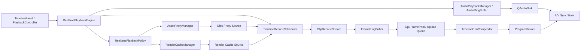

# Topos Color 专业 NLE 播放引擎实施规格书

日期：2026-06-14  
配套总计划：`docs/professional_nle_realtime_playback_optimization_plan.md`  
目标范围：Edit 页面时间线实时播放内核  
核心方向：`proxy/cache + decode scheduler + GPU compositor`

## 1. 规格书定位

上一份文档是路线图，负责回答“为什么慢、先做什么、怎么验收”。这份文档是工程实施规格书，负责回答“具体建哪些模块、放在哪些文件、API 怎么设计、状态怎么流转、哪些旧路径要删、每个阶段怎么提交”。

后续 AI 执行时，必须同时阅读两份文档：

- `docs/professional_nle_realtime_playback_optimization_plan.md`
- `docs/professional_nle_playback_engine_implementation_spec.md`

本规格书的首要原则：

- 不再继续围绕 `TimelinePreviewRenderer` 做小补丁。
- 不再把 `memory proxy` 当成专业代理。
- 不再让实时播放热路径 fallback 到 master。
- 不再在播放热路径同步打开文件、生成代理、随机 seek、CPU QImage 合成。
- 新架构必须以可观测、可测试、可逐阶段提交为边界。

## 2. 当前代码基线

现有相关模块：

| 模块 | 当前角色 | 新架构处理 |
|---|---|---|
| `src/features/edit/core/timeline_preview_renderer.py` | 当前 Edit 时间线预览主入口，混合了请求调度、解码、CPU 合成、QImage 发射 | 保留为过渡壳，逐步降级为 presentation coordinator |
| `src/features/edit/core/edit_playback_controller.py` | 播放控制器和播放时钟 | 保留，接入新的 realtime engine 状态 |
| `src/features/edit/core/edit_gpu_decode_manager.py` | GPU/planar 解码管理尝试 | 收敛为 decode scheduler 的后端之一 |
| `src/features/edit/core/edit_gpu_preview_renderer.py` | GPU 预览合成尝试 | 演进为 `TimelineGpuCompositor` 或被其包装 |
| `src/features/edit/core/render_cache.py` | Edit 渲染缓存模型 | 保留并扩展为 timeline render cache |
| `src/features/edit/core/render_cache_worker.py` | 渲染缓存后台 worker | 保留并接入缓存 manifest |
| `src/shared/media/disk_proxy_service.py` | 磁盘代理服务 | 保留，升级为资产级 proxy manager 的执行后端 |
| `src/shared/media/proxy.py` | proxy 配置/状态模型 | 保留，补齐 manifest 和策略 |
| `src/shared/media/proxy_manager.py` | 现有代理管理 | 优先演进，不要平行重复造同名职责 |
| `src/shared/video/frame_provider_service.py` | 当前同步按帧取帧服务 | 暂停/导出可继续使用；实时播放不再直接依赖其同步路径 |
| `src/shared/video/yuv_gpu_upload.py` | YUV/planar 上传和 shader | 复用到 GPU frame upload/pool |
| `src/shared/media/gpu_frame.py` / `gpu_frame_handle.py` | GPU frame 数据结构 | 统一为新的 frame handle 生命周期 |
| `src/features/edit/core/audio_playback.py` | 音频解码/混音/输出 | 修 leftover bug，增加 audio ring buffer |

重要判断：

- 如果现有模块已覆盖同一职责，优先演进现有模块，避免新旧两套系统并存。
- 如果现有模块职责混杂，允许新建更清晰的模块，然后逐步把旧调用迁移过去。
- Edit 实时播放新链路应尽量独立于 Color/Source Viewer 的旧播放系统。

## 3. 目标架构总览

目标数据流：



核心链路：

```text
播放 tick
  -> RealtimePlaybackEngine.request_present(frame, deadline)
  -> RealtimePlaybackPolicy.decide_sources(frame)
  -> TimelineDecodeScheduler.get_or_prepare_bundle(frame)
  -> ClipDecodeStream / FrameRingBuffer 返回 ready frames
  -> GpuFramePool 确保 GPU-resident frame
  -> TimelineGpuCompositor 合成
  -> ProgramViewer present
```

热路径禁止：

- `av.open()`
- 磁盘代理生成
- 同步 master fallback
- 多轨 CPU 串行 resize/blend
- QImage 作为实时播放主输出
- GL readback
- 不受控的 random seek

## 4. 新模块目录建议

为了减少对现有大文件继续堆补丁，建议新增一个 Edit 实时播放内核包：

```text
src/features/edit/core/realtime_playback/
    __init__.py
    engine.py
    policy.py
    types.py
    timeline_decode_scheduler.py
    clip_decode_stream.py
    frame_ring_buffer.py
    gpu_frame_pool.py
    timeline_gpu_compositor.py
    render_cache_adapter.py
    proxy_adapter.py
    telemetry.py
```

共享媒体层建议演进或新增：

```text
src/shared/media/
    proxy_manifest.py
    asset_proxy_manager.py
    render_cache_manifest.py

src/shared/video/
    realtime_frame_provider.py
```

注意：

- `asset_proxy_manager.py` 应包装/演进现有 `disk_proxy_service.py` 和 `proxy_manager.py`，不是复制一套代理系统。
- `timeline_gpu_compositor.py` 可以先包装现有 `edit_gpu_preview_renderer.py`，成熟后再迁移/合并。
- `realtime_frame_provider.py` 只做实时播放接口，不复用 `VideoFrameProviderService.request_frame()` 的 master fallback 语义。

## 5. 核心类型定义

建议文件：`src/features/edit/core/realtime_playback/types.py`

### 5.1 PlaybackMode

```python
from enum import Enum

class PlaybackMode(Enum):
    REALTIME = "realtime"
    PAUSED = "paused"
    SCRUB = "scrub"
    STEP = "step"
    EXPORT = "export"
```

语义：

| mode | 目标 | 是否允许 master | 是否允许等待 | 是否允许近似帧 |
|---|---|---:|---:|---:|
| `REALTIME` | 稳定播放 | 否 | 短暂 rebuffer | 否，miss 时 hold |
| `PAUSED` | 画质/准确 | 是 | 是 | 否 |
| `SCRUB` | 交互响应 | 可按策略 | 有短 timeout | 可用低质占位，但最终要 exact |
| `STEP` | 帧准确 | 是 | 是 | 否 |
| `EXPORT` | 最终质量 | 是 | 是 | 否 |

### 5.2 SourceKind

```python
class SourceKind(Enum):
    DISK_PROXY = "disk_proxy"
    RENDER_CACHE = "render_cache"
    MEMORY_PROXY = "memory_proxy"
    MASTER = "master"
    PLACEHOLDER = "placeholder"
    NONE = "none"
```

实时播放优先级：

```text
render_cache > disk_proxy > ready_gpu_cache > placeholder/hold
```

非实时优先级：

```text
master > render_cache > disk_proxy
```

注意：`MEMORY_PROXY` 只能作为临时过渡，不应作为专业实时主路径。

### 5.3 FrameIdentity

```python
@dataclass(frozen=True)
class FrameIdentity:
    timeline_id: str
    clip_id: str
    asset_id: str
    source_path: str
    source_frame: int
    source_kind: SourceKind
    proxy_key: str | None = None
    render_cache_key: str | None = None
```

要求：

- 缓存 key 必须包含 `clip_id`，避免同素材多 clip 共用 decode cursor。
- 代理文件可按 source path 共享，但 display stream 不能共享 cursor。

### 5.4 FrameHandle

```python
@dataclass
class FrameHandle:
    identity: FrameIdentity
    frame_index: int
    width: int
    height: int
    pixel_format: str
    bit_depth: int
    color_space: str | None
    pts_seconds: float
    source_kind: SourceKind
    payload: object
    payload_type: str  # "gpu_texture", "planar_yuv", "cpu_ndarray", "placeholder"
    exact: bool = True
    decode_ms: float = 0.0
```

要求：

- `exact=False` 的 frame 不能用于 paused/step/export。
- realtime 模式也不应该展示错误帧；miss 应 hold previous 或 rebuffer。
- `payload_type=cpu_ndarray` 不能成为 realtime 主路径。

### 5.5 LayerFrameBundle

```python
@dataclass
class LayerFrameBundle:
    timeline_frame: int
    generation_id: int
    layers: tuple[FrameHandle, ...]
    deadline_ns: int
    complete: bool
    miss_reason: str | None = None
```

语义：

- `complete=True` 才能提交 GPU compositor。
- `complete=False` 时 engine 选择 hold/rebuffer/placeholder。

## 6. RealtimePlaybackPolicy

建议文件：`src/features/edit/core/realtime_playback/policy.py`

职责：

- 根据播放模式、proxy 状态、render cache 状态、是否播放中，决定每个 layer 应该从哪里取帧。
- 明确禁止实时 master fallback。
- 输出可 trace 的决策结果。

核心 API：

```python
class RealtimePlaybackPolicy:
    def decide_layer_source(
        self,
        *,
        mode: PlaybackMode,
        asset_id: str,
        source_path: str,
        timeline_frame: int,
        source_frame: int,
        clip_id: str,
        requires_effect_cache: bool,
    ) -> SourceDecision:
        ...

    def should_rebuffer(self, miss: DecodeMiss) -> bool:
        ...

    def may_use_master(self, mode: PlaybackMode) -> bool:
        return mode in {PlaybackMode.PAUSED, PlaybackMode.SCRUB, PlaybackMode.STEP, PlaybackMode.EXPORT}
```

`SourceDecision`：

```python
@dataclass(frozen=True)
class SourceDecision:
    source_kind: SourceKind
    source_path: str | None
    proxy_info: object | None
    render_cache_info: object | None
    allow_blocking_decode: bool
    allow_master_fallback: bool
    max_wait_ms: int
    reason: str
```

实时规则：

| 条件 | 决策 |
|---|---|
| render cache ready | `RENDER_CACHE` |
| disk proxy ready | `DISK_PROXY` |
| disk proxy generating 且无 ready frame | `PLACEHOLDER` 或 `rebuffer` |
| disk proxy missing/failed | `PLACEHOLDER` + 发出 proxy required 状态 |
| memory proxy 仅过渡可用 | 可短期使用，但 trace 必须标红 |
| master only | realtime 不解 master，显示 placeholder/hold |

验收：

- 播放状态下 trace 中 `allow_master_fallback=False`。
- 播放状态下 `master_requests=0`。
- 如果没有 proxy/cache，画面不会蓝屏，而是明确进入 `proxy_generating` / `rebuffering` / `placeholder`。

## 7. AssetProxyManager

建议文件：

- `src/shared/media/asset_proxy_manager.py`
- `src/shared/media/proxy_manifest.py`

职责：

- 以资产/源文件为单位管理磁盘代理。
- 复用现有 `DiskProxyService` 的实际转码能力。
- 维护 proxy manifest，避免每个 timeline clip 重复生成。
- 给 realtime policy 提供快速查询，不阻塞播放热路径。

### 7.1 ProxyManifest

```python
@dataclass(frozen=True)
class ProxyManifestKey:
    source_path: str
    source_mtime_ns: int
    source_size: int
    codec_policy: str
    resolution_policy: str
    app_version: str

@dataclass
class ProxyManifestEntry:
    key: ProxyManifestKey
    status: ProxyStatus
    proxy_path: str | None
    width: int
    height: int
    codec: str
    pixel_format: str
    created_at: float
    updated_at: float
    progress: float = 0.0
    error: str | None = None
```

存储建议：

```text
.cache/video_proxy/manifest.json
.cache/video_proxy/<hash>/<proxy_file>.mov
```

### 7.2 AssetProxyManager API

```python
class AssetProxyManager(QObject):
    proxy_state_changed = pyqtSignal(str, object)  # source_path, ProxyManifestEntry

    def get_proxy_entry(self, source_path: str) -> ProxyManifestEntry | None:
        ...

    def ensure_proxy_async(
        self,
        *,
        source_path: str,
        asset_id: str,
        policy: ProxyBuildPolicy,
    ) -> ProxyManifestEntry:
        ...

    def open_proxy_source(self, entry: ProxyManifestEntry) -> MediaSource | None:
        ...

    def invalidate_proxy(self, source_path: str, reason: str) -> None:
        ...
```

### 7.3 ProxyBuildPolicy

```python
@dataclass(frozen=True)
class ProxyBuildPolicy:
    max_width: int = 1920
    max_height: int = 1080
    prefer_intraframe: bool = True
    codec_order: tuple[str, ...] = ("prores_proxy", "dnx_lb", "h264_intra")
    allow_long_gop: bool = False
    priority: int = 0
```

建议策略：

- 4K/6K/8K：默认 1/2 或 1/4，目标 1080p 或 720p preview。
- ProRes/DNxHR/H265/H264：统一生成低成本代理，不按原 codec 直接播放。
- 多轨实时：优先 intra 或低 GOP，避免 seek 放大。

必须避免：

- 不要在 `VideoFrameProviderService.open_clip()` 里自动启动重转码。
- 不要在 render worker 里调用 `generate_proxy()`。
- 不要为同一 source path 的每个 clip 生成重复 proxy。
- 不要把生成中 proxy 当 ready。

验收：

- 同一素材拖入两轨，只生成一个 proxy entry。
- proxy 查询不超过 1ms 级别。
- proxy 生成在后台低优先级队列执行。
- 播放中不会因 proxy 生成阻塞 renderer。

## 8. RenderCacheManager

建议文件：

- 演进 `src/features/edit/core/render_cache.py`
- 演进 `src/features/edit/core/render_cache_worker.py`
- 新增 `src/shared/media/render_cache_manifest.py` 或 `src/features/edit/core/realtime_playback/render_cache_adapter.py`

职责：

- 对复杂效果、Composite Clip、转场、调色栈输出建立可复用缓存。
- 实时播放优先读 render cache。
- 参数变化时准确失效。

### 8.1 RenderCacheKey

```python
@dataclass(frozen=True)
class RenderCacheKey:
    timeline_id: str
    clip_id: str
    asset_id: str
    source_path: str
    frame_rate_num: int
    frame_rate_den: int
    width: int
    height: int
    render_hash: str
    cache_version: int
```

`render_hash` 必须包含：

- clip source range
- speed/retime
- transform/crop/opacity
- effects
- composite graph id + graph version/hash
- color stack id + version/hash
- transition parameters
- proxy/render resolution

### 8.2 RenderCacheManager API

```python
class RenderCacheManager:
    def get_cache_entry(self, key: RenderCacheKey) -> RenderCacheEntry | None:
        ...

    def ensure_cache_async(
        self,
        key: RenderCacheKey,
        frame_range: range,
        priority: int,
    ) -> RenderCacheEntry:
        ...

    def open_cache_source(self, entry: RenderCacheEntry) -> MediaSource | None:
        ...

    def invalidate_by_clip(self, clip_id: str, reason: str) -> None:
        ...
```

### 8.3 缓存格式建议

第一阶段：

- image sequence 或 intra video。
- 以 1080p preview cache 起步。
- 每个 cache entry 有 manifest，不依赖猜文件名。

后续：

- 可增加 half-float / linear cache，用于更高质量预览。

必须避免：

- 不要将 render cache 和 proxy 混为一个状态。
- 不要没有 hash/version 就复用缓存。
- 不要播放时临时同步渲染 composite graph。

验收：

- Composite Clip 生成 cache 后播放不走 CPU graph。
- 修改效果参数后旧 cache 必须失效。
- cache ready 后 `RealtimePlaybackPolicy` 优先选择 `RENDER_CACHE`。

## 9. TimelineDecodeScheduler

建议文件：`src/features/edit/core/realtime_playback/timeline_decode_scheduler.py`

职责：

- 根据时间线 frame 和 render plan 计算各 layer source frame。
- 管理每个 clip 的 `ClipDecodeStream`。
- 预取未来帧。
- 提供 ready frame bundle 给 playback engine。
- 控制并发、背压、seek flush。

### 9.1 API

```python
class TimelineDecodeScheduler(QObject):
    bundle_ready = pyqtSignal(int, object)  # timeline_frame, LayerFrameBundle
    decode_miss = pyqtSignal(int, object)   # timeline_frame, DecodeMiss

    def configure(
        self,
        *,
        project: EditProject,
        sequence: TimelineSequence,
        proxy_manager: AssetProxyManager,
        render_cache_manager: RenderCacheManager,
    ) -> None:
        ...

    def prepare_window(
        self,
        *,
        center_frame: int,
        direction: int,
        radius_before: int,
        radius_after: int,
        mode: PlaybackMode,
    ) -> None:
        ...

    def request_bundle(
        self,
        *,
        timeline_frame: int,
        generation_id: int,
        deadline_ns: int,
        mode: PlaybackMode,
    ) -> LayerFrameBundle | None:
        ...

    def flush_seek(self, timeline_frame: int) -> None:
        ...

    def shutdown(self) -> None:
        ...
```

### 9.2 线程模型

建议：

```text
UI thread:
  PlaybackController / TimelinePreviewRenderer / ProgramViewer

Scheduler thread:
  TimelineDecodeScheduler queue, source decisions, stream coordination

Decode worker pool:
  ClipDecodeStream decode jobs

GL/render thread:
  GpuFramePool upload/wrap, TimelineGpuCompositor
```

规则：

- Decode worker 不能调用 OpenGL。
- GL thread 不能 `av.open()` 或阻塞转码。
- UI thread 不能同步等待 decode 超过极短 timeout。
- Scheduler 统一控制 prefetch，不能每个模块私自预取。

### 9.3 调度策略

播放方向为正向时：

```text
current frame: 必须尽快准备
lookahead: 8-30 frames，按素材/轨道数动态调整
lookbehind: 2-4 frames，用于短暂停顿/回退
```

多轨时：

- 每个 visible layer 都有 decode request。
- 被完全遮挡、opacity=0、track invisible 的 layer 不请求。
- 同一 source path 可共享 proxy file，但不能共享 display decode cursor。

deadline 策略：

- 25fps：每帧预算 40ms。
- request bundle 时如果 frame 不 ready，不能同步解 200ms。
- 返回 miss，由 engine hold/rebuffer。

必须避免：

- 不要在 scheduler 外部直接调用 `frame_provider.request_frame()`。
- 不要让 prebuffer 移动 display stream cursor。
- 不要无上限提交 decode futures。
- 不要在 pending 队列堆积旧帧，播放中只保留当前窗口。

验收：

- 播放中 frame bundle cache/ring hit 率 >95%。
- 大 seek 后旧 frame bundle 不会展示。
- 多轨解码并发有上限，CPU 不被打满。

## 10. ClipDecodeStream

建议文件：`src/features/edit/core/realtime_playback/clip_decode_stream.py`

职责：

- 一个 timeline clip 对应一个 display decode stream。
- 维护 source、decode cursor、ring buffer。
- 支持 disk proxy/render cache/master 按策略打开。
- 对 sequential playback 优先 `read_next_frame()`。

### 10.1 StreamKey

```python
@dataclass(frozen=True)
class StreamKey:
    timeline_id: str
    clip_id: str
    asset_id: str
    source_kind: SourceKind
    source_path: str
    target_width: int
    target_height: int
```

注意：

- `clip_id` 必须进入 key，保证同素材不同 clip 不共享 cursor。
- `source_path` 可以是 proxy/cache/master path。

### 10.2 API

```python
class ClipDecodeStream:
    def open_async(self) -> None:
        ...

    def is_ready(self) -> bool:
        ...

    def request_frame(
        self,
        source_frame: int,
        *,
        exact: bool,
        priority: int,
    ) -> None:
        ...

    def get_ready_frame(self, source_frame: int) -> FrameHandle | None:
        ...

    def prefetch_range(self, start: int, end: int, direction: int) -> None:
        ...

    def flush(self, reason: str) -> None:
        ...

    def close(self) -> None:
        ...
```

### 10.3 Decode 行为

顺序播放：

- 如果请求 `current + 1`，优先 `read_next_frame()`。
- 如果 ring buffer 已有，直接返回。
- 如果小范围 miss，可后台补解。

seek：

- 大跳变时 flush 当前 decode cursor。
- 重新 seek 到 keyframe 附近，预热当前窗口。
- 旧 generation 的结果必须丢弃。

错误帧：

- 如果 decoder 返回 `frame_index != requested`：
  - realtime：不展示，返回 miss/hold。
  - paused/step：不展示，继续 exact decode 或报错。

必须避免：

- 不要接受 adjacent frame 作为真实展示帧。
- 不要缓存错误 source frame。
- 不要在多个 timeline clip 之间共享 decode cursor。

## 11. FrameRingBuffer

建议文件：`src/features/edit/core/realtime_playback/frame_ring_buffer.py`

职责：

- 固定容量保存每个 stream 的 ready frames。
- 支持精确查找、窗口淘汰、seek flush。

### 11.1 API

```python
class FrameRingBuffer:
    def __init__(self, capacity: int) -> None:
        ...

    def put(self, frame: FrameHandle) -> None:
        ...

    def get_exact(self, source_frame: int) -> FrameHandle | None:
        ...

    def contains(self, source_frame: int) -> bool:
        ...

    def evict_outside_window(self, start: int, end: int) -> None:
        ...

    def clear(self, reason: str) -> None:
        ...

    def stats(self) -> dict[str, int | float]:
        ...
```

### 11.2 容量建议

初始值：

| 场景 | capacity |
|---|---:|
| 单轨 25fps | 32-64 frames |
| 双轨 25fps | 每 stream 24-48 frames |
| 4K proxy | 16-32 frames |
| scrub | 8-16 frames |

要求：

- 容量按 frame memory 和轨道数动态调节。
- 不要所有 clip 无限缓存。
- 统计 hit/miss/evict。

验收：

- 连续播放时 ring miss 应极低。
- seek 后旧窗口 frame 不再被展示。

## 12. GpuFramePool

建议文件：`src/features/edit/core/realtime_playback/gpu_frame_pool.py`

职责：

- 将 `FrameHandle` 的 payload 转成 GPU 可合成资源。
- 管理 GPU texture 生命周期。
- 复用现有 `src/shared/video/yuv_gpu_upload.py`。
- 支持外部 GPU texture、planar YUV、CPU ndarray fallback。

### 12.1 API

```python
class GpuFramePool(QObject):
    def ensure_gpu_frame(
        self,
        frame: FrameHandle,
        *,
        generation_id: int,
    ) -> GpuFrameHandle | None:
        ...

    def release_generation(self, generation_id: int) -> None:
        ...

    def collect_garbage(self) -> None:
        ...

    def shutdown(self) -> None:
        ...
```

### 12.2 GpuFrameHandle

```python
@dataclass
class GpuFrameHandle:
    identity: FrameIdentity
    texture_ids: tuple[int, ...]
    texture_type: str  # "rgb", "yuv420p", "yuv422p", "nv12", "external"
    width: int
    height: int
    bit_depth: int
    color_space: str | None
    generation_id: int
    release: Callable[[], None]
```

### 12.3 线程规则

- `ensure_gpu_frame()` 必须在 GL/render 线程执行。
- decode thread 只产出 CPU/planar/external handle，不直接创建 ModernGL texture。
- external texture 必须有明确 release 语义。

必须避免：

- 不要在 decode worker 调 ModernGL。
- 不要每帧创建大量 texture 后不释放。
- 不要 GPU readback 到 CPU 再上传。
- 不要把 QImage 作为 GPU pool 的中间格式。

验收：

- 播放中 GPU texture 数量稳定。
- 无持续增长的 VRAM/内存。
- 4K proxy planar 上传稳定，不发生每帧大额 Python bytes copy。

## 13. TimelineGpuCompositor

建议文件：`src/features/edit/core/realtime_playback/timeline_gpu_compositor.py`

实现选择：

- 第一阶段包装现有 `EditGpuPreviewRenderer`。
- 第二阶段把多轨合成 shader 和 task 数据结构收敛到该模块。

职责：

- 接收多个 layer 的 `GpuFrameHandle`。
- 执行 transform/crop/opacity/letterbox/YUV->RGB。
- 输出一个可由 ProgramViewer 直接显示的 GPU texture。

### 13.1 RenderTask

```python
@dataclass(frozen=True)
class TimelineGpuRenderTask:
    timeline_frame: int
    generation_id: int
    output_width: int
    output_height: int
    layers: tuple[GpuLayerInput, ...]
    color_management: dict[str, object]
    deadline_ns: int
```

```python
@dataclass(frozen=True)
class GpuLayerInput:
    clip_id: str
    track_index: int
    opacity: float
    transform: object
    crop: object
    frame: GpuFrameHandle
    blend_mode: str = "normal"
```

### 13.2 API

```python
class TimelineGpuCompositor(QObject):
    frame_ready = pyqtSignal(int, int, int, int, int)
    render_error = pyqtSignal(int, str)

    def submit(self, task: TimelineGpuRenderTask) -> bool:
        ...

    def reset_generation(self, generation_id: int) -> None:
        ...

    def shutdown(self) -> None:
        ...
```

`frame_ready` 参数：

```text
timeline_frame, generation_id, texture_id, width, height
```

### 13.3 GPU 合成规则

- layer 按 `track_index` 从小到大绘制。
- opacity 在 shader/blend state 处理。
- YUV/planar 纹理在 shader 中转换到 RGB。
- output FBO 尺寸使用 viewer fitted size 或 preview render size。
- 不在播放路径输出 QImage。

必须避免：

- 不要在 GPU compositor 内部请求解码。
- 不要 GPU miss 后自行 CPU fallback。
- 不要每个 layer 分别 present。
- 不要发生 GL readback。

验收：

- realtime trace 中 `render_path=gpu_composite`。
- `cpu_qimage_upload` 在播放模式为 0。
- 双轨代理播放不会进入 CPU `_composite_layers()`。

## 14. RealtimePlaybackEngine

建议文件：`src/features/edit/core/realtime_playback/engine.py`

职责：

- 新实时播放入口。
- 连接 PlaybackController、Policy、Scheduler、GpuFramePool、GpuCompositor、ProgramViewer。
- 处理 frame miss、hold previous、rebuffering、generation。

### 14.1 API

```python
class RealtimePlaybackEngine(QObject):
    frame_presented = pyqtSignal(int)
    state_changed = pyqtSignal(str)
    playback_warning = pyqtSignal(str, object)

    def configure(
        self,
        *,
        project: EditProject,
        sequence: TimelineSequence,
        viewer: object,
    ) -> None:
        ...

    def set_mode(self, mode: PlaybackMode) -> None:
        ...

    def request_present(self, timeline_frame: int, deadline_ns: int) -> None:
        ...

    def warmup(self, timeline_frame: int) -> None:
        ...

    def seek(self, timeline_frame: int) -> None:
        ...

    def shutdown(self) -> None:
        ...
```

### 14.2 状态机

```text
IDLE
  -> WARMING
  -> READY
  -> PLAYING
  -> REBUFFERING
  -> PLAYING
  -> PAUSED
  -> SHUTDOWN
```

状态含义：

| 状态 | 说明 | viewer 行为 |
|---|---|---|
| `IDLE` | 未配置 | no clip |
| `WARMING` | 预热 proxy/cache/decode | 显示缩略图/占位 |
| `READY` | 当前帧可显示 | 显示 ready frame |
| `PLAYING` | 实时播放 | 显示 GPU texture |
| `REBUFFERING` | 当前帧未准备好 | hold previous + 状态提示 |
| `PAUSED` | 暂停/逐帧 | 可请求 master exact |
| `SHUTDOWN` | 释放资源 | 不再发射 |

### 14.3 miss 策略

`REALTIME`：

1. 当前 frame bundle ready：提交 GPU。
2. 当前 bundle missing，但上一帧可用：hold previous，scheduler 继续补。
3. 连续 miss 超过阈值：进入 `REBUFFERING`，暂停推进或要求 controller defer tick。
4. proxy/cache missing：显示 placeholder + proxy required，不解 master。

`PAUSED/STEP`：

1. 请求 exact frame。
2. 可等待 master。
3. 不接受 wrong/adjacent frame。

必须避免：

- 不要播放时让 controller 无限前进而 viewer 慢慢追。
- 不要显示过期 generation 的 frame。
- 不要为了避免蓝屏显示错误 source frame。

验收：

- 拖入素材后 viewer 100ms 内有占位。
- 无 ready frame 时进入 rebuffer/hold，不蓝屏。
- 播放中 frame generation 单调，不回跳。

## 15. TimelinePreviewRenderer 迁移规则

当前 `TimelinePreviewRenderer` 太重，不能再继续扩展。迁移目标：

### 15.1 过渡阶段

`TimelinePreviewRenderer` 保留以下职责：

- 接收老的 `request_render(frame)`。
- 计算或转交 `TimelineRenderPlan`。
- 调用 `RealtimePlaybackEngine.request_present()`。
- 暂停/逐帧时可走 old exact path，直到新 exact path 完成。

必须移出：

- 实时播放中的 `_get_video_frame()`。
- 实时播放中的 `_composite_layers()`。
- 实时播放中的 QImage 输出。
- realtime proxy miss 后 master fallback。

### 15.2 删除或隔离点

后续 AI 应重点处理：

| 旧代码 | 处理 |
|---|---|
| `TimelinePreviewRenderer._get_video_frame()` | 仅保留 paused/exact fallback；实时禁用 |
| `TimelinePreviewRenderer._composite_layers()` | 仅保留 CPU fallback/测试；实时禁用 |
| `PreviewRenderWorker` | 不再承担实时播放 decode/composite |
| `VideoFrameProviderService.request_frame(proxy)` 自动 master fallback | 改为 mode-aware 或实时不调用 |
| `open_clip(... defer_memory_proxy=True)` 首帧热路径 | 移到 asset prepare/warmup |

验收：

- 播放中 trace 不出现 `_composite_layers()`。
- 播放中 trace 不出现 `VideoFrameProviderService.request_frame(master)`。
- `TimelinePreviewRenderer` 逐步变薄。

## 16. RealtimeFrameProvider

建议文件：`src/shared/video/realtime_frame_provider.py`

职责：

- 给实时播放提供无 master fallback 的取帧接口。
- 与 `VideoFrameProviderService` 区分语义。

API：

```python
class RealtimeFrameProvider:
    def open_stream(
        self,
        key: StreamKey,
        *,
        source_path: str,
        source_kind: SourceKind,
    ) -> ClipDecodeStream:
        ...

    def close_stream(self, key: StreamKey) -> None:
        ...

    def shutdown(self) -> None:
        ...
```

规则：

- realtime provider 不提供 `quality="auto"`。
- realtime provider 不 fallback master。
- source kind 由 policy 决定。

## 17. 音频实施规格

文件：`src/features/edit/core/audio_playback.py`

### 17.1 修 leftover samples

新增字段：

```python
self._sample_remainder: np.ndarray | None = None
```

`decode_next_samples(num_samples)` 新流程：

```text
1. 如果 remainder 有数据，先消费 remainder。
2. 不足再 demux/decode 新 audio frames。
3. 如果合并后超过 num_samples：
   - 返回前 num_samples。
   - 剩余保存到 _sample_remainder。
4. seek/close 时清空 _sample_remainder。
```

验收：

- 25fps/48kHz 下每帧输出 1920 samples。
- 60 帧丢失 samples = 0。
- seek 后不会播放旧 remainder。

### 17.2 AudioRingBuffer

后续新增：

```python
class AudioRingBuffer:
    def write(self, samples: np.ndarray) -> int: ...
    def read(self, num_samples: int) -> np.ndarray: ...
    def clear(self) -> None: ...
    def fill_level_ms(self) -> float: ...
```

目标：

- 音频混音提前进行。
- QAudioSink 写入附近不做重解码。
- underflow 可 trace。

必须避免：

- 不要每次 QAudioSink 需要数据时才 seek/decode。
- 不要为修漂移频繁重置音频设备。
- 不要丢 samples。

## 18. Telemetry 与 Benchmark

建议文件：

```text
src/features/edit/core/realtime_playback/telemetry.py
tools/benchmarks/bench_realtime_playback_engine.py
tools/benchmarks/bench_audio_continuity.py
tools/benchmarks/bench_proxy_cache_pipeline.py
```

### 18.1 PlaybackFrameTelemetry

```python
@dataclass
class PlaybackFrameTelemetry:
    timeline_frame: int
    generation_id: int
    mode: str
    source_kinds: tuple[str, ...]
    proxy_ready: bool
    render_cache_ready: bool
    ring_hit: bool
    decode_ms: float
    upload_ms: float
    composite_ms: float
    present_ms: float
    total_ms: float
    miss_reason: str | None
```

### 18.2 必须输出的 benchmark

每次阶段完成后至少输出：

```text
素材
轨道数
首帧 ms
平均 ms
p50/p95/max
有效 fps
source kind 统计
master requests
ring hit rate
gpu composite rate
audio dropped samples
audio drift ms
```

验收门槛沿用总计划：

- 播放中 master_requests = 0。
- 音频 dropped_samples = 0。
- 代理 ready 后 4K 单轨 >=25fps。
- 代理 ready 后双轨 >=25fps 或稳定 rebuffer。

## 19. 阶段化提交计划

每个阶段必须单独 commit。

### Stage A：规格与基线

范围：

- 新增 benchmark 脚本。
- 新增 telemetry 数据结构。
- 不改播放行为。

验收：

- 可以复现当前 2K/4K 单轨/双轨数据。

### Stage B：音频正确性

范围：

- 修 `AudioDecoder` leftover。
- 增加音频连续性测试。

验收：

- dropped samples = 0。
- 原有音频测试通过。

### Stage C：实时播放 policy

范围：

- 新增 `RealtimePlaybackPolicy`。
- 禁止播放中 master fallback。
- 未 ready 时 hold/placeholder/rebuffer。

验收：

- 播放 trace 中 master_requests = 0。
- 拖入时间线不蓝屏。

### Stage D：AssetProxyManager

范围：

- 建 proxy manifest。
- 代理生成移出 render hot path。
- 同源素材只生成一次。

验收：

- proxy generating/ready 状态正确。
- 生成期间播放不阻塞。

### Stage E：DecodeScheduler + RingBuffer

范围：

- 新增 scheduler、stream、ring buffer。
- 实时播放从 scheduler 取 ready bundle。

验收：

- ring hit rate >95%。
- 连续播放不每帧 seek。

### Stage F：GPU compositor 主路径

范围：

- 新增或包装 `TimelineGpuCompositor`。
- 实时播放输出 GPU texture。
- CPU QImage path 从实时播放移除。

验收：

- playback render_path = gpu_composite。
- 双轨 proxy 稳定接近/达到 25fps。

### Stage G：Render cache 接入

范围：

- render cache manifest。
- Composite Clip/效果优先读 cache。

验收：

- complex clip cache ready 后不实时 CPU 渲染。

### Stage H：删除旧旁路

范围：

- 删除/隔离旧实时播放入口。
- 加 regression test。

验收：

- Edit ProgramViewer 只有一条写入链路。

## 20. 测试矩阵

### 20.1 单元测试

| 测试 | 覆盖 |
|---|---|
| `test_audio_leftover_samples.py` | 音频不丢 remainder |
| `test_realtime_playback_policy.py` | 播放中不 master fallback |
| `test_proxy_manifest.py` | proxy key/status/stale |
| `test_frame_ring_buffer.py` | exact get/evict/flush |
| `test_clip_decode_stream.py` | cursor 隔离/seek flush |
| `test_timeline_decode_scheduler.py` | 多轨 bundle/prebuffer |
| `test_gpu_frame_pool.py` | texture lifecycle |
| `test_timeline_gpu_compositor.py` | layer order/generation |

### 20.2 集成测试

| 测试 | 覆盖 |
|---|---|
| `test_edit_realtime_no_master_fallback.py` | realtime trace 无 master |
| `test_edit_realtime_no_cpu_qimage.py` | realtime 不走 QImage |
| `test_edit_realtime_seek_generation.py` | seek 后旧帧丢弃 |
| `test_edit_realtime_multitrack_stream_isolation.py` | 多轨同素材 cursor 隔离 |
| `test_edit_proxy_ready_switch.py` | proxy ready 热切换 |
| `test_edit_render_cache_priority.py` | render cache 优先 |

### 20.3 性能测试

素材：

- `2K_h264.mp4`
- `4K_H264.mov`
- `4K_H265.mov`
- `4K_prores422HQ.mov`
- `4K_DNxHR HQX 12-bit.mov`

场景：

- 单轨播放
- 双轨播放
- proxy missing
- proxy generating
- proxy ready
- seek
- pause/step exact
- Composite Clip cache ready/missing
- 音频 10 分钟 drift

## 21. 旧代码删除清单

后续阶段完成后应删除或隔离：

| 旧行为 | 文件 | 处理 |
|---|---|---|
| realtime `_get_video_frame()` 同步解码 | `timeline_preview_renderer.py` | 移除实时调用 |
| proxy miss 后 master fallback | `timeline_preview_renderer.py` / `frame_provider_service.py` | mode-aware，realtime 禁止 |
| realtime CPU `_composite_layers()` | `timeline_preview_renderer.py` | 只保留 paused/exact fallback |
| realtime QImage emit | `timeline_preview_renderer.py` | 改 GPU texture present |
| `open_clip()` 触发 proxy generation | `frame_provider_service.py` | 移到 AssetProxyManager prepare queue |
| prebuffer 复用 display cursor | 相关 prefetch 逻辑 | 统一由 scheduler 管 |
| 多个旧 frame_ready 旁路 | `edit_page.py` / `file_controller.py` | regression test 防回归 |

## 22. 失败状态与 UI 行为

| 状态 | 内部原因 | UI 行为 | 是否解 master |
|---|---|---|---:|
| `proxy_missing` | 未生成 proxy | 显示缩略图 + generating | 否 |
| `proxy_generating` | 后台生成中 | 显示进度/上一帧 | 否 |
| `proxy_failed` | 转码失败 | 显示错误 + 可手动重试 | 否 |
| `decode_miss` | 当前帧未 ready | hold/rebuffer | 否 |
| `gpu_upload_miss` | GPU frame 未 ready | hold/rebuffer | 否 |
| `render_cache_missing` | 复杂效果未缓存 | 显示 cache pending | 否 |
| `paused_exact_decode` | 暂停请求高清 | 可等待 master | 是 |

原则：

- 实时播放不应该用 master 硬顶失败状态。
- 用户看到等待，应知道是在生成 proxy/cache，而不是蓝屏。

## 23. 后续 AI 执行模板

每个 AI 任务使用如下模板：

```text
请阅读：
- docs/professional_nle_realtime_playback_optimization_plan.md
- docs/professional_nle_playback_engine_implementation_spec.md

本次只实现 Stage X：[阶段名]。

约束：
- 不要改其它阶段。
- 不要新增平行播放链路。
- 不要在 realtime 热路径 fallback master。
- 不要在 decode thread 调 OpenGL。
- 不要使用 QImage 作为 realtime 主路径。
- 保留用户未提交改动，不要 revert。

完成后必须：
1. 说明改动文件；
2. 跑相关单元测试；
3. 跑真实素材 benchmark；
4. 对比优化前后数据；
5. 本地 git commit。
```

## 24. 第一批建议执行任务

最推荐第一批这样切：

1. `Stage A1`：新增 benchmark 脚本，固化当前性能数据。
2. `Stage B1`：修 audio leftover samples。
3. `Stage C1`：新增 `RealtimePlaybackPolicy`，不接 UI，只写测试。
4. `Stage C2`：让 `TimelinePreviewRenderer` 播放状态下禁止 master fallback，并显示 placeholder/hold。
5. `Stage D1`：整理 `DiskProxyService` 调用，建立 asset-level proxy manifest。
6. `Stage E1`：实现 `FrameRingBuffer` 和 `ClipDecodeStream` 单元测试。
7. `Stage E2`：接入 `TimelineDecodeScheduler`。
8. `Stage F1`：接入 GPU compositor 主路径。

这样拆的原因：

- 先让性能数据可复现。
- 先修确定的音频 bug。
- 再切断最大的视频错误路径：realtime master fallback。
- 最后逐步替换核心播放管线。

## 25. 关键验收断言

后续所有实现都要守住这些断言：

```text
assert realtime_master_requests == 0
assert realtime_cpu_qimage_frames == 0 after GPU stage
assert audio_dropped_samples == 0
assert wrong_source_frame_presented == 0
assert stale_generation_presented == 0
assert duplicate_proxy_jobs_for_same_source == 0
assert decode_thread_gl_calls == 0
assert render_thread_av_open_calls == 0
```

## 26. 最终形态

完成后，Edit 播放不再是：

```text
播放 tick -> request_render -> 同步取 proxy/master -> CPU 合成 -> QImage -> viewer
```

而应该是：

```text
素材准备 -> 代理/缓存后台 ready
播放 tick -> policy 决策 -> scheduler 取 ready bundle
-> GPU frame pool -> GPU compositor -> viewer present
-> audio ring buffer / A/V sync
```

这才是接近专业 NLE 的实时播放模型。
