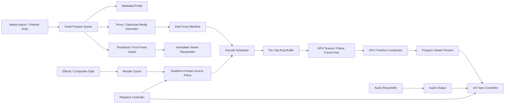

# Topos Color 专业 NLE 实时播放架构优化计划

日期：2026-06-14  
项目：Topos Color / Edit Timeline Playback  
测试 Python：`.venv/bin/python`  
测试素材目录：`tests/test_videos`

## 1. 目标

这份计划不是小修小补清单，而是一次播放架构重建计划。最终目标是让 Edit 页面时间线播放接近专业 NLE 的实时预览模型：

- 素材拖入时间线后不蓝屏，立即显示可用占位帧或已缓存帧。
- 播放线程不在热路径里打开大文件、生成代理、随机 seek 母版。
- 实时播放优先走已准备好的磁盘代理、解码环形缓冲、GPU 合成和渲染缓存。
- 多轨视频不靠串行 CPU 解码 + QImage 合成硬顶。
- 音频不丢样本、不爆音、不持续漂移。
- 暂停/逐帧保持帧准确，播放模式允许稳定的实时策略。

最终体验目标不是“任何母版都硬解实时”，而是专业 NLE 的模型：母版、代理、缓存、解码调度、GPU 合成、A/V 时钟共同工作。

## 2. 当前结论

当前播放问题主要不是 UI 层偶发 bug，也不是用户感知错误。实测显示：

- 完整时间线播放链路远低于 25fps 播放预算。
- 2K H.264 单轨完整时间线链路只有约 15.6fps，双轨约 9.4fps。
- 4K ProRes422HQ 单轨约 3.18fps，双轨约 2.28fps。
- 4K DNxHR HQX 单轨约 2.65fps，双轨约 1.80fps。
- 首帧打开和渲染可达 3-4 秒，足以造成蓝屏或等待。
- 音频每视频帧会丢 64/128 samples，60 帧会丢 158-192ms 音频，音画不同步和杂音是代码层面的必然结果。

现在已经收敛了多条 UI 播放链路互相抢帧的问题，但剩下这条主链路本身还不是专业 NLE 架构。它仍然会在实时路径里做昂贵的母版/内存代理解码、CPU 转换、CPU 多轨合成和 QImage 发射。

## 3. 测试环境与方法

测试命令均使用项目虚拟环境：

```bash
.venv/bin/python
```

素材目录：

```bash
tests/test_videos
```

测试覆盖了四层：

1. 原始 PyAV 顺序解码能力。
2. 原始 PyAV 随机 seek 单帧能力。
3. `VideoFrameProviderService.request_frame(quality="proxy")` 的真实耗时。
4. `TimelinePreviewRenderer` 完整时间线链路的真实耗时。
5. `AudioDecoder` / `AudioMixer` 的音频耗时与样本连续性。

## 4. 测试素材概况

| 素材 | 分辨率 | 编码 | 像素格式 | 帧率 | 码率/大小特征 |
|---|---:|---|---|---:|---|
| `2K_DNxHR HQX 12-bit.mov` | 1920x1080 | DNxHR HQX | yuv422p12le | 25fps | 约 658MB |
| `2K_H265.mov` | 1920x1080 | HEVC Main10 | yuv420p10le | 25fps | 约 30.5MB |
| `2K_h264.mp4` | 1920x1080 | H.264 High | yuv420p | 25fps | 约 50MB |
| `2K_prores422HQ.mov` | 1920x1080 | ProRes 422 HQ | yuv422p10le | 25fps | 约 495MB |
| `4K_DNxHR HQX 12-bit.mov` | 3840x2160 | DNxHR HQX | yuv422p12le | 25fps | 约 2.59GB |
| `4K_H264.mov` | 3840x2160 | H.264 High | yuv420p | 25fps | 约 51.25MB |
| `4K_H265.mov` | 3840x2160 | HEVC Main10 | yuv420p10le | 25fps | 约 36.68MB |
| `4K_prores422HQ.mov` | 3840x2160 | ProRes 422 HQ | yuv422p10le | 25fps | 约 2.54GB |

## 5. 原始 PyAV 顺序解码数据

这个测试绕过项目播放架构，只看 PyAV 直接顺序解码和 `to_ndarray(format="bgr24")` 的能力。

| 素材 | decode-only | decode + BGR | BGR 转换平均 |
|---|---:|---:|---:|
| 2K_DNxHR | 623fps | 114fps | 6.66ms |
| 2K_H265 | 271fps | 87.8fps | 7.08ms |
| 2K_h264 | 379fps | 221fps | 1.53ms |
| 2K_ProRes | 497fps | 111fps | 6.15ms |
| 4K_DNxHR | 159fps | 49.3fps | 13.89ms |
| 4K_H264 | 70fps | 54.1fps | 4.17ms |
| 4K_H265 | 112.7fps | 41.4fps | 15.64ms，最大 48.54ms |
| 4K_ProRes | 88.8fps | 43.0fps | 13.15ms |

结论：

- 原始顺序解码并没有慢到 2-7fps。
- 项目完整时间线链路比 PyAV 原始解码慢很多，说明主要瓶颈在项目播放/代理/合成链路，而不是单纯 codec 本身。
- 4K 10/12-bit 素材 CPU RGB 转换已经接近 25fps 预算的一半，不能作为多轨实时主路径。

## 6. 原始 PyAV 随机 seek 单帧数据

这个测试模拟“每一帧都 seek 再解一帧”的坏路径。

| 素材 | 平均单帧 seek+decode+BGR | 有效 fps |
|---|---:|---:|
| 2K_DNxHR | 13.57ms | 73.7fps |
| 2K_H265 | 26.06ms | 38fps |
| 2K_h264 | 6.33ms | 158fps |
| 2K_ProRes | 9.87ms | 101fps |
| 4K_DNxHR | 19.93ms | 50fps |
| 4K_H264 | 32.37ms | 30.9fps |
| 4K_H265 | 40.59ms | 24.64fps |
| 4K_ProRes | 25.62ms | 39fps |

结论：

- 长 GOP 素材如果播放时不断随机 seek，会直接接近或超过 25fps 预算。
- 专业 NLE 实时播放必须使用顺序解码、解码环形缓冲、预取和代理，不能每帧随机 seek。
- 这也解释了多轨和跳帧场景下画面前后抖动：多个解码 cursor/seek 竞争时，很容易错过展示时机。

## 7. VideoFrameProviderService 数据

### 7.1 刚打开素材后立即请求 proxy

测试方式：`open_clip(..., share_by_path=False, defer_memory_proxy=True)` 后立即请求 60 帧 `quality="proxy"`。

结果：所有文件刚打开时 `source_type_after_open = master_only`。4K 文件 `memory_proxy_pending_after_open=True`。

| 素材 | open_clip 耗时 | request proxy 平均 | p50 | p95 | 有效 fps |
|---|---:|---:|---:|---:|---:|
| 4K_DNxHR | 554ms | 172ms | 151ms | 404ms | 5.81fps |
| 4K_H264 | 752ms | 109.79ms | 87ms | 292ms | 9.11fps |
| 4K_H265 | 142ms | 162.53ms | 133ms | 270ms | 6.15fps |
| 4K_ProRes | 1272ms | 193.21ms | 165ms | 339ms | 5.18fps |
| 2K_DNxHR | - | 24.97ms | - | - | 40fps |
| 2K_H265 | - | 31.93ms | - | - | 31fps |
| 2K_h264 | - | 16.96ms | - | - | 59fps |
| 2K_ProRes | - | 47.98ms | - | - | 20.84fps |

结论：

- 时间线请求的是 proxy，但刚拖入时间线时实际经常是 master。
- `open_clip()` 本身会阻塞数百毫秒到 1.27 秒，这足以造成首帧蓝屏。
- 4K 素材的 `request_frame(proxy)` 实际只有 5-9fps，不能实时播放。

### 7.2 等待 memory proxy 打开后再请求 proxy

等待 `session.proxy_source` 出现后再请求 60 帧。

| 素材 | source_type_after_wait | 平均 | p50 | p95 | 有效 fps | 输出尺寸/格式 |
|---|---|---:|---:|---:|---:|---|
| 4K_ProRes | memory_proxy | 53.2ms | 41.76ms | 65.56ms | 18.8fps | 1920x1080 yuv422p10le |
| 4K_DNxHR | memory_proxy | 80.66ms | 69.24ms | 149.66ms | 12.4fps | 1920x1080 yuv422p12le |
| 4K_H265 | memory_proxy | 132.0ms | 108.45ms | 261.57ms | 7.58fps | 1920x1080 yuv420p10le |
| 4K_H264 | memory_proxy | 164.4ms | 158.43ms | 260.1ms | 6.08fps | 1920x1080 yuv420p |

结论：

- 当前 memory proxy 不是专业代理文件，而是“解原始文件并即时缩放”的降级源。
- memory proxy 仍然不够实时，尤其 4K H.264/H.265/ProRes/DNxHR 都不能稳定 25fps。
- 真正专业 NLE 需要磁盘代理或渲染缓存，不应该把 memory proxy 当主播放方案。

## 8. 完整 TimelinePreviewRenderer 数据

这个测试最接近用户在 Edit 页面看到的结果：走 `TimelinePreviewRenderer -> PreviewRenderWorker -> VideoFrameProviderService -> CPU composite -> QImage`。

| 素材 | 单轨首帧 | 单轨平均 | 单轨有效 fps | 双轨首帧 | 双轨平均 | 双轨有效 fps |
|---|---:|---:|---:|---:|---:|---:|
| 2K_h264 | 432ms | 64.2ms | 15.6fps | 217ms | 105.9ms | 9.4fps |
| 4K_H264 | 821ms | 140.7ms | 7.1fps | 1149ms | 236.2ms | 4.2fps |
| 4K_H265 | 2886ms | 330.3ms | 3.0fps | 2702ms | 424.2ms | 2.36fps |
| 4K_ProRes422HQ | 3448ms | 314.0ms | 3.18fps | 3272ms | 437.8ms | 2.28fps |
| 4K_DNxHR HQX | 4212ms | 377.7ms | 2.65fps | 3938ms | 554.4ms | 1.80fps |

结论：

- 一轨都播不动是事实，不是错觉。
- 双轨不是简单翻倍，而是会引发更严重的解码、缩放、混合、缓存和调度压力。
- 25fps 的单帧预算是 40ms；当前 4K 单轨常见 300ms 级，双轨可达 400-550ms 级，差距接近一个数量级。
- 这种情况下任何播放调度都只能“等待、卡住、丢帧或显示旧帧”，无法丝滑。

## 9. 音频测试数据

### 9.1 音频耗时

音频解码/混音本身不慢：

- 单轨音频解码多数平均 0.1-1.0ms。
- 双轨混音多数平均 0.2-2.2ms。
- 所以杂音不是 CPU 算不过来导致。

### 9.2 音频样本丢失

25fps / 48kHz 时，每视频帧需要：

```text
48000 / 25 = 1920 samples
```

真实素材音频 packet 多数是 1024 samples，H.264 mp4 首包可能是 960 samples。当前代码在 `AudioDecoder.decode_next_samples()` 中会：

1. 连续解 packet，直到 collected_count >= num_samples。
2. 如果超过 `num_samples`，直接截断。
3. 没有把剩余 samples 保存到下一次调用。

实测丢失：

| 素材类型 | 每视频帧丢失 | 60 帧丢失 | 60 帧丢失时间 |
|---|---:|---:|---:|
| 大多数 PCM / MOV | 128 samples | 9216 samples | 192ms |
| 2K_h264.mp4 AAC | 64/128 samples | 7616 samples | 158.67ms |

结论：

- 音频杂音、断裂、音画漂移有明确代码根因。
- 即使视频不卡，音频也会因丢 samples 逐步错位。
- 视频卡顿会进一步放大音画不同步。

## 10. 当前关键瓶颈代码位置

### 10.1 实时路径 fallback 到 master

文件：`src/features/edit/core/timeline_preview_renderer.py`

- `_get_video_frame()` 中先请求 `proxy`，失败后请求 `master`。
- 实时播放时 master fallback 会把播放线程拖死。

文件：`src/shared/video/frame_provider_service.py`

- `request_frame()` 中 proxy 解码失败会自动 fallback 到 master。
- 对暂停/导出可能合理，对实时播放不合理。

### 10.2 memory proxy 不是磁盘代理

文件：`src/shared/video/frame_provider_service.py`

- `_open_clip_sources()` 里 memory proxy 只是 `MediaSourceFactory.create(path=原文件, target_size=proxy_size)`。
- 它仍然读取原始素材，只是即时缩放。
- 这不是专业 NLE 的 lightweight proxy。

### 10.3 多轨 CPU 串行合成

文件：`src/features/edit/core/timeline_preview_renderer.py`

- `_composite_layers()` 按 track 顺序逐层 `_get_layer_frame()`。
- 每层都会触发解码、转换、resize、alpha blend。
- 双轨/多轨性能线性恶化。

### 10.4 首帧打开链路阻塞

文件：`src/features/edit/core/timeline_preview_renderer.py`

- `_get_or_open_clip_id()` 在首次渲染时调用 `frame_provider.open_clip()`。

文件：`src/shared/video/frame_provider_service.py`

- `open_clip()` 会查询/触发 DiskProxyService，再同步打开 master source。
- 这不应该发生在第一帧渲染热路径里。

### 10.5 音频截断丢样本

文件：`src/features/edit/core/audio_playback.py`

- `decode_next_samples()` 合并后直接截断多余 samples。
- 没有 leftover buffer。

## 11. 专业 NLE 目标架构

目标数据流：



核心原则：

- 实时播放热路径只做“拿已准备好的帧、提交 GPU、按时展示”。
- 文件打开、代理生成、重采样、缓存生成不能阻塞播放 tick。
- 代理是资产级、持久化、可复用，不是 per clip 临时解原片。
- 播放模式和暂停/逐帧模式要分离策略。
- 音频样本流必须连续，不能按视频帧粗暴切包。

## 12. 分阶段重构计划

### Phase 0：建立性能基线和可观测性

目标：每次优化都能用真实数据验证，避免继续靠感觉改。

实施内容：

| 任务 | 文件/模块 | 方案 | 验证 |
|---|---|---|---|
| 增加真实素材 benchmark 脚本 | `tools/benchmarks/` | 固化本次测试：PyAV decode、seek、FrameProvider、TimelineRenderer、AudioDecoder | 一条命令输出 JSON/Markdown 报告 |
| 完善帧级 trace | `playback_frame_trace` / renderer / provider | 记录 source_type、decode_ms、convert_ms、resize_ms、composite_ms、qimage_ms、upload_ms、cache_hit、proxy_state | 每帧能定位耗时在哪一段 |
| 增加 A/V trace | audio playback | 记录 requested_samples、decoded_samples、leftover_samples、dropped_samples、audio_clock、video_frame | 10 分钟播放 drift 可量化 |
| 建立性能门槛 | CI 或手动脚本 | 保存目标阈值：单轨/双轨/首帧/音频 drift | 每次 AI 修改后先跑 benchmark |

完成标准：

- `tests/test_videos` 可一键输出性能报告。
- 任何一次修改都能比较修改前后差异。
- 不再用“感觉变快了”作为验收。

必须避免：

- 不要只跑 unit test 就认为播放性能好了。
- 不要只测 2K H.264。
- 不要只测底层 PyAV，必须测完整时间线 renderer。

### Phase 1：先修音频正确性

目标：消除音频样本丢失、杂音、断裂和长期漂移。

实施内容：

| 任务 | 文件/模块 | 方案 | 验证 |
|---|---|---|---|
| 增加 leftover sample buffer | `AudioDecoder` | 新增 `_sample_remainder`，每次先消费 remainder，多余样本保留到下一次 | 60 帧丢失 samples = 0 |
| seek 时清空 remainder | `seek_to_time()` / `seek_to_frame()` | seek 后 flush resampler + 清空 leftover | seek 后无旧音频污染 |
| 重采样后仍保证目标 samples | `_resample_audio` 调用后 | 不足补零或继续读取，多余保留 | 每次输出 samples 精确匹配 |
| 增加音频连续性测试 | `tests/edit/test_audio_playback.py` | 模拟 1024 packet -> 1920 chunk，验证不丢 128 samples | 测试覆盖 AAC/PCM |
| 增加长时间 drift 测试 | benchmark | 10 分钟理论 samples 和实际写入 samples 差异 | drift < 1ms |

完成标准：

- 任何 25fps/48kHz 素材不再每帧丢 128 samples。
- 播放 10 分钟音频 sample count 无持续漂移。
- seek、暂停、恢复后无爆音。

必须避免：

- 不要用简单 `result[..., :num_samples]` 丢掉尾巴。
- 不要每帧 flush resampler。
- 不要把音频按视频帧当作 packet 边界。
- 不要用硬削波解决杂音，先保证样本连续。

### Phase 2：拆出实时播放源选择策略

目标：实时播放期间禁止自动落回母版解码。

实施内容：

| 任务 | 文件/模块 | 方案 | 验证 |
|---|---|---|---|
| 新增 `RealtimePreviewSourcePolicy` | edit playback / frame provider | 区分 playback、paused、scrub、export 四种模式 | trace 显示 mode 和 source policy |
| 禁止实时 master fallback | `TimelinePreviewRenderer._get_video_frame` / `VideoFrameProviderService.request_frame` | playback 模式 proxy miss 时返回 miss/hold，不同步解 master | 播放 trace 中 master_requests=0 |
| 暂停/逐帧允许 master | 同上 | paused/scrub 可以精确请求 master | 暂停逐帧仍清晰准确 |
| 未 ready 时显示占位 | ProgramViewer / renderer | 用缩略图、上一帧、代理生成进度，不蓝屏 | 拖入时间线 100ms 内有画面 |
| 首帧打开移出热路径 | asset prepare queue | timeline drop 后异步 open/probe/warmup | renderer 首帧不直接 open_clip |

完成标准：

- 播放中 `request_frame(proxy)` 不再同步 fallback master。
- 未准备好时显示稳定占位/上一帧，不蓝屏。
- 首帧渲染不再承担 `open_clip()` 的 0.5-4s 成本。

必须避免：

- 不要为了“避免黑屏”在播放热路径里解母版。
- 不要把 placeholder 当真实帧写入帧缓存。
- 不要让播放 controller 继续跑远，然后 renderer 追墙钟跳帧。

### Phase 3：实现真正磁盘代理 / Optimized Media

目标：把 memory proxy 从主播放方案降级为应急方案，建立资产级磁盘代理。

实施内容：

| 任务 | 文件/模块 | 方案 | 验证 |
|---|---|---|---|
| 资产级 Proxy Manifest | `src/shared/media/proxy.py` / project schema | 每个 source file 一个 proxy key，记录路径、分辨率、codec、mtime、size、status | 同一素材多 clip 只生成一次 |
| 后台代理生成队列 | `DiskProxyService` | 独立 worker，低优先级，不在 render worker 执行 | 拖入时间线不卡 UI |
| 代理格式策略 | proxy config | ProRes Proxy / ProRes LT / DNxLB / H.264 intraframe 选择；优先 intra、低解码成本 | proxy decode >= 60fps 单轨 |
| 代理分辨率策略 | proxy config | 4K 默认 1/2 或 1/4，2K 可按 viewport 决策 | 1080p preview 稳定 |
| 代理完成热切换 | frame provider | proxy ready 后清空旧 proxy cache，切换 disk_proxy_source | source_type 从 generating 到 disk_proxy |
| UI 状态 | ProgramViewer / timeline clip | 显示 proxy generating/ready/fallback 状态 | 用户知道为何等待 |

完成标准：

- 4K ProRes/DNxHR/H265 走磁盘代理后单轨稳定 >=25fps。
- 双轨代理播放稳定 >=25fps 或有明确 cache/rebuffer 策略。
- 代理生成不会重复、不会在播放热路径启动重任务。

必须避免：

- 不要把 `MediaSource(target_size=...)` 命名成专业 proxy。
- 不要每个 timeline clip 都生成一份 proxy。
- 不要在 `open_clip()` 或 render worker 中直接启动高 CPU/IO 转码。
- 不要用长 GOP H.264 作为唯一代理格式；多轨编辑更适合 intra 或低 GOP。

### Phase 4：解码调度器与环形缓冲

目标：从“请求一帧解一帧”改成“顺序预解码 + ready frame 队列”。

实施内容：

| 任务 | 文件/模块 | 方案 | 验证 |
|---|---|---|---|
| 新增 `TimelineDecodeScheduler` | edit core | 按 timeline frame 生成各 layer source frame 请求 | 单一入口调度所有 layer |
| 每 clip 解码环形缓冲 | shared media/video | 每个 timeline clip 一个 display stream，缓存当前帧前后 N 帧 | 播放 cache hit >95% |
| 顺序 decode 优先 | decode source | 连续播放时 read_next_frame，不每帧 seek | seek 次数显著下降 |
| seek 策略 | scheduler | 大跳变 flush ring，重新 warmup | seek 后不会显示旧帧 |
| bounded prefetch | scheduler | 预取 8-30 帧，受内存/轨道数限制 | 无内存暴涨 |
| 解码线程池隔离 | scheduler | 每轨/每素材有限并发，避免 CPU 过载 | 多轨不会把系统打满 |

完成标准：

- 播放中大多数帧来自 ring buffer，而不是同步解码。
- 长 GOP 素材播放不再每帧随机 seek。
- 多轨解码有上限、有背压、有丢弃策略。

必须避免：

- 不要让 prebuffer 复用 display decoder cursor 导致画面错帧。
- 不要无限制并发解码，多轨会把 CPU 和磁盘打爆。
- 不要让缓存只保留 16 帧却指望稳定多轨播放。
- 不要接受错误 source frame 作为“差不多”；暂停/逐帧必须 exact。

### Phase 5：GPU-first 预览合成管线

目标：实时播放不再走 CPU RGB + QImage 主路径。

实施内容：

| 任务 | 文件/模块 | 方案 | 验证 |
|---|---|---|---|
| 统一 GPU frame 类型 | `edit_gpu_decode_manager` / media frame | 支持 GPU texture、planar YUV、CPU fallback 明确标记 | trace 显示 frame_type |
| YUV/planar shader 转换 | `edit_gpu_preview_renderer` | ProRes/DNxHR/H264/H265 尽量保持 planar 到 GPU shader 转 RGB | CPU BGR 转换显著减少 |
| GPU 多轨合成 | `EditGpuPreviewRenderer` | 所有 layer 作为纹理提交，opacity/transform/crop 在 shader 做 | CPU composite_ms 接近 0 |
| CPU fallback 限制 | renderer policy | 播放中 GPU miss 后 hold/rebuffer，不进慢 CPU fallback | playback 无 QImage path |
| ProgramViewer 直接显示 texture | ProgramViewer | 避免 QImage copy / CPU upload | present path 稳定 |

完成标准：

- 实时播放 trace 中 `render_path=gpu_composite`。
- 播放中不出现 `cpu_qimage_upload`。
- 1080p proxy 2-4 轨 GPU 合成稳定 25fps。

必须避免：

- 不要在 GPU 管线准备失败时立刻 CPU fallback 解母版。
- 不要把每帧转成 QImage 再交给 viewer。
- 不要在 GPU 路径里又偷偷 readback 到 CPU。

### Phase 6：时间线渲染缓存

目标：复杂效果、Composite Clip、转场不实时硬算。

实施内容：

| 任务 | 文件/模块 | 方案 | 验证 |
|---|---|---|---|
| Render Cache Manifest | edit/render cache | 按 clip/effect/transform/hash/fps/resolution 建缓存 key | 修改参数后正确失效 |
| 缓存格式 | cache writer | 代理分辨率 image sequence 或 intra video | 解码成本低 |
| Composite Clip 缓存 | composite bridge | comp clip 首次后台渲染缓存，播放读缓存 | comp clip 播放不掉帧 |
| 转场缓存 | timeline render plan | 复杂转场可后台缓存 | 转场播放稳定 |
| UI 状态 | timeline / viewer | 显示 render cache pending/ready | 用户可理解等待 |

完成标准：

- 开启效果/Composite Clip 后播放不会回到 2fps。
- 缓存 ready 后实时播放走 cache，不重新计算 graph。

必须避免：

- 不要在播放帧回调里实时渲染复杂 composite graph。
- 不要缓存没有 hash/version，容易显示旧画面。
- 不要把 render cache 和 proxy cache 混成一套状态。

### Phase 7：A/V 同步与播放模式

目标：音频连续，视频稳定，不用跳来跳去追时间。

实施内容：

| 任务 | 文件/模块 | 方案 | 验证 |
|---|---|---|---|
| 明确播放模式 | playback controller | `frame_accurate`、`realtime_best_effort`、`rebuffering` | 状态可 trace |
| 音频 ring buffer | audio playback | 音频提前混音到 ring，不在设备回调附近做重活 | 无 underflow |
| 视频 present queue | renderer | 已准备帧按 PTS 展示，miss 时 hold/rebuffer | 不前后抖动 |
| drift 监控 | synchronizer | 记录 audio_clock - video_pts | 10 分钟 drift <20ms |
| rebuffer 策略 | controller | proxy/cache 未 ready 时暂停推进或显示 buffering | 不让音频跑飞 |

完成标准：

- 正常播放音画误差稳定在 20ms 内。
- 视频 miss 时不会来回显示旧帧/新帧。
- 音频不会因视频卡顿持续错位。

必须避免：

- 不要让 audio 一直跑、video 慢慢追，结果必然失同步。
- 不要通过频繁 seek 音频来修视频卡顿。
- 不要用“丢很多视频帧”伪装流畅；剪辑软件需要可选的帧准确模式。

### Phase 8：多轨可扩展性

目标：多轨播放不是串行解码叠加灾难。

实施内容：

| 任务 | 文件/模块 | 方案 | 验证 |
|---|---|---|---|
| layer decode 并行但限流 | decode scheduler | 每帧多个 layer 并行取 ready frame，但总并发受控 | 双轨不再 2x-3x 恶化 |
| 可见性裁剪 | timeline render plan | invisible/muted/opacity 0/被遮挡 layer 不解码 | 减少无效工作 |
| 相同资产共享 proxy source | frame provider | proxy 文件共享，display cursor per clip 隔离 | 不重复打开重资源 |
| GPU blend 批处理 | GPU compositor | 多 layer 一次任务提交 | 减少调度开销 |

完成标准：

- 2 轨 1080p proxy 稳定 >=25fps。
- 4 轨 1080p proxy 可用，至少不死锁、不长时间冻结。

必须避免：

- 不要因为同素材共享一个 decode cursor 导致多轨互相 seek。
- 不要为了 cursor 隔离而每个 clip 重复打开昂贵资源。
- 不要无脑 parallel，CPU/IO 会雪崩。

### Phase 9：删除/隔离旧播放路径

目标：真正做减法，避免又回到多套系统互相拉扯。

实施内容：

| 任务 | 文件/模块 | 方案 | 验证 |
|---|---|---|---|
| 梳理旧播放入口 | `src/shared/video/video_playback.py` / edit page / file controller | 标记 Source Viewer、Color、Edit Timeline 各自入口 | 文档化调用图 |
| Edit 页面只保留一条入口 | edit page/file controller | `TimelinePanel -> PlaybackController -> TimelinePreviewRenderer -> ProgramViewer` | grep 无直接旁路 |
| 删除实时 master fallback | provider/renderer | realtime policy 统一控制 | trace 无 master fallback |
| 断言旧信号不更新 viewer | tests | legacy frame_ready 不直接 set_frame | regression test |

完成标准：

- Edit ProgramViewer 只有一个写入源。
- 所有 fallback 都可 trace、可配置，而不是隐藏发生。

必须避免：

- 不要新增第三条“临时快速播放路径”。
- 不要为了兼容旧工程保留会抢帧的旧链路。
- 不要让 Source Viewer 的优化影响 Edit Timeline 的帧调度。

### Phase 10：最终性能门槛

目标：用数字验收是否接近专业 NLE 模型。

建议门槛：

| 场景 | 目标 |
|---|---:|
| 拖入时间线后占位显示 | <100ms |
| 代理已 ready 的 4K 单轨播放 | >=25fps |
| 代理已 ready 的 4K 双轨播放 | >=25fps 或稳定 rebuffer 策略 |
| 2K H.264 单轨完整时间线 | >=25fps |
| 2K H.264 双轨完整时间线 | >=25fps |
| 音频 10 分钟 drift | <20ms，理想 <1ms sample count drift |
| 播放中 master_requests | 0 |
| 播放中 CPU QImage path | 0 或仅紧急 fallback |
| 逐帧/暂停 source frame | exact，不接受错帧 |
| 代理生成重复率 | 同一素材只生成一次 |

## 13. 推荐 AI 执行顺序

建议每完成一个阶段就单独提交一个本地 git 版本。

| 优先级 | 阶段 | 为什么先做 |
|---:|---|---|
| P0 | Phase 0 性能基线 | 没有基线会继续盲改 |
| P1 | Phase 1 音频正确性 | 明确代码 bug，收益确定 |
| P2 | Phase 2 实时源策略 | 立刻阻止播放热路径解母版 |
| P3 | Phase 3 真磁盘代理 | 解决蓝屏/首帧/4K 母版性能根因 |
| P4 | Phase 4 解码环形缓冲 | 解决逐帧 seek 和 cache miss |
| P5 | Phase 5 GPU-first 合成 | 解决多轨 CPU 合成瓶颈 |
| P6 | Phase 6 render cache | 解决效果/Composite Clip |
| P7 | Phase 7 A/V sync | 完成稳定播放体验 |
| P8 | Phase 8 多轨扩展 | 提升复杂时间线 |
| P9 | Phase 9 删除旧路径 | 防止架构再次发散 |
| P10 | Phase 10 性能门槛 | 持续防回退 |

## 14. AI 每次接任务必须带上的上下文

给后续 AI 的建议 prompt：

```text
项目：Topos Color，PyQt6 + ModernGL + GLSL。
目标：重构 Edit Timeline 专业 NLE 实时播放架构。
必须阅读 docs/professional_nle_realtime_playback_optimization_plan.md。
当前结论：完整 TimelinePreviewRenderer 低于实时预算；实时播放不能 fallback master；memory proxy 不是专业代理；音频 decode_next_samples 会丢 leftover samples。
本次只实现 Phase X，禁止顺手做其它阶段。
完成后必须：
1. 跑对应单元测试；
2. 跑 tools/benchmarks 的真实素材 benchmark；
3. 给出性能前后对比；
4. 只提交本阶段相关文件。
```

## 15. 最容易踩的坑清单

1. 把 memory proxy 当成专业代理。
2. 播放中 proxy miss 后偷偷解 master。
3. 每帧 seek 长 GOP 素材。
4. 多轨解码无限并发，导致 CPU/IO 雪崩。
5. prebuffer 和 display 解码共用 cursor，造成画面来回跳。
6. 播放中走 CPU RGB + QImage 主路径。
7. GPU fallback 失败后立刻进入慢 CPU fallback。
8. 音频多解出来的 samples 直接截断丢弃。
9. 用硬削波、音量缩放掩盖音频断裂。
10. 让音频一直跑、视频慢慢追，最后音画完全错位。
11. 为了“不黑屏”显示错误帧或旧异步帧。
12. 暂停/逐帧接受 adjacent frame，破坏帧准确。
13. 每个 timeline clip 单独生成磁盘代理。
14. 代理生成在 render worker 或 UI tick 中触发。
15. 没有性能基线，只凭肉眼判断是否变快。
16. 保留旧播放旁路，导致新架构和旧架构继续抢 viewer。
17. 把 Source Viewer、Color Page、Edit Timeline 的播放逻辑混成一套。
18. 只优化 2K H.264，不测 4K ProRes/DNxHR/H265。
19. 只测 decode-only，不测完整 TimelinePreviewRenderer。
20. 不记录 source_type，导致不知道到底在播 proxy 还是 master。

## 16. 验收方式

每一阶段完成后必须输出：

```text
阶段：
修改文件：
核心改动：
测试命令：
测试结果：
性能变化：
是否达到本阶段完成标准：
未解决风险：
下一阶段建议：
```

最终验收必须至少覆盖：

- `2K_h264.mp4`
- `4K_H264.mov`
- `4K_H265.mov`
- `4K_prores422HQ.mov`
- `4K_DNxHR HQX 12-bit.mov`
- 单轨、双轨、多轨
- 播放、暂停逐帧、seek、拖入时间线首帧
- 音频连续播放、seek 后恢复、长时间漂移

## 17. 一句话根因

当前 Edit 时间线播放不是一个真正的专业 NLE 实时播放模型。它已经减少了多链路互抢，但主链路仍在实时路径里做母版/内存代理解码、CPU 多轨合成和 QImage 发射；同时音频解码按视频帧取样时丢弃 leftover samples。要彻底解决，需要从“同步按帧请求”升级为“资产级代理 + 解码调度 + 环形缓冲 + GPU 合成 + 渲染缓存 + 正确 A/V 时钟”的底层架构。
