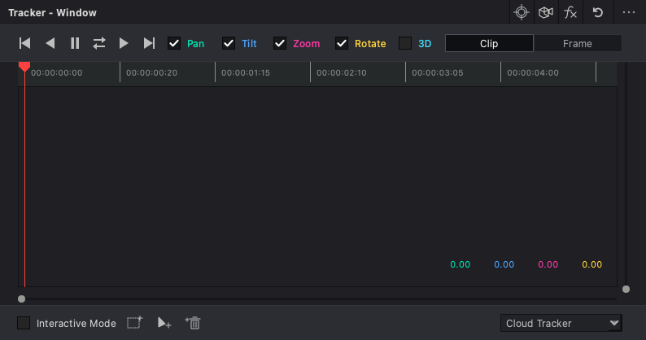
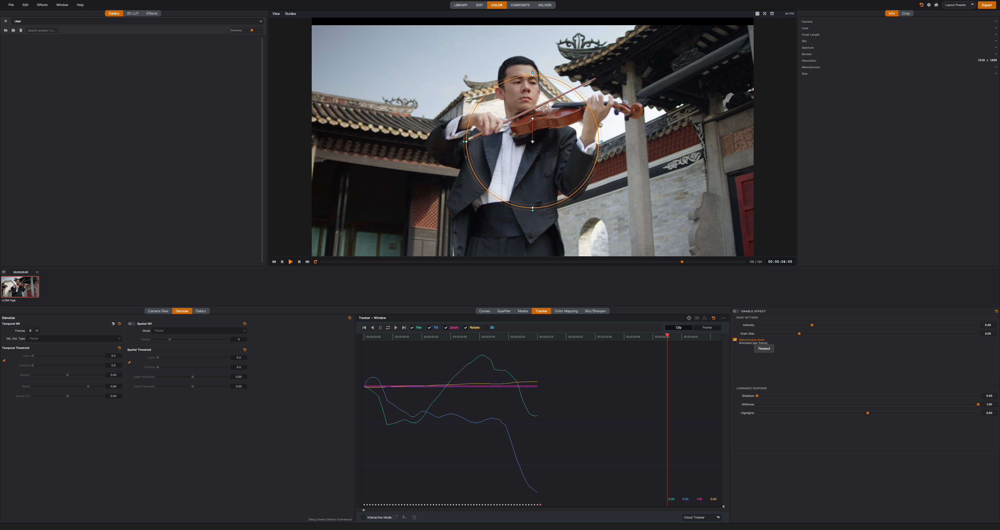

# Tracker UI 与播放性能复测 — 2026-11-02

本轮直接访问运行中的 DaVinci Resolve Studio 20，并在 Topos 的隔离临时工程中导入用户提供的 `测试素材01.mov`。原有图片智能蒙版、智能背景、画笔、橡皮擦保留。

## 外观与操作核对

重新绘制六个传输图标和标题栏模式图标，统一 30×30 命中区域，显式设置高分屏图标尺寸；调整运动通道、Clip/Frame、底部点工具、下拉框、时间尺和缩放控件。Window 与 Tracker 的重置都调用项目 `icon_reset()`。

在两边实际执行圆形建窗、向前单帧、Clip/Frame 和 Interactive Mode 切换。两边单帧操作都使播放头从第 0 帧前进到第 1 帧。在 Resolve 的实际结果中发现 Zoom 基准为 1.00，已将 Topos 的显示从百分比差值改为倍率。Resolve 中本轮新建的圆形测试窗口已移除，应用留在暂停的 Tracker 面板。

## 性能定位与结果

素材实测为 H.264 / yuv420p，1920×1080，25fps，124 帧。使用 production MainWindow、原有导入/时间线/Color 播放入口、原有音频与 GPU 渲染线程。每组测量 4.2 秒，以 `renderer.frame_ready` 计数，并用 10ms Qt 定时器测 UI 停顿。此计数是完成渲染的吞吐量，不能等同于显示器上逐帧呈现的独立帧数。

| 场景 | 完成渲染吞吐量 |
| --- | ---: |
| 修复前，正常工具布局 | 4.64 fps |
| 只隐藏示波器和曲线 | 7.02 fps |
| 分隔线修复后，正常布局，音频/独立示波器开启 | 24.07 fps |
| 最终版本，曲线可见、独立示波器隐藏，播放时背景冻结 | 24.51 fps |
| 最终版本，带圆形跟踪窗口、跟踪曲线和画布手柄 | 18.46 fps |

主要全局回退来自面板分隔线：每个边框的四条边都递归 `findChildren(QDockWidget)`，反复扫描整个应用控件树。采样多数阻塞落在这里。测试中仅关闭该绘制便恢复约 24.5fps。正式修复保留相同分隔线，改成仅查询 QMainWindow 的直接 Dock 子项，每个 overlay 绘制只收集一次邻居矩形。

跟踪蒙版另有 CPU 开销。旋转时原先分配并 warp 大幅补边的整图，随后立即裁掉大部分输出。本轮保留必要源几何，直接 warp 到最终输出区域，并以数值测试比较旧补边路径。跟踪代理使用弱引用缓存，重复/保持帧复用纹理，原始形状缓存不被污染。播放中的跟踪蒙版复用现有 512 基准宽预览档位，暂停恢复 1024 基准宽；导出路径不变。

## 曲线背景的更新规则

- 未激活曲线 Dock，包括被其它标签覆盖时，不提交背景直方图计算。
- 播放、拖动时间线和调节颜色时冻结背景，取消排队的曲线需求，拒绝迟到结果。
- 结束调节后，等待最终画面发布再请求一次背景；相同画面/尺寸/模式的重复请求去重。
- 独立示波器仅在自身 Dock 实际激活时工作，其需求不再顺带重算被冻结的曲线背景。

原生应用记录：播放中曲线背景请求 0 次；连续 10 次曝光调整期间 0 次，结束后 1 次。原始计数见 JSON 文件。

## 验证与尚存差异

最终聚焦回归：909 passed，1 skipped（已有 macOS tabified Dock 样式测试跳过）。覆盖跟踪、取消/陈旧结果、图片蒙版、几何、History、控制器、GPU scope、停靠状态、播放/暂停精度恢复。Ruff、compileall 和 `git diff --check` 通过。

仍不能宣称与达芬奇完全一致：画布手柄、运动通道数值标定、每条曲线的纵轴表现和算法结果仍有差异；带跟踪窗口的播放仍低于素材 25fps。此真实默认圆形区域的跟踪产生 62 帧结果并进入 PARTIAL_FAILED，不能当作全片成功或准确度验收。

Resolve 播放期间桌面接口在点击/读取阶段反复超时，需用户暂停后才能恢复。因而没有取得可靠 Resolve 帧率，未建立两款应用的同编码、同分辨率、同 ROI 的性能等价结论。Resolve 当前缩略图标注 Apple ProRes 4444，Topos 测试文件为 H.264；画面内容相同也不能替代编码一致性验证。

这些是后续继续对齐的明确验收项。本轮改动尚未提交或发布，需重启实际项目加载 Python 源码修改。
