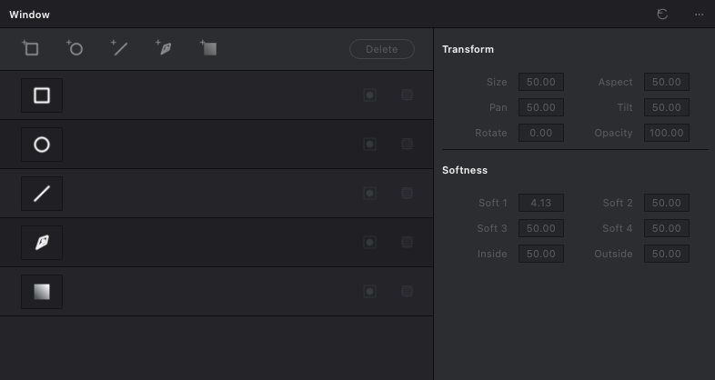
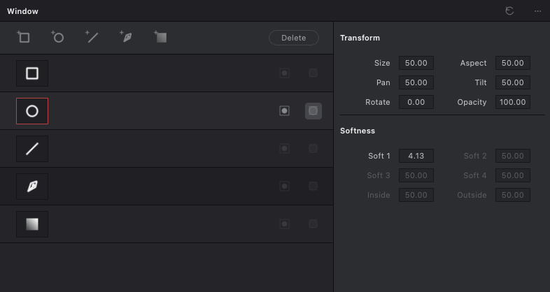
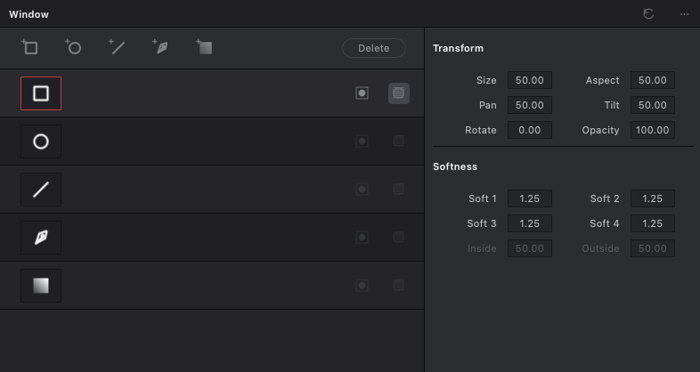
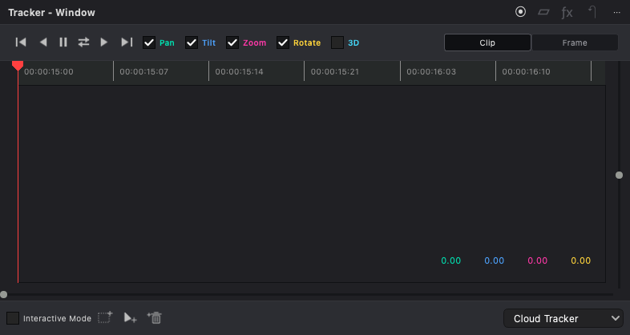
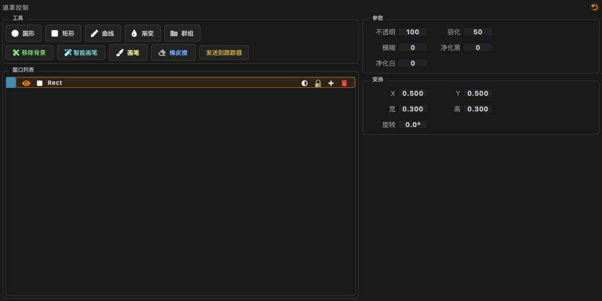

# Window / Tracker redesign — 2026-11-02

Implemented a video-specific Window palette and rebuilt Tracker - Window around
the supplied screenshots and direct inspection of the running DaVinci Resolve
Studio 20 Color page. Image mode retains its existing segmentation, background,
brush and eraser tools. This is a working functional alignment, **not a claim of
pixel-identical UI, identical proprietary algorithms, or complete experience parity**.

## Delivered behavior

| Area | Implementation |
| --- | --- |
| Window layout | Five persistent type rows, compact add toolbar, Delete, Transform and Softness columns, selection outline and contextual actions. |
| Window creation | Linear, Circle, Polygon, Curve, Gradient. Polygon uses straight corner points in the existing curve model. Clicking the selected row toggles window activation; the type template remains. |
| Transform | Size, Aspect, Pan, Tilt, Rotate, Opacity drive actual model/evaluated geometry. Tilt increases upward, verified in Resolve. Circle sizes use model radii; default diameter is 30% of image width with pixel aspect compensation. |
| Softness | Rectangle has four independent local edges; circle retains global feather; curve Inside/Outside retain per-point fi/fo; gradient uses actual gradient softness. Irrelevant controls are disabled. |
| Tracker layout | Six transport actions in observed Resolve order; colored motion channels; Clip/Frame; timecode ruler, playhead, component readouts, zoom controls and point tools. Narrow Tracker docks wrap controls. |
| Analysis | Forward, backward, both directions and single-frame analysis use the existing asynchronous worker/service. Continuing a pass composes transforms with the original reference and preserves previous results. Single-frame analysis advances the playhead. |
| Motion channels | Pan/Tilt/Zoom/Rotate affect evaluated motion, including the window pivot. The 3D checkbox selects perspective/homography, independently from unavailable camera reconstruction. |
| Clip / Frame | Clip edits rebase the window while retaining motion. Frame edits store an exact frame override and manual marker; arbitrary curve/gradient point edits survive serialization. |
| Interactive points | Insert by clicking the viewer; select an existing point; Set Point retains a reference seed; Delete excludes its location. Worker detectors receive frozen region-relative seeds/exclusions. |
| Stop / clear | Stop retains completed frames without caching an incomplete pass. Clear and undo invalidate stale workers so late results cannot resurrect cleared data. |
| Persistence / undo | Tracking data follows all history snapshots and symmetric undo/redo. Optional rectangle edge softness has shape schema version 2, validation, cache invalidation and legacy compatibility. |

Additional fixes include gradient tracking that previously did not move its
endpoints; per-point feather fields lost in Canvas roundtrips; curve/gradient
rotation applied twice or around the wrong pivot; QImage row-stride corruption;
shape selection cleared immediately after creation; pending edits leaking between
windows; final mask values reaching autosave after the interaction had ended;
and circle tracking masks incorrectly treating model radii as diameters.

No UI handler performs OpenGL work. Rendering continues through the existing
renderer/task boundary. Image-specific controls and their public signals remain
available when work mode is `image`.

## Screenshots

These are actual Qt widget renders at 786 × 418, not design mockups.

## Validation and limits

The regression log and exact final count are recorded in `regression_summary.txt`.
The focused suite covers shared tracking, mask rasterization, shape schemas,
service cancellation/generations, history, controller flow and actual QTest viewer
clicks inside a mask. Ruff and Python compilation are checked separately.

The new real asynchronous integration fixture encodes a 640 × 360, 48-frame,
24 fps textured-card clip through PyAV and decodes it through the production
FrameSampler on worker threads. Circle, rectangle, gradient and curve each
track a 47-pixel translation with less than 0.03-pixel endpoint error. Tests then
apply a 10-pixel Frame correction and a 5-pixel Clip correction and verify JSON
roundtrip equality. Additional tests verify playhead 0 → 1 → 2 → 3 during repeated
single-frame tracking and retaining completed frames after Stop.

The asynchronous integration uses a geometry observer instead of a GPU Canvas;
it does not certify real-time 4K playback, HDR export, or GPU-driver performance.
Viewer point routing is separately exercised with real Canvas/QTest events and a
test viewport. Analytic rectangle softness is shared by preview and CPU paths;
PIL tracking masks are compared with actual QPainter rasterization with explicit
antialiasing tolerance.

The local OpenCV build has no FFmpeg MP4 encoder. Missing shared test fixtures
were generated with the existing fixture generator and a temporary PyAV MPEG-4
writer adapter. No production dependency or fixture-generator source was changed.

## Remaining differences from Resolve

- Optical-flow solving, point recovery and softness mathematics are project
  implementations. They have not been measured against Resolve on identical
  exported reference trajectories; identical output is not established.
- Analysis progress is displayed while workers run; per-frame viewer animation
  during a continuous pass is not yet equivalent to Resolve. Results refresh
  the window when the pass completes or stops.
- Pan/Tilt use the project's normalized-coordinate display gain. Direction and
  default center match, but Resolve's numeric gain across source/timeline sizes
  still needs calibration. This is not a claim that entering the same non-default
  number produces exactly the same displacement in both applications.
- Viewer handles, fonts, curve zoom behavior and some glyphs are not pixel-identical.
  Stabilizer and FX modes remain explicitly unavailable; they do not masquerade
  as working modes. The perspective checkbox is not a 3D camera solver.
- A clip-wide curve topology change creates a new automatic reference shape;
  other exact manual frame shapes keep their prior topology. Synchronizing node
  insertions across all manually corrected frames would require stable node IDs.

These differences remain visible acceptance items. The current build should not
be described as “100% identical to DaVinci Resolve.”

## Main implementation entry points

- `src/features/color/ui/power_window_panel.py`: video palette and model-value mapping.
- `src/features/color/ui/mask_panel.py`: image/video presentation and existing public signals.
- `src/features/color/ui/tracker_panel.py`, `tracker_graph.py`, `tracker_overlay.py`: tracker UI and viewer editing.
- `src/features/color/tracking/window_edit.py`, `window_points.py`: pure geometry edits and worker point selection.
- `src/app/controllers/color_controller.py`: store, worker, evaluator and UI integration.
- `src/features/color/core/window_softness.py`: shared four-edge rasterization.
- `tests/color/test_window_tracking_integration.py`: production asynchronous integration fixture.

Restart Topos to load the changed Python modules. No commit or release was created.
