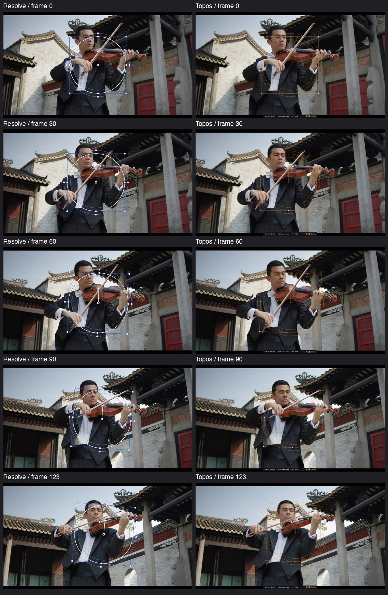

# Window tracking quality and interaction verification — 2026-11-02

## Scope and acceptance

The supplied `测试素材01.mov` contains 124 frames at 25 fps, 1920 × 1080.
The production app now tracks all 124 frames with its default Circle and
standard two-dimensional Pan/Tilt/Zoom/Rotate preset. The native run took
4.44 seconds including completion settling. All 124 results were VALID. A separate pass starting at frame 61 also covered
the complete clip in both directions, with all 124 merged results VALID.
A new default Circle in the running Resolve was tracked separately with 3D off.
The comparison below covers frames 0, 30, 60, 90 and 123.

This establishes a close **sampled 2D window tracking comparison for this clip**.
It does not establish identical algorithms, every-frame equality, 3D perspective
parity, or performance parity across arbitrary footage. Resolve displayed a
ProRes 4444 source; Topos used the supplied H.264 1080p file of the same scene.
The UI readouts are rounded, and source resolution was accounted for by a 2:1
conversion. Treat the comparison as approximate, not ground truth.

The crops are resized to the same display size. They are actual application
screenshots; no synthetic tracking outlines were added. The footage, tint,
softness contours and control drawing retain each app's actual appearance.

## Quality investigation

The original default stopped at frame 61: the first-frame appearance correlation
fell to about 0.4498, just below the 0.45 loss threshold, despite eleven usable
optical-flow points. Merely choosing recapture would process the clip while
marking the second half failed. Merely adapting appearance with twelve points
would reach the end but visibly drift.

The shared engine now offers an opt-in rolling appearance template. Only VALID,
sharp frames with sufficient inliers, a high forward/backward pass ratio, and
local appearance similarity at least 0.80 may update it. The original reference
is retained for reacquisition; failed frames discard the adapted reference.
The original 0.45 appearance threshold was not reduced. Existing non-Window
consumers keep adaptation off unless they explicitly opt in.

Color Window opts into that verified template and uses 64 initial features and
recapture by default. Larger clouds and rectangle-only detection were tested:
they shifted this window toward unrelated background motion and were rejected.
Original shape-masked detection remains intact. Explicit user failure policies,
point mode and non-default legacy preferences remain available. Opening an old
binding upgrades only the old default preset in the UI, leaving its saved
transforms untouched. A solver revision is saved when analysis starts. Normal
analysis and failed-range retries both include the appearance-model version in
their cache key so an earlier truncated result cannot masquerade as a new pass.

Approximate cage-corner differences against rounded Resolve readouts, converted
to source pixels, were measured at frames 30, 60, 90 and 123:

| Preset | Mean of 16 sampled corners | Largest sampled corner difference |
| --- | ---: | ---: |
| 12 points + verified appearance adaptation | 71.1 px | 190.2 px |
| 64 points + verified appearance adaptation | 12.3 px | 32.2 px |

This comparison isolates the effect of the feature preset after fixing the early
stop; the original twelve-point, fixed-template configuration did not complete
the same pass. These are differences from Resolve's output, not absolute target
tracking errors. Synthetic tests independently check known geometric truth.

## Interaction changes and native verification

- The Tracker ruler is enabled without a window or tracking data. A native
  QTest drag through the production MainWindow reached frames 60, 123 and 0,
  and the actual VideoController frame matched each target after release.
- Dragging uses the existing asynchronous scrub lane and exact final seek.
  Source frames are converted to clip-local frames for trimmed clips.
- A completed forward pass advances the actual preview to frame 123; backward
  completion selects the other endpoint. Stop retains the current preview.
- Pan/Tilt readouts measure displacement at the original window pivot rather
  than the image-origin translation term of the matrix. Tilt is positive upward;
  Rotate is displayed in counterclockwise radians. Stored matrices and rendered
  geometry retain their existing pixel/degree conventions. The native harness
  verifies the readouts against the actual matrix at every sampled frame.
- Video circles and rectangles have eight resize handles, an internal rotation
  handle and screen-sized hit targets. Corners preserve proportions; axes change
  one dimension. Circle feather moves all four softness handles; rectangle
  feather commits the individual edge. Native QGraphicsView/QTest mouse drags
  verify geometry changes and balanced interaction start/end signals.
- Image-only tools and their existing handle style remain available in image
  mode. These changes add no OpenGL work to UI handlers.

Native results are summarized in `native_verification.json`. The local harness
uses a separate project and configuration directory. It imports the supplied
clip through the existing media pool/timeline path and runs the actual service
and renderer, rather than substituting synthetic transforms into the app.

## Safety and remaining differences

The focused regression includes cancellation, scene cuts, occlusion, confidence,
shape masking, cache invalidation, persistence, history, worker lifecycle,
tracking edits, exact seeking, curve-scope suspension and video playback wiring.
New appearance tests preserve loss detection and known-ground-truth TRS accuracy
in both directions. Real-footage checks require the explicit
`TOPOS_TRACKING_REAL_VIDEO` environment variable and also bound the approximate
Resolve comparison; they do not require a checked-in copy of the user's clip.

3D/perspective remains a material limitation: on this nonplanar scene it can
produce failed frames and differs from Resolve's projective window. Experiments
that relaxed coordinate conditioning reached more VALID frames but also produced
an incorrect expanding quadrilateral; those changes were rejected. No safety
gate was weakened to force a success count. Circle/rectangle projection still
uses a fitted center/size/rotation rather than a fully projective mask raster.

Continuous analysis updates progress; it does not yet animate the live viewer
and window on every analyzed frame as Resolve does. The completed pass and
manual scrubbing do preview the actual tracked geometry. UI fonts, antialiasing
and some control glyphs are also not certified pixel-identical.

See `regression_summary.txt` for the final checks. Restart Topos to load changed
Python modules, then rerun tracking on an existing window to replace old results.
