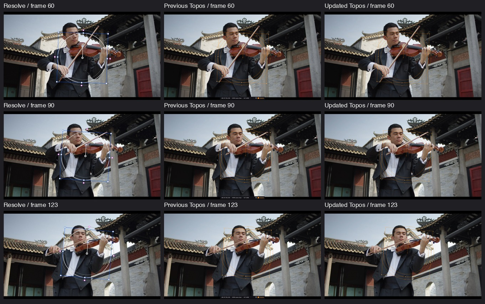

# Window tracking quality — patch-scale consensus

This follow-up reduces the measured gap of ordinary 2D Cloud Window tracking
against the running Resolve. It preserves the existing 3D/perspective and Point
Tracker flow policy; it does not claim to solve their remaining quality gaps.

## Comparison

The same supplied 124-frame clip, default Circle and Pan/Tilt/Zoom/Rotate preset
were used. The earlier four comparison frames were supplemented with independent
samples at frames 15, 45, 75 and 105, read directly from a fresh default Circle in
Resolve. Rounded UI values were converted from the ProRes 4K reference to the
supplied H.264 1080p source. These are approximate differences from Resolve's
output, not absolute tracking errors or every-frame equality.

| Comparison | Previous preset | Updated preset |
| --- | ---: | ---: |
| Mean cage-corner difference, original four samples | 12.28 px | 6.09 px |
| Mean cage-corner difference, all eight samples | 11.12 px | 6.14 px |
| Largest cage-corner difference, all eight samples | 32.22 px | 14.81 px |
| Mean difference, four newly collected samples | 9.97 px | 6.20 px |
| Native full-pass valid coverage | 124 / 124 | 124 / 124 |
| Native pass including settling | 4.44 s | 5.15 s |

Improvement is not uniform at every sample: frame 60's mean changes from 7.01 to
8.23 px, while the endpoint improves from 24.41 to 9.78 px. The new preset reduces
both the overall sampled mean and the worst sampled corner difference.

Columns: Resolve, previous Topos, updated Topos. Rows: frames 60, 90, 123.
Only screenshot cropping and resizing were performed; no outlines were added.

## Implementation

Cloud translation/TRS analysis computes LK flow independently with 15, 21 and
31 pixel patch windows, then takes a per-point coordinate median. A point needs
successful, finite estimates from a strict majority of scales. Missing estimates
never become zero-valued votes. The identical consensus runs in the backward
flow check, and the existing FB-distance, inlier, geometry, confidence and
appearance checks remain in force. Appearance thresholds were not weakened.

The shared configuration defaults to an empty scale tuple, which retains the
original single-window implementation. Color enables consensus only for Cloud
translation/TRS. Point Tracker and homography retain their existing policy.
Color analysis/retry cache keys include `multiscale_median_v1`, and newly analyzed
bindings record solver revision 3. Existing saved trajectories are preserved
until the user reruns analysis.

Single-window patch sizes, higher LK precision, fixed-reference point fitting,
robust least-squares refinement and subpixel feature refinement were compared
locally. The consensus change was selected for its improvement on both the
original and newly collected samples and for its bounded cost. Experimental
variants were not added to production.

## Verification

The production MainWindow harness imported the clip through the media pool and
timeline, ran the real asynchronous service and renderer, and verified actual
video/graph positions and matrix-derived readouts. It completed all 124 frames,
left the viewer at frame 123, and saved the comparison screenshots. The largest
10 ms UI heartbeat gap during this native analysis was approximately 84 ms;
this is a responsiveness observation, not an FPS benchmark. Additional work is
performed when analyzing a tracking pass, with no per-playback-frame solver work.

Focused checks cover majority/median behavior, absent/nonfinite optical-flow
results, unchanged single-window behavior, synthetic bidirectional TRS accuracy,
occlusion and scene-cut rejection, cancellation, compatibility, serialization,
worker generations and UI integration. Opt-in user-media checks also start at
frame 61 and verify complete bidirectional coverage. See `regression_summary.txt`
for final test results. Restart Topos and rerun tracking to use the new solver.

3D projective fitting and projective mask rasterization remain separate limits;
this report does not claim their gap has been reduced. Rendered masks continue
to use the existing pipeline. No OpenGL calls were introduced in UI or solver
handlers.
