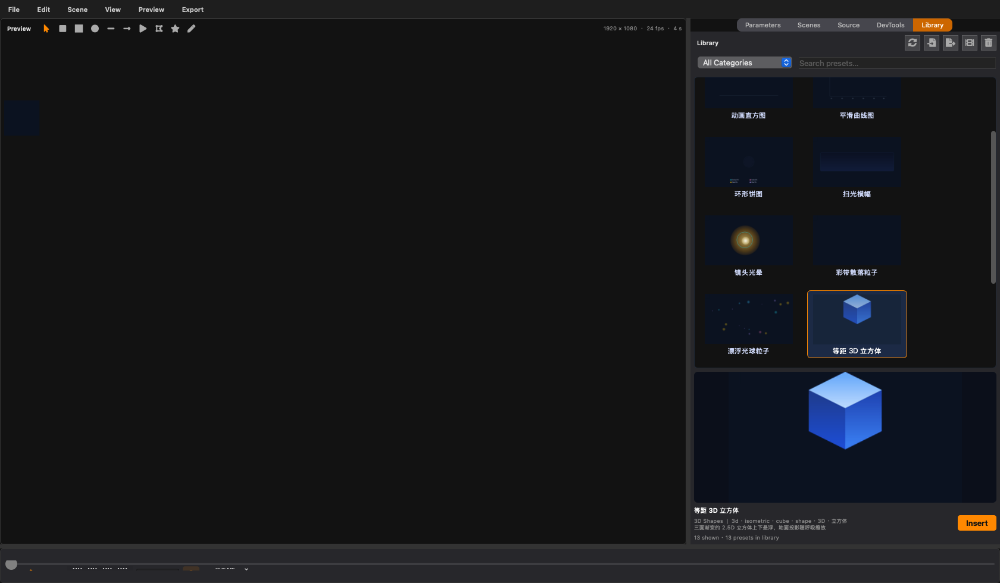

# MG 素材库（Motion Graphic Preset Library）

MG 编辑器的预设素材库。每个预设是一个文件夹，按分类归档在库根目录下；
编辑器内的「Library」面板浏览这些预设、拖拽到画布实例化，也可以把当前
场景（或选中元素）另存为新预设并自动渲染 GIF 动图预览。



## 目录结构

```
<库根目录>/
  backgrounds/              ← 分类 = 一级文件夹（小写 slug）
    aurora_glow_bg/         ← 预设 = 二级文件夹
      build.py              ← 代码预设：PRESET 元信息 + build() -> scene dict
      preview.gif           ← 动图预览（编辑器/脚本生成，QMovie 播放）
      assets/               ← 可选：关联素材（预留，v1 结构化预设不引用外部资产）
    blueprint_grid_bg/
      ...
  charts/
    animated_histogram/
      preset.json           ← 也可以用 manifest（编辑器另存的预设走这种）
      scene.json            ← 完整场景文档（schema v3，与编辑器一致）
      preview.gif
  text/  particles/  light/  shapes3d/  general/ ...
```

三个库根目录合并展示（后扫描的根在 preset_id 冲突时胜出）：

- **内置库**：`src/features/teaching_animation/presets/library/`（随应用分发、
  git 版本管理，应用内只读）
- **用户库**：`~/Library/Application Support/Topos/mg_presets/`（macOS；
  Windows `%APPDATA%/Topos/mg_presets`，Linux `~/.config/topos/mg_presets`），
  可用环境变量 `TOPOS_MG_PRESET_ROOT` 覆盖——测试与批量迁移时很有用。
- **工程库**：`<工程文件所在目录>/mg_presets/`——工程打开期间自动加入扫描，
  优先级最高并接收新保存/导入的预设（未打开工程时回落到用户库）。拷走整个
  工程目录（`.topos` + `mg_presets/`），预设随工程一起迁移。

用户库与工程库都是用户自建数据，**不纳入 git**（仓库已忽略 `mg_presets/`）；
只有内置库随源码提交。整个库迁移 = 拷贝一个目录。

## 预设的两种写法

### 1) 代码预设（`build.py`）

```python
from src.features.teaching_animation.presets.builders import (
    key, scene_document, shape_element, text_element, track,
)

PRESET = {
    "preset_id": "my_preset",          # 必须与文件夹同名
    "name": "我的预设",
    "category": "general",             # 必须与一级分类文件夹一致
    "description": "一句话说明",
    "tags": ["demo", "示例"],
}

def build():
    return scene_document([...], name="My Preset", duration_frames=60).to_dict()
```

`builders` 提供元素工厂（`text_element` / `shape_element`）、动画助手
（`key` / `track`，自动放宽 KeyframeTrack 的 [0,1] 默认钳制范围）、效果
（`glow_effect` / `shadow_effect` / `blur_effect`）与渐变
（`linear_gradient` / `radial_gradient`）。**所有动画必须写成元素的
`local_animation_tracks`**（`track()` 的产物）——预设因此可以整体嫁接进
任意场景，插入/撤销都是单条命令。

### 2) 编辑器另存（`preset.json` + `scene.json`）

在 MG 编辑器 File → **Save as Preset…**：选中若干元素（含子层级与动画）
或留空保存全部元素，选分类、填标签，编辑器写出 `preset.json`、
`scene.json` 并渲染 `preview.gif`。场景级动画在保存与加载时都会自动折叠
为元素内嵌轨道。

## 校验与预览

- 每个预设加载时通过 `validate_scene` 全量校验（schema v3）。
- GIF 预览由 `presets.preview.render_preset_gif` 生成：纯 CPU 走
  SvgSceneRenderer → QSvgRenderer 光栅化 → Pillow 编码，320px 宽、
  ≤24 帧、循环播放；不启动 WebEngine/OpenGL。
- 批量（重）生成预览：`.venv/bin/python scripts/build_mg_preset_previews.py [--force]`

## 导入 / 导出（批量迁移）

- 面板 Import…：选择一个 `.zip`（内含一个或多个 `category/preset/…`，
  或散置的预设文件夹）或单个预设文件夹 → 拷入用户库并校验大小/路径安全。
- 面板 Export…：把当前选中的预设打成 `category/preset/…` 结构的 zip。
- zip 内条目拒绝绝对路径与 `..` 穿越；`scene.json` ≤ 8 MiB、
  `preview.gif` ≤ 32 MiB、`build.py` ≤ 256 KiB。

## 分类约定

分类即文件夹名（`^[a-z0-9][a-z0-9_-]{0,39}$`）。内置分类：
`backgrounds` 背景 · `charts` 图表 · `text` 文字特效 · `particles` 粒子 ·
`light` 光效 · `shapes3d` 2.5D/3D 形状。新增分类 = 新建一级文件夹。

## v1 范围说明

- 结构化预设 = 矢量元素 + 内嵌动画 + 层级关系，不引用外部资产
  （`assets/` 目录已预留）；HTML 图层预设继续走既有模板系统
  （File → Save as Template）。
